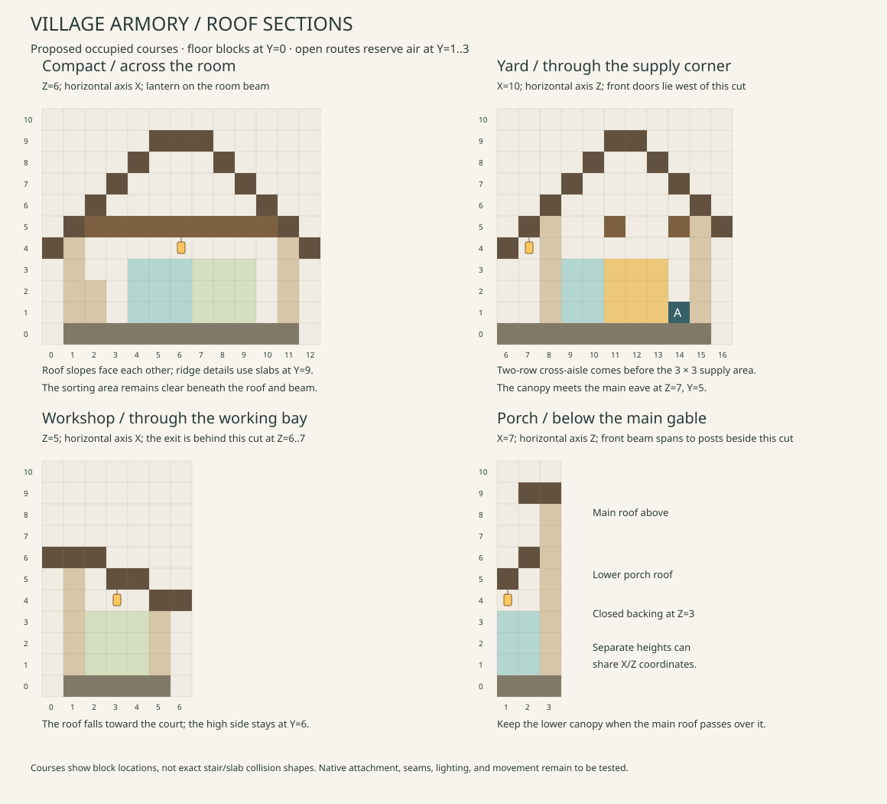

# Village Armory architectural details

These details develop the two [Plains floor plans](armory-designs.md). Both now
have separate [furnished previews](armory-preview.md). All coordinates are
unrotated and follow that brief:
X east, Z south, floor blocks at Y=0, standing feet at Y=1.

## Space and proportions

The compact storehouse stays **13 × 13 × 11**. It gains a reserved entry
landing, sorting area, short rest bench, and a clear passage west of the ammo
store. The occupied room remains small enough to read as a village workshop.

The supply yard becomes **16 × 17 × 11**. Its wider side shelter accommodates
a sorting bench and a 3 × 3 working area. The enlarged rear room separates
the two-row entry cross-aisle from the supply area and provides a two-block
passage beside it. The extra room has a specific use; the open court stays
4 × 4 and the roof height stays within the original envelope.

The compact building has a north-facing gable over its sheltered entrance.
The yard has a long rear roof running east–west and a lower workshop wing.
The latter silhouette should look like a storehouse with an attached working
shelter. Use strong door frames and a stone base, with ordinary shuttered
windows and a modest banner. Keep the new structures visually related to the
regional Barracks through materials and joinery.

## Roof sections and supports

The drawing shows occupied roof courses, support beams, and representative
clearance. A course gives the block's Y coordinate, not necessarily its full
collision height. Stairs and slabs must be authored with their actual states.

| Part | Section | Proposed course rule |
| --- | --- | --- |
| Compact gable | X=0..12 at an interior Z | Y sequence `4,5,6,7,8,9,9,9,8,7,6,5,4`; opposing spruce stair slopes, bottom slabs at X=5/7, full plank ridge at X=6 to close the cap underside |
| Compact porch | Z=1..2 | Front course Y=5, rear course Y=6; lower roof attaches below the gable, with closed backing at the front wall |
| Yard rear gable | Z=7..16 at an interior X | Y sequence `5,6,7,8,9,9,8,7,6,5`; opposing stair slopes with a two-cell bottom-slab ridge at Z=11..12 |
| Yard workshop | X=0..6, away from the rear junction | Prototype surface heights `6.5,6.5,6,5.5,5,4.5,4.5`; alternating bottom slabs and backed full planks form a lean-to toward the court |
| Yard frontage canopy | Z=6..7 | Front course Y=4, rear course Y=5; rear course meets the main roof's Y=5 eave |

Back stair joins and close the gable ends. Where a stair leaves a visible
gap against a wall or another roof, use a local plank backing or trim course;
keep that backing above the reserved route headroom. Lower canopies remain
under higher roof overhangs unless their actual blocks intersect. At a real
intersection, trim the subordinate roof against a continuous backing face.
The lower workshop/frontage roofs should finish neatly against the storehouse.

The compact porch posts at (4,1) and (9,1) in X/Z support a beam across
X=4..9 at Y=5, Z=1. Its main room has transverse beams across X=2..10
at Y=5, Z=6 and Z=9. Short top-stair brackets at X=2/10, Y=4 join the wall
posts; the beam ends stay beneath the roof instead of interrupting its slopes.
No cross-beam belongs at Y=3 over an open route.

The yard workshop's west wall and posts at (5,3)/(5,5) support its roof.
Those posts end at Y=3 and meet the roof underside at Y=4. The shared post at
(5,5) supports the junction beside the workshop exit to Z=6; extending it
through the roof would expose its log end.
The frontage's east post is at (14,6). Keep all braces over the clear passage
at Y=4 or higher, or within an occupied post cell. The rear room's transverse
beams run across X=1..14 at Y=5, Z=11 and Z=14, with end supports in the walls.

These profiles leave room for three air blocks above the open routes and
keep the yard's X=7..10, Z=2..5 court open to sky. Door headers occupy Y=3
only at the two-block-high door openings. Confirm stair corners, seams,
attachment faces, and actual collisions when the blocks are placed in game.

## Work areas and furnishings

Give the decoration a simple sequence: supplies arrive under shelter, get
sorted at a bench, and go into the storehouse. These are visual cues. Guards
continue to use the existing Armory rather than following a new work routine.

| Layout | Detail | Exact placement and clearance |
| --- | --- | --- |
| Compact | Sorting bench | Crafting table (10,1,4), decorative slab worktop (10,1,5); clear work area X=7..9, Z=4..6 |
| Compact | Rest bench | Slab seat at (2,1,4), below the west window; keep X=3..4, Z=4..5 open |
| Compact | Equipment shelves | X=2, Z=6..9, occupied decoration limited to Y=1..2; no projecting trim in the central passage |
| Yard | Covered sorting bench | Crafting table (2,1,4), decorative worktop (3,1,4), clear work area X=2..4, Z=5..7 |
| Yard | Delivery crate | One solid decorative block at (2,1,3); keep the two-row workshop connection at Z=6..7 clear |
| Yard | Indoor packing bench | Decorative worktops X=2, Z=10..11 at Y=1; work area X=3..5, Z=10..12 |
| Yard | Rest bench | Slab seats X=3..4, Z=9 at Y=1, against the front wall and west of the doors |
| Yard | Stored equipment | Shelves X=2..5, Z=14, limited to Y=1..2; the functional Armory remains separate at (10,1,14) |

Each layout has one crafting table and one functional Armory. Use solid wood
and restrained wall-side details for crates and shelving. Do not substitute
real barrels, chests, item entities, or new inventory blocks. Keep decorative
trim within its occupied bay so an open trapdoor or protruding shelf does not
reduce the adjacent route. A small change of texture around a bench is enough
to suggest work; the court center remains open.

## Windows, materials, and inhabited details

For Plains, use cobblestone and occasional andesite at the base, oak posts,
pale terracotta infill, and spruce roofs. Frame the windows with full sills at
Y=1, glazing at Y=2, and lintels at Y=3 in the wall cells. Compact windows are
at west X=1/Z=4..5 and east X=11/Z=7..8; yard windows are at west X=1/Z=10..11
and east X=14/Z=11..12. Shutters sit outside those walls within the roof margin.
Their open and closed states still need a collision check.

Keep wear deliberate and sparse:

- Mix a few full stone floor blocks into the compact threshold at X=5..6,
  Z=2..4 and the yard threshold at X=7..8, Z=7..9. The floor stays at one height.
- Give the covered work bay a slightly worn plank patch beneath the bench.
  Floor texture should not create holes or steps in the passage.
- Put one small repaired infill patch on a side wall, clear of windows and
  structural posts. Keep most panels calm so the framing remains readable.
- Place a single muted green wall banner at (10,3,2), facing north against
  the compact wall at (10,3,3). For the yard, use the east wall at
  (15,3,13), facing east with backing at (14,3,13), clear of the shutters at
  Z=11..12. Both lie outside the
  reserved floor routes and sentry positions, under roof margins. Check the
  hanging cloth in the prototype; do not move it into a doorway to improve
  visibility.
- Restrict moss to a few damp base stones. Leave door frames, benches, and
  the working face of the Armory visually maintained.

The timber supports and stone base provide the practical fortification.
Shuttered windows, work surfaces, small resting places, and warm lights provide
the village character. Extra towers, decorative gun emplacements, continuous
iron bars, and piles filling the court are not part of this design.

## Proposed lighting and nighttime checks

All regular hanging lanterns below have `hanging=true`; the court lantern has
`hanging=false`. Support cells need the appropriate solid attachment face.
The yard's bottom slab at (3,5,5) and bottom stair at (10,5,7) retain their full
undersides for the hanging lights. Their native attachment survival is checked
in the preview. Other lamps use full timber or stone supports.

| Layout | Lantern (X,Y,Z) | Support block | Purpose |
| --- | --- | --- | --- |
| Compact | (7,4,1) | (7,5,1), porch beam | Visible sheltered arrival |
| Compact | (6,4,6) | (6,5,6), main beam | Entry landing and sorting area |
| Compact | (9,4,9) | (9,5,9), rear beam | Supply corner |
| Yard | (3,4,5) | (3,5,5), bottom slab underside | Covered sorting bench |
| Yard | (10,4,7) | (10,5,7), bottom stair underside | Storehouse doors and frontage |
| Yard | (5,4,11) | (5,5,11), room beam | Packing bench and shelves |
| Yard | (11,4,14) | (11,5,14), rear beam | Armory and side passage |
| Yard | (13,2,3) | (13,1,3), full stone pedestal on floor Y=0 | Court edge and arrival marker |

The pedestal replaces the low slab at its own border cell; the other two
border cells remain bottom slabs. It is outside the reserved circulation,
sentry, and open 4 × 4 center. Hanging lanterns occupy Y=4, leaving Y=1..3
clear below them. Do not hang an interior light from a beam one block lower.

These are starting light positions, not a calculated lighting guarantee.
During packaged-game review, inspect the road view at night, each working
corner, the sheltered paths in rain, and possible roof spawning surfaces.
Adjust a fixture or roof surface where needed; retain the clear routes and
regional material character. Use actual in-game observations before claiming
that every corner is lit sufficiently or that a roof prevents spawning.

## Regional changes that deserve space

The Plains plans are references, not eight identical shells with new colors.
Reserve the following changes when developing each regional pair. Dimensions
can grow to accommodate them, with the same entrance and supply checks.

| Setting | Spatial change | Architectural consequence |
| --- | --- | --- |
| Desert | Deepen the shaded front work area if needed; keep indoor supplies enclosed | Low masonry roofs/parapets and a covered loggia, with high framed openings |
| Savanna | Favor a broad veranda around the sorting bench | Lower, wider roof planes and acacia posts; keep posts outside circulation |
| Taiga | Shelter arrivals beneath a longer eave | Steeper spruce roof and heavier joinery; retain useful daylight at the work bench |
| Snowy | Add a real lobby if needed, with clear turning space between door pairs | More depth for weather protection; do not insert extra doors into the existing short porch |
| Deep ocean / Tidal Towns | Budget a protected gangway landing and dry delivery deck | Roofed supply room on the raft, with contained circulation and no unprotected side exit |
| Jungle / MMV | Give the raised work veranda space for a supported road transition | Deep eaves, jungle timber and stone, and screened upper openings |
| Swamp / MMV | Keep the work floor dry above the adjoining boardwalk level | Dark timber, mud brick, stone plinths, and controlled vegetation around the approach |

The [regional Armory specifications](regional-armory-designs.md) now establish
proposed dimensions, palettes, and space reservations for all seven remaining
pairs. The [regional drawing set](regional-armory-drawings.md) assigns their
coordinates and sections. [Native previews](regional-armory-preview.md) now
implement those schedules. The [optional integration packs](regional-armory-integration.md)
add road connectors and generated stock, with provider-road trials documented
separately. The 17-block Plains yard uses the direct native template writer.
The integration retains the existing stock, garrison, and resupply rules.
