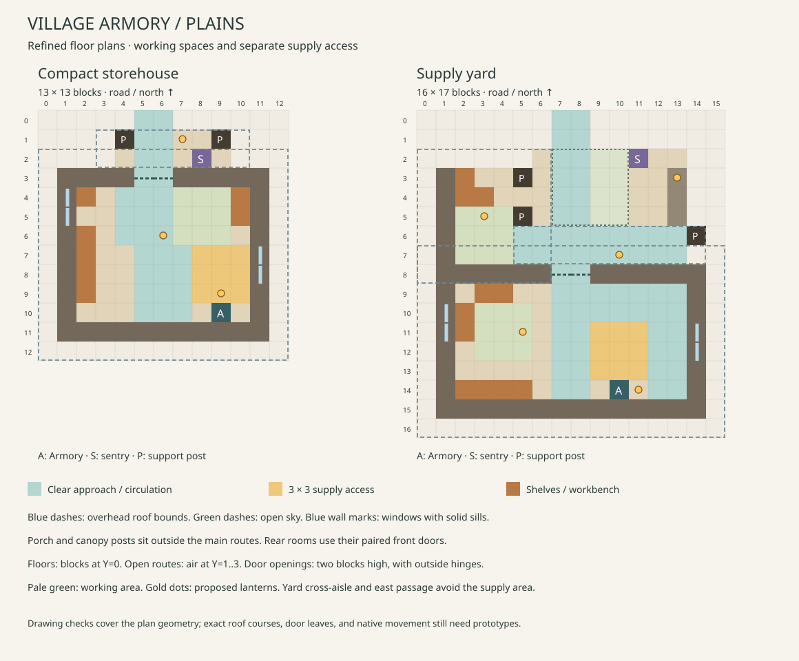

# Village Armory design proposals

Status: the compact Plains storehouse and supply yard are implemented as separate
[furnished previews](armory-preview.md). The [regional pairs](regional-armory-preview.md) also have separate furnished previews.
The current built-in Village Armory remains the generation reference.

## Building identity

The design brief is **rustic village defense buildings, built in the local
architectural style, with practical fortifications and believable interiors**.
The [CTOV gallery](https://modrinth.com/mod/ct-overhaul-village/gallery) is the
style reference; "rustic vanilla-plus" is our descriptive label. Regional
themes should change the silhouette, openings, roof, and working spaces as
well as the palette.

The Village Armory should feel like a village storehouse used by its militia.
Give it a sturdy stone base, local timber or masonry, a sheltered entrance,
equipment shelves, a working bench, and one obvious ammo store. Use the
regional architecture established by the [Barracks designs](regional-barracks-designs.md),
with a modest roof and a smaller occupied footprint. Keep the approach visible
from the road. Shutters, repaired plaster, worn thresholds, and a small banner
give it an inhabited character. Concentrate wear where feet, weather, and
materials would produce it.

Practical fortification means strong corners, substantial wooden doors, and
protected supplies. Use ordinary framed windows for daylight; avoid a facade
of arrow slits, continuous iron bars, battlements, or identical dark roofs in
every region. Furnish the edges of useful rooms, leaving their routes clear.

Two layouts provide different arrangements of the same service:

| Layout | Character | Proposed envelope, width × depth × height |
| --- | --- | --- |
| Compact storehouse | Enclosed supply room with a sheltered porch and broad central aisle | 13 × 13 × 11 |
| Supply yard | Rear storehouse, wider workshop shelter, and open delivery court | 16 × 17 × 11 |

The larger yard provides circulation and shelter. It does not grant more ammo,
storage blocks, or guards. These are Plains reference dimensions; regional
roof and foundation sections can change after their drawings are reviewed.
The dimensions are flexible. Increase them where a wider passage, useful work
bay, sheltered landing, or regional roof needs the space. Retain a compact
village scale and identify the purpose of each increase. The current source
authoring tools limit each axis to 16 blocks and volume to 4,096 blocks;
exceeding those limits requires deliberate tooling and placement validation.
These are authoring constraints, not a statement of Minecraft's structure limit.
The supply yard deliberately uses 17 blocks of depth. Its extra width provides
a two-block passage beside the supply area; the extra depth provides a separate
two-block cross-aisle inside the doors. The wider workshop has a clear work bay.
Its 2,992-block envelope stays within the current volume limit, but its depth
needs an authoring-limit update before using the layout compiler. The compact
design retains its original envelope and improves its interior reservations.

## Functional requirements

- Place exactly one functional Village Armory block. Its marker becomes the
  block, so the anchor is occupied furniture, not a guard standing cell.
- Preserve public generated access, normal resupply and automation, configured
  placement/stock controls, and one-time ammo stock. Reopening or revisiting the
  building must not recreate used stock or removed storage.
- Keep the north face of the unrotated Armory open to the room. The current
  placement code rotates that face with the building. Leave an unobstructed
  3 × 3 service area in front, connected to the main aisle. Keep the block top
  free of shelves and allow access from the adjacent interior side cells too.
- Reserve two clear blocks across principal routes and three air blocks above
  open routes. At wooden doors, two adjacent door cells provide the opening;
  their two-block height and open leaves reduce the actual clear space. These
  are exceptions to the three-air-block target, not carrier-clearance claims.
  Keep lanterns, beams, shutters, and counters out of the reserved open routes.
- Give the existing service-sentry duty a separate porch position. It remains
  a duty for available guards; Village Armory buildings do not spawn a new
  garrison. A painted waiting area or side exit does not create queueing AI.
- Use shelves, slab benches, solid decorative crates, and one crafting table.
  Additional containers, profession blocks, beds, a Quartermaster block,
  functional weapon racks, and medical services are outside this design pass.

The [architectural details](armory-architectural-details.md) define work areas,
roof sections, windows, lighting positions, wear, and regional adjustments.

The baseline source is a 9 × 10 × 8 building with a single front door and rear
Armory. Its existing stock and resupply behavior is described in
[Village Defense Buildings](village-defense-buildings.md).

## Plains floor plans

Coordinates use X east and Z south, with the road at Z=0. All ranges are
inclusive. Full floor blocks occupy Y=0; their top surface and standing feet
are at Y=1. The Armory anchor is the block at Y=1. Dimensions include roofs
and entrance margins; local coordinates end at size minus one. The current
Plains proposals have no below-Y=0 foundation or automatic terrain extension.

### Compact storehouse

| Element | Local position or bounds | Purpose |
| --- | --- | --- |
| Main shell | X=1..11, Z=3..11 | One store room; clear interior X=2..10, Z=4..10 |
| Road connector | (5,1,0) | Supported entrance connection; companion approach cell at X=6 |
| Porch | X=4..9, Z=1..2 | Sheltered arrival space; posts at (4,1) and (9,1) in X/Z |
| Front doors | X=5..6, Z=3 | Paired wooden doors; hinges at the outside jambs, opening leaves kept at the two outer edges |
| Main aisle | X=5..6, Z=0..9 | Direct road-to-room access |
| Interior entry landing | X=4..6, Z=4..6 | Clear 3 × 3 turn immediately inside the doors |
| Sorting area | X=7..9, Z=4..6 | Clear 3 × 3 work space beside the bench |
| Turning and service approach | X=5..10, Z=7..9 | Connects the aisle to the north face of storage |
| Passage beside supplies | X=5..7, Z=7..10 | Separate clear passage west of the supply area |
| Armory anchor | (9,1,10) | One functional store against the rear wall, facing north |
| Service area | X=8..10, Z=7..9 | Clear 3 × 3 space directly before storage |
| Decorative shelves | X=2, Z=6..9 | Wall-side equipment and crate silhouettes |
| Rest bench | (2,1,4) | One decorative wooden seat below the west window |
| Work surface | X=10, Z=4..5 | One crafting table and one decorative bench |
| Windows | East wall X=11, Z=7..8 and west wall X=1, Z=4..5, glazing at Y=2 | Solid sills; shutters remain in the exterior margin |
| Service sentry | (8,1,2) | Porch edge, facing the road; anchor offset (-1,0,-8) |

Keep the main roof as a simple north–south gable with a lower porch roof.
Use oak framing, pale terracotta panels, a cobblestone/andesite base, and a
spruce roof. A small pair of shuttered windows and a sheltered working bench
should make this feel like a well-used village workshop. Shelving should look
stocked without requiring real item entities or extra inventories. Keep the
service area open to the actual store; a counter across it would obstruct access.

The front is the only exterior entrance in this reference. The former side
door had just one landing cell before unknown terrain and cut through the
supply area. The east window retains daylight without relying on that exit.
The two-cell front approach and interior turning area carry incoming and
outgoing traffic; this does not guarantee that two guards will pass in a doorway.

Three proposed hanging lanterns serve the porch, central room, and supply
corner. Their mounting cells are in the architectural details. Keep the rear
roof closed; the first design has no occupied attic.

### Supply yard

| Element | Local position or bounds | Purpose |
| --- | --- | --- |
| Rear storehouse shell | X=1..14, Z=8..15 | Clear interior X=2..13, Z=9..14 |
| West workshop shelter | X=1..5, Z=3..7 | West wall X=1; posts at (5,3) and (5,5), leaving its rear two-cell opening clear |
| Court | X=6..13, Z=2..7 | Uncluttered arrival and turning space |
| Open-air court center | X=7..10, Z=2..5 | Clear 4 × 4 area; no cart, well, or central pile |
| Low court border | X=13, Z=3..5 | Bottom stone slabs, with a full stone lantern pedestal at Z=3; clear of the sentry and routes |
| Road connector | (7,1,0) | Companion approach cell at X=8 |
| Main approach | X=7..8, Z=0..14 | Connects road, court, and storehouse |
| Sheltered store frontage | X=6..13, Z=6..7 | Two-block covered cross-route; shares the workshop post at (5,5), with an east post at (14,6) |
| Storehouse doors | X=7..8, Z=8 | Paired wooden doors with outer hinges and a clear landing on each side |
| Interior cross-aisle | X=7..13, Z=9..10 | Two clear rows between the doorway and supply area |
| Armory anchor | (10,1,14) | Rear store, facing north |
| Service area | X=9..11, Z=11..13 | Clear 3 × 3 area joined to the main approach |
| Passage beside supplies | X=12..13, Z=9..14 | Two-block passage east of the service area, reached from the cross-aisle |
| Decorative shelves | X=2..5, Z=14 | Rear wall storage cues |
| Indoor packing bench | X=2, Z=10..11 | Decorative slab bench, with clear working space at X=3..5, Z=10..12 |
| Covered sorting bench | X=2..3, Z=4 | One crafting table at X=2 and decorative work surface at X=3 |
| Delivery crate | (2,1,3) | One solid decorative crate beside the sorting bench |
| Workshop standing area | X=2..4, Z=5..7 | Clear 3 × 3 bay; X=2..6, Z=6..7 connects it to the court |
| Rest bench | X=3..4, Z=9 | Two decorative seats against the storehouse front wall, west of the doors |
| Windows | East wall X=14, Z=11..12 and west wall X=1, Z=10..11, glazing at Y=2 | Solid sills; shutters stay in the exterior margin |
| Service sentry | (11,1,2) | Court edge clear of the main route; anchor offset (1,0,-12) |

Use an east–west rear gable and a lower side shelter, with timber braces at
the post cells. A short low stone edge and a modest banner mark the court.
Keep the road opening at X=7..8 clear of gates and posts. Use five proposed
supported lanterns: workshop, store frontage, two interior positions, and a
standing light on the low court edge. The last light gives the open arrival
area its own visible marker without hanging a lantern from empty sky.

The side shelter now has enough room to suggest unloading and sorting supplies
without filling its working space. The shared post at (5,5) meets the lower
roof beside its junction with the frontage at Z=6. Keep the two-row passage
beneath that junction clear.
Functional supply access stays in the rear storehouse, with one pair of doors
onto the court. The cross-aisle and east passage remain separate from the
3 × 3 service area. This gives guards room to move beside another user, but
does not establish queueing behavior or collision-free simultaneous use.

## Roof, supports, and placement limits

| Part | Plan bounds | Height and support reservation |
| --- | --- | --- |
| Compact main roof | X=0..12, Z=2..12 | Closed gable; lowest roof blocks at Y=4, ridge/cap no higher than Y=9; retain free space at Y=10 |
| Compact porch roof | X=3..10, Z=1..2 | Front course Y=5, rear course Y=6; porch posts, beams and front-wall attachment support the roof; keep Z=0 clear |
| Yard storehouse roof | X=0..15, Z=7..16 | East–west ridge, closed ends; eaves Y=5, ridge/cap blocks at Y=9 |
| Yard workshop roof | X=0..6, Z=2..8 | Lean-to toward the court; occupied roof courses Y=4..6 |
| Yard frontage canopy | X=5..14, Z=6..7 | Front course Y=4, rear course Y=5; shared west post (5,5), east post (14,6), and attachment to the storehouse |

Roof plans must leave X=7..10, Z=2..5 open to sky in the yard. At intersections,
trim the lower roof against a closed backing face: the storehouse roof takes
precedence over both canopies, and the frontage canopy takes precedence over
the workshop roof where their occupied blocks overlap. Roofs at different
heights can share X/Z coordinates; do not erase a lower canopy merely because
the main roof projects over it. The section drawing specifies proposed
courses and supported light positions. Stair states, attachment faces, and
closed seams still need native placement checks.

Put full floor support under each shell, room, porch, court, workshop, canopy
post, sentry, and both approach cells at Z=0. The roof-margin cells are not
promised walking landings. Confine the yard's stone border to X=13, Z=3..5;
keep the entrance, sentry, workshop connection, and service area clear. Use solid base courses beneath
occupied floors; cosmetic depth on a slope is later placement work.

Both road connections have one north-facing jigsaw. Keep the companion
approach cell supported, but do not add a second jigsaw: a two-cell doorway
does not imply a second road connection or a two-cell-wide provider road.
The entrance landing must meet the actual road surface during integration.
Route air must clear terrain explicitly; structure-void cells belong outside
the required walking space. Check fit and road-height transitions before
claiming compatibility for a pool. A small footprint alone does not establish fit.

## What the current resupply code actually guarantees

The Armory face guides the architecture and player access. Guard resupply
currently considers neighboring positions on all sides and permits withdrawal
within four blocks, using distance rather than a front-face or line-of-sight
requirement. A guard can therefore collect ammo beside an exterior wall without
entering. A clear service area does not change that behavior.

Separate the prototype checks: first prove a native walking journey through
the doors to the service area, then observe ordinary resupply from several
starting sides. Record where transfer happens. A successful transfer alone is
not evidence of entrance use. Requiring every guard to enter would be a
separate behavior change, not a floor-plan correction.

## Regional directions

Each region needs both a storehouse and a supply-yard version. These directions
extend the existing Barracks palette. The
[regional Armory specifications](regional-armory-designs.md) develop all seven
remaining pairs, including proposed dimensions, materials, roofs, work spaces,
Snowy lobbies, and raised entrances. The
[dimensioned regional drawings](regional-armory-drawings.md) now develop those
reservations. The [regional preview pack](regional-armory-preview.md) supplies
furnished prototypes for native validation.

| Setting | Storehouse treatment | Supply-yard treatment | Access detail to resolve |
| --- | --- | --- | --- |
| Plains | Framed pale walls, dark gable, sheltered porch | Stone-edged court, timber side shelter | Ordinary road-height threshold |
| Desert | Sandstone depot, small high windows, deep entry recess | Shaded loggia around a pale paved delivery court | Shade without low beams across the service route |
| Savanna | Acacia framing, warm infill, broad low eaves | Open veranda and generous roof over the work shelter | Keep veranda posts outside the arrival lane |
| Taiga | Heavy spruce storehouse with steep roof and stone base | Sheltered timber work wing and gravel court | Snow and roof overhang at the entrance |
| Snowy | Enclosed insulated store with recessed entry lobby | Wind-protected service court and covered room approach | Budget turning space between lobby doors; keep service floor dry |
| Deep ocean / Tidal Towns | Harbor supply shed on a contained raft deck | Protected delivery deck beside a rear storehouse | Dry transition from campfire/slab roads; side route stays on the platform |
| Jungle / MMV | Jungle timber and stone, deep eaves, screened upper openings | Raised veranda with shaded supply court | Match the observed road elevation without obstructing the approach |
| Swamp / MMV | Dark oak, mud brick, stone plinth, weathered shutters | Raised boardwalk court and low lean-to | Keep working cells above water; prevent decoration or growth blocking the lane |

Ocean variants use an internal return route and protected refuge space instead
of a side exit into water. The functional Armory stays under a roof in every
region. Carry over the tested Barracks entrance principles, but verify each new
footprint against its actual village road.

## Implementation sequence and acceptance

1. Use the revised floor plans and architectural sections to create furnished
   preview templates. Include the lights, work spaces, windows, and restrained
   wear described in the details. Check the front and side elevations in the
   rendered prototypes. Update the authoring limit for the 17-block yard
   deliberately if using the layout compiler, including its validation and
   integration checks. Use a preview pack while reviewing appearance.
2. In an isolated ordinary Forge installation, test the packaged mod with a
   finalized Armory block. Execute entrance/service-area/exit walking journeys,
   and separately observe ordinary resupply as described above. Cover
   simultaneous arrivals, empty/incompatible supplies, and blocked approaches.
   Confirm retry behavior where a trip is required, and no stock duplication
   after save and reload. Inspect all four rotations and both door states.
   Inspect at night and in rain: the road entrance should be readable, supply
   positions sheltered, and lighting/roof spawning checked in game.
3. Develop the other seven regional pairs from the reviewed reference. Test
   the Tidal deck transition and Snowy lobby early; these alter circulation.
4. Resolve the family inventory before enabling all regional definitions.
   The 25 built-in definitions plus 16 regional Barracks use 41 of the current
   50 slots. Another 16 Armories would total 57. Preview templates need no
   village-building entries. For eventual combined integration, choose a
   replacement plan for old layouts, a selected subset, or a separately
   justified limit increase. Do not silently exceed the limit or drop entries.
5. Sample natural entrances and compare family frequency in fresh worlds.
   Larger footprints are not guaranteed to fit house pools. Evaluate street
   ends where necessary and retain opt-in integration until checked.

Required fixes are unreachable supplies on ordinary approaches, blocked service
cells, unsafe standing positions, repeated stock issuance, broken rotation, or
invalid pack definitions. Occasional awkward foundations, cosmetic terrain
seams, and rare crowding can remain follow-up work. A bigger storehouse does
not require a new logistics or traffic controller to be useful.
