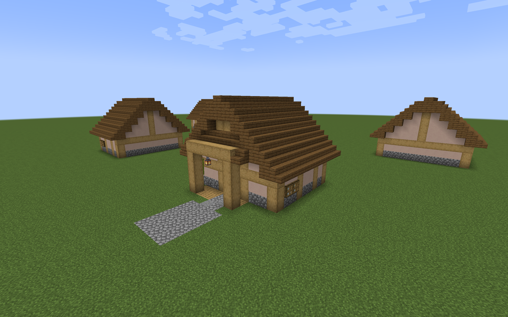
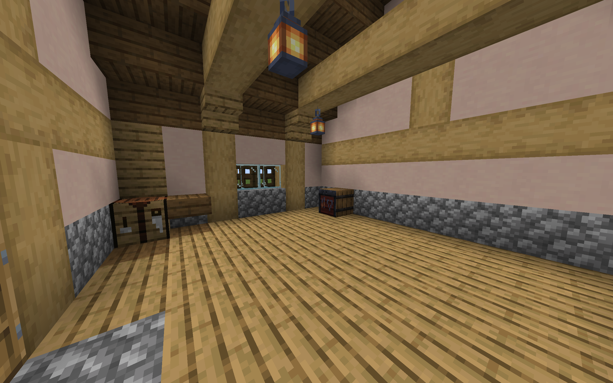
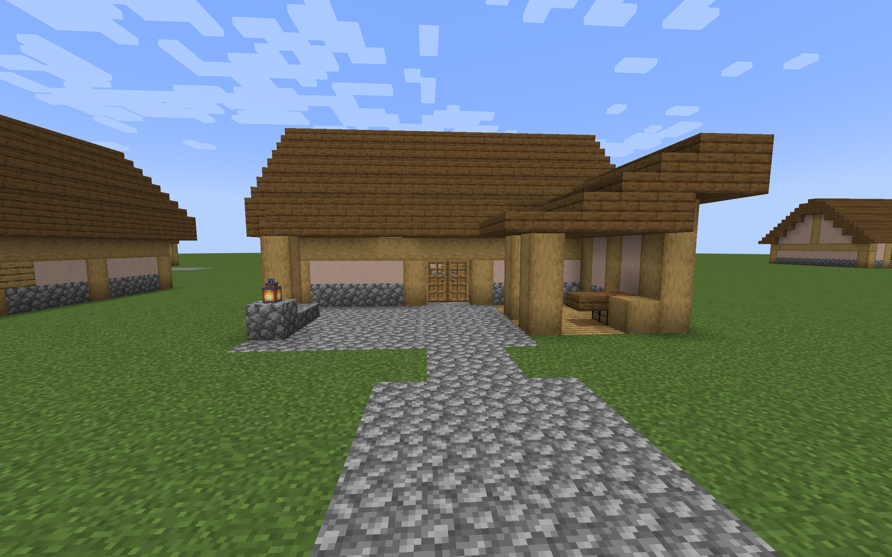
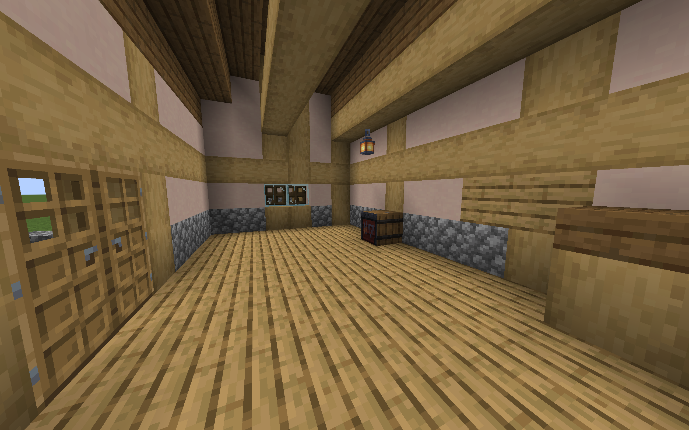

# Plains Village Armory previews

The furnished prototypes turn the [Plains floor plans](armory-designs.md) into
two timber-framed Village Armories. Each has a stone base, spruce roof,
shuttered windows, work surfaces, resting seats, equipment shelves, and one
real, initially empty Village Armory with a clear service area.

The compact storehouse has a sheltered porch and broad central aisle. The
supply yard pairs a rear storehouse with a covered side workshop and open
delivery court. Its interior cross-aisle and passage beside storage provide
room to move around the supply area. Five lanterns serve the workshop, store
frontage, packing area, storage corner, and court edge.

This is a separate architecture datapack. The seven other regional pairs have
their own [furnished preview pack](regional-armory-preview.md). The separate
[regional integration packs](regional-armory-integration.md) add all sixteen
layouts to village generation when installed and enabled.









## Build and place

Run either command from the repository root:

```sh
./gradlew armoryPreview
python3 tools/build_armory_preview.py
```

Each command produces
`build/distributions/villager-guard-gunners-armory-preview.zip`.
Put that ZIP in a Minecraft 1.20.1 test world's `datapacks` directory and run
`/reload`. Use packaged Villager Guard Gunners, Guard Villagers, and Timeless
and Classics Zero (TaCZ), with their required dependencies.

On a level grass surface, choose one command to place its floor at ground level:

```mcfunction
/place template vggpreview:armory/plains/compact ~ ~-1 ~
/place template vggpreview:armory/plains/supply_yard ~ ~-1 ~
```

The command origin is the northwest corner, including the roof margin.

| Layout | Width east × depth south × height | North-facing doors | Armory position, facing north |
| --- | --- | --- | --- |
| Compact | 13 × 13 × 11 | X=5..6, Z=3 | (9,1,10) |
| Supply yard | 16 × 17 × 11 | X=7..8, Z=8 | (10,1,14) |

Floors are at local Y=0; standing feet are at Y=1. Place each in clear space: the template
clears its volume above Y=0. It supplies no foundation beneath the floor and
does not adapt automatically to slopes or connect to a village road.

Both approaches extend to Z=0. The yard leaves X=7..10, Z=2..5 open to sky,
with the workshop to the west and the storehouse to the south. Fill the
Armory with compatible ammo to use ordinary guard resupply.

## Authoring and integration boundary

Edit [`build_armory_preview.py`](../tools/build_armory_preview.py) to change
the prototypes. It builds native structure NBT, checks floor support and clear
routes, and writes a reproducible ZIP. Its manifest contains one row per layout
and uses Minecraft's size order:
width, height, depth. The [architectural details](armory-architectural-details.md)
describe the materials and room reservations.

This preview generator supports the yard's 17-block depth directly. It does
not use or change the village-layout compiler's 16-block axis limit. Native
template placement and eventual village-pool fit are separate checks.

Roof rises have plank backing. The compact center ridge is a full plank instead
of the drawing's top slab, closing its underside with the same upper outline.
Its beam ends sit beneath the eaves on short brackets rather than breaking the roof.
The yard uses an east–west rear gable, a lower workshop lean-to, and a frontage
canopy. Their occupied blocks meet in that order of precedence. The workshop
roof steps down in half-block increments. Its bottom slab and the frontage's
bottom stair provide solid undersides for hanging lanterns. The east banner
sits beside the shutters, leaving them visible.
Shelves and benches are decorative wood and slabs; only the Armory stores ammo.

The pack contains no building definitions, jigsaw connectors, pool entries,
spawn markers, loot tables, or stocked inventories. Manual placement does not
register a defense building, assign a service sentry, or create guards. A
separate integration pass must preserve generated stock, access rules, saved
building records, and road transitions.

## Packaged validation

The disposable compatibility helper detects
`vggpreview:armory_manifest.json` through the runner's existing
`barracksDesignPreview` mode. It uses the ordinary Forge client and packaged
mod JARs. It checks native placement in four rotations, Armory facing and mirror
states, empty storage, attachments, floor support, route clearance, and sampled
work-area lighting and roof cover. The client captures the exterior, roof,
interior, nighttime, and supply-yard rain views. The yard's 4 × 4 court must
remain open to sky; sampled covered work areas must remain sheltered in rain.

Two guards in each rotation walk from the approach to the work area, then to
supplies, then back outside. These are scripted movement goals using native
navigation, wooden-door opening, and entity collision. A separate armed guard
per layout uses ordinary goals to seek stock from the Armory, checking source
and reserve counts once both guards have received ammo.
The existing four-block withdrawal range can allow supply through a wall;
successful resupply alone is not evidence of entrance use.

Both prototypes passed these checks on Minecraft 1.20.1, Forge 47.4.10,
Guard Villagers 1.6.19, and TaCZ 1.1.8-hotfix. Sixteen guards completed all
48 walking legs across the two layouts and four rotations. Each ordinary
resupply trial moved 60 rounds from a 64-round source into guard reserves,
leaving four in its Armory. Four sampled compact work/service positions had
block light levels 9–12; seven yard positions had levels 8–11. All eleven
positions had roof cover and remained sheltered during the rain check. The
yard's sixteen central court cells were exposed to rain as intended.

These checks cover a controlled level plot. Natural generation, uneven terrain,
provider roads, casualty carrying, crowd queueing, combat, and save/reload of
generated stock require separate integration trials. Sampled light readings
do not establish that every floor or roof cell prevents hostile spawning.
