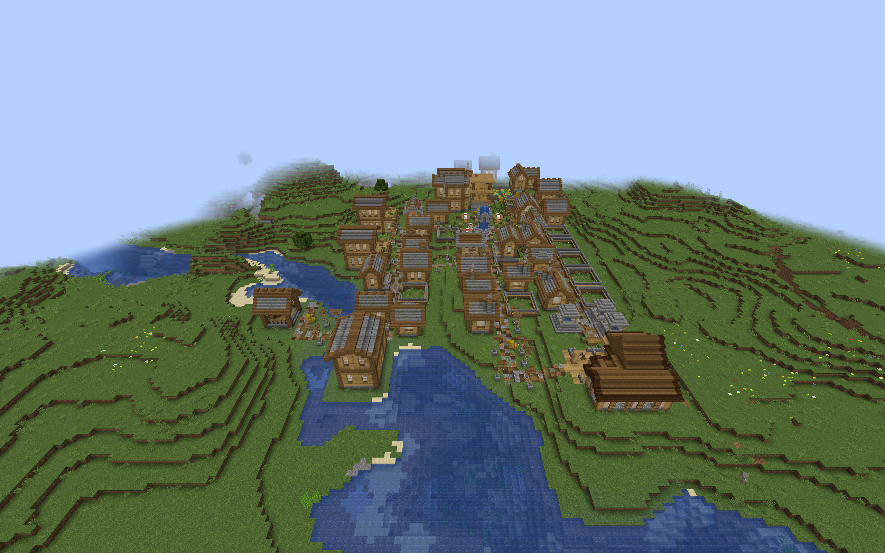
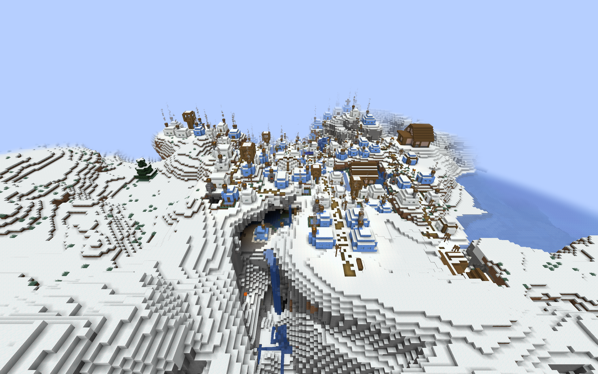

# Barracks in custom villages

This optional datapack adds compact and courtyard Barracks to six regional
village themes in ChoiceTheorem's Overhauled Village (CTOV). The buildings use
local materials, furnished rooms, a muster area, and an entrance sentry duty.

## Installation and coverage

Build with `./gradlew build customBarracksIntegration`. The optional archive is
`build/distributions/villager-guard-gunners-barracks-ctov.zip`.

Install the ZIP in the world's `datapacks` folder with the current Villager
Guard Gunners JAR, Guard Villagers, Timeless and Classics Zero (TaCZ), CTOV,
and their dependencies. Enable **Generate Village Defense Buildings** and
Barracks in the Village Defense Buildings settings. Reopen the world or
restart the server; generation changes affect newly generated villages.
`/reload` alone does not replace the live village pools.

| CTOV theme | Architecture | Incoming pool |
| --- | --- | --- |
| Plains | Plains timber and stone | `ctov:village/plains/terminator` |
| Desert | Desert masonry | `ctov:village/desert/terminator` |
| Taiga | Taiga timber | `ctov:village/taiga/terminator` |
| Snowy Igloo | Snowy enclosed buildings | `ctov:village/snowy_igloo/terminator` |
| Swamp | Raised Swamp buildings | `ctov:village/swamp/terminator` |
| Jungle | Raised Jungle buildings | `ctov:village/jungle/roads` |

Each theme contains both layouts. The pool contracts were inspected in the
CTOV 3.4.14 JAR. Jungle's roads have an empty fallback, so that theme uses the
roads pool directly. Other CTOV themes and custom villages from other mods
require their own placement review; this pack does not add entries to them.

The pack works alongside the [CTOV Armory pack](custom-village-armories.md).
With all five regional building families, both custom Armory packs, and the
built-ins, the total is 131 definitions across 20 pools. Use a build supporting
192 definitions; a 128-definition build cannot load this full combination.
Adding the [CTOV Sentry Post pack](custom-village-sentry-posts.md) brings that
collection to 143 definitions across the same 20 pools.
The target-pool limit remains 24. Installing CTOV Barracks and CTOV Armories
alone with the built-ins uses 49 definitions across 11 pools.

## Placement and guard behavior

Each building retains its reviewed [regional Barracks geometry](regional-barracks-integration.md),
including doors, furnishings, and guard positions. Its single outward connector
uses `minecraft:street`, an empty continuation pool, rigid projection, and
empty processors. Raised entrances retain their bottom-slab step. The pack
adds entries without replacing CTOV's pool resources.

Entries have weight 1 and selection chance 0.25. Available space and the
provider's road layout affect appearance. These numbers do not mean that a
quarter of villages contain a Barracks. Large courtyards can be less frequent
where roads leave limited space, and a Barracks can terminate a road branch.

One DATA marker registers the Barracks and claims its initial garrison.
The existing difficulty-based policy applies; on Normal, the default group
contains two guards and a possible third. The building authors three muster
duties and one entrance sentry duty. All use positions and facings relative
to the building's rotation. Readiness, orders, available guards, and population
settings determine actual staffing.

## Validation

Validation used the packaged Villager Guard Gunners JAR with Minecraft 1.20.1,
Forge 47.4.10, Guard Villagers 1.6.19, TaCZ 1.1.8-hotfix, CTOV 3.4.14, and
CTOV's Lithostitched dependency in ordinary clients. Both CTOV Barracks and
Armory player packs were installed, with their normal weights and chances.
The observer located naturally selected buildings; it did not place substitute
roads or flatten the surroundings.

All twelve layouts have successful fresh-generation and full-process-restart
samples. Across 27 successful runs, guards completed 198 native walking legs
and the saved-world audit checked 3,948 dry standing positions. These totals
include repeated diagnostic trials. Each route visited the muster area,
interior destinations, secondary exit, entrance sentry position, and adjoining
road. Recorded garrison UUIDs, action claims, and rotated duty layouts survived
restart; repeated activation added no guards.

| Theme | Compact and courtyard | Successful sample seeds |
| --- | --- | --- |
| Plains | Placement, walking, restart passed | 314159 |
| Desert | Placement, walking, restart passed | Compact 314159; courtyard 314160 |
| Taiga | Placement, walking, restart passed | 314159 |
| Snowy Igloo | Placement, walking, restart passed | 314159 |
| Swamp | Placement, walking, restart passed | 314159 |
| Jungle | Placement, walking, restart passed | Compact 314160; courtyard 314159 |

These trials target CTOV's large starts. Small and medium starts share the
reviewed pools, but their building appearance rates were not separately tested.
Rotations are those encountered in the natural samples. Four unsuccessful
runs remain in the evidence: two reproductions of the Desert cactus contact,
one Jungle foliage obstruction, and an observer error in Snowy garrison
counting. The corrected observer found both original Snowy guard identities
among loaded entities, including a guard below the village's bounding box in
a ravine; the same seed then passed the full restart checks.

Structural tests preserve the complete regional template except incoming
connector identifiers, and preserve all garrison and duty offsets. The Java
suite passed 889 tests, including acceptance at 192 definitions and overflow
rejection before pool mutation. All 97 Python tooling tests passed. Installed
template and definition bytes matched the player ZIPs; the observation helper
and its manifests are excluded from the mod and player packs.

A separate ordinary dedicated Forge server loaded all eighteen player ZIPs
without the observation helper: 131 definitions across 20 pools. Startup,
`/reload`, and a full process restart passed. Missing pools, processors,
templates, and invalid templates were all zero. JAR and ZIP hashes remained
unchanged, and both processes exited successfully. This checks combined
resource loading, not multiplayer movement or every provider's road fit.

These adapters have finite foundations. Occasional exposed foundations or
rough surrounding terrain remain possible. A Desert courtyard trial on seed
314159 reproduced one point of cactus damage during a guard's return to the
road after restart. The cactus was outside the Barracks envelope, beside the
adjoining CTOV road. This surrounding-terrain hazard remains deferred; the
test keeps its strict damage check and records the failed sample.

A Jungle compact sample on seed 314159 had leaves filling a secondary exit.
Both observed copies had working front-door-to-muster paths, but one failed
the additional side-exit walk. This foliage obstruction also remains
deferred; it is not counted as a successful full-route sample.

Automatic staffing, combat,
village-wide patrol coverage, and combined building frequency need separate
behavior and balance testing.

## Natural village examples

Plains courtyard Barracks beside CTOV timber-and-stone buildings:

Snowy buildings in CTOV’s Igloo theme; the adjoining ravine illustrates the
surrounding terrain that these templates do not reshape:

