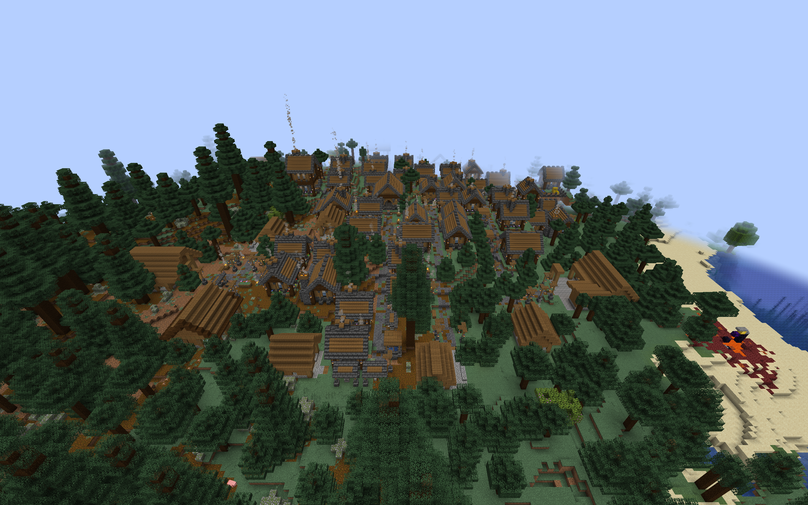
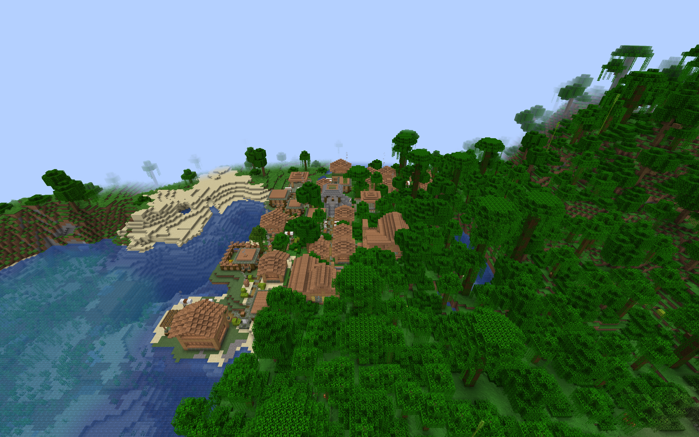

# Sentry Posts in custom villages

This optional datapack adds roadside shelters and gateway lodges to six
regional themes in ChoiceTheorem's Overhauled Village (CTOV). Each provides a
sheltered sentry position and a furnished interior in the local building style.

## Installation and coverage

Build with `./gradlew customSentryPostIntegration`. Install
`build/distributions/villager-guard-gunners-sentry-posts-ctov.zip` in the world's
`datapacks` folder with Villager Guard Gunners, Guard Villagers, Timeless and
Classics Zero (TaCZ), CTOV, and their dependencies.

Enable **Generate Village Defense Buildings** and **Sentry Posts** in the
Village Defense Buildings settings. Reopen the world or restart the server.
Generation changes affect newly generated villages; `/reload` alone does not
replace the live village pools.

| CTOV theme | Regional architecture | Incoming pool |
| --- | --- | --- |
| Plains | Timber and stone | `ctov:village/plains/terminator` |
| Desert | Desert masonry | `ctov:village/desert/terminator` |
| Taiga | Taiga timber | `ctov:village/taiga/terminator` |
| Snowy Igloo | Enclosed Snowy shelter | `ctov:village/snowy_igloo/terminator` |
| Swamp | Raised Swamp platform | `ctov:village/swamp/terminator` |
| Jungle | Raised Jungle platform | `ctov:village/jungle/roads` |

Both layouts are included for each theme. The connections use the CTOV 3.4.14
pool contracts reviewed for the [custom Armories](custom-village-armories.md)
and [Barracks](custom-village-barracks.md). Jungle roads have an empty fallback,
so that theme receives entries directly in its roads pool. Other CTOV themes
require separate placement review.

The three CTOV packs together with the built-ins use 61 definitions across
11 pools. The full collection of five regional building families, both custom
Armory packs, CTOV Barracks, and CTOV Sentry Posts uses 143 definitions across
20 pools in nineteen ZIPs plus the built-ins. Use the current build supporting
192 definitions and 24 target pools. Adding the
[CTOV Watchtower pack](custom-village-watchtowers.md) brings the full collection
to 155 definitions across the same 20 pools.

## Placement and guard behavior

The pack preserves the complete [regional Sentry Post interiors](regional-sentry-post-integration.md),
including the raised entrance steps. Each template has one outward
`minecraft:street` connector, an empty continuation pool, rigid projection,
and empty processors. Entries have weight 1 and selection chance 0.25;
available road space also affects whether a building appears. A post can
terminate a road branch. Existing CTOV pool resources are preserved.

Each post retains the existing limit of one initial guard and one sheltered
`road_sentry` duty that accepts any weapon. The DATA marker registers the
building and becomes air. The duty rotates with the structure. Difficulty,
garrison, population, readiness, and equipment settings still govern guards
and actual staffing. These posts do not receive initial Armory stock.

Foundations are finite. Surrounding slopes, ravines, foliage, and provider
road hazards can still affect a generated building. Village-wide patrol
coverage and combined building frequency require separate behavior and
balance testing.

## Validation scope

The natural-placement matrix uses the packaged Villager Guard Gunners JAR in
ordinary Minecraft 1.20.1 clients with Forge 47.4.10, Guard Villagers 1.6.19,
TaCZ 1.1.8-hotfix, CTOV 3.4.14, and Lithostitched 1.4.11. The CTOV Armory,
Barracks, and Sentry Post player packs are installed together at their normal
weights and selection chances. A separate observation helper locates naturally
selected posts and checks actual guard walking; it does not replace the roads
or flatten surrounding terrain.

Each sampled post is checked for one resident, the rotated sheltered duty,
finalized marker, and three native walking legs: road to sentry position,
interior destination, and back to the road. The helper requires the walking
guard to stay alive, at full health, and out of water. It checks residents by
building identity among loaded entities, including residents beyond the
village's bounding box. Full process restarts compare resident UUIDs, action
claims, and duty layouts; repeated activation must add no guards. Saved-world
checks inspect the adjoining road and body space at authored standing positions.

All twelve layouts have successful fresh-generation and full-process-restart
samples: 24 passing client runs, 126 completed walking legs, and 1,508 dry
standing-position checks. Seed 314159 supplied the successful samples except
the Swamp gateway lodge, which used 314160. All four rotations occurred across
the sample set; this is not a per-layout test of every rotation. Original
resident UUIDs, action claims, and duty layouts survived restart, and repeated
activation added no guards. Installed resources matched the player ZIP bytes.
The build and all 99 Python tooling tests passed, including structural checks
that preserve the complete regional geometry and duty positions.

A separate ordinary dedicated Forge server loaded all nineteen player ZIPs
without the observation helper: 143 definitions across 20 pools. Startup,
`/reload`, and a full process restart passed with zero missing or invalid
resources. Both processes exited successfully, and all JAR and ZIP hashes
remained unchanged. Existing Guard Villagers configuration-watcher warnings
recurred during shutdown. This validates combined resource loading, not
multiplayer movement or every provider's road fit.

These checks target large village starts and the rotations encountered in
natural samples. They do not establish every seed's terrain safety, separate
small/medium-start appearance rates, multiplayer movement, or automatic
readiness and staffing transitions. The observation helper and its manifests
are excluded from the mod JAR and player ZIPs.

A Swamp gateway-lodge sample on seed 314159 failed the dry road-approach check.
The adjoining CTOV `village/swamp/roads/inter` piece uses waterlogged, unlit
campfires in both approach lanes, below the post's raised step. This junction
remains a known connection limitation: not every Swamp placement provides a
dry entrance. Its failed sample is retained. Resolving it requires a separate
junction adaptation or attachment rejection; the pack does not overwrite the
provider's road blocks to create a passing sample.

## Natural village examples

These ordinary-client overviews show the surrounding village context. Trees
obscure some buildings; they are not close-up interior validation images.

