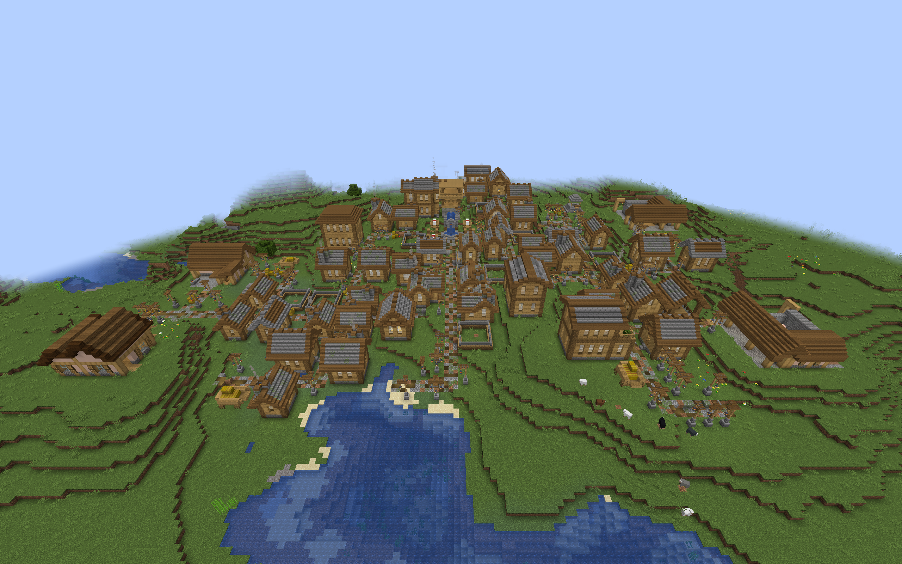
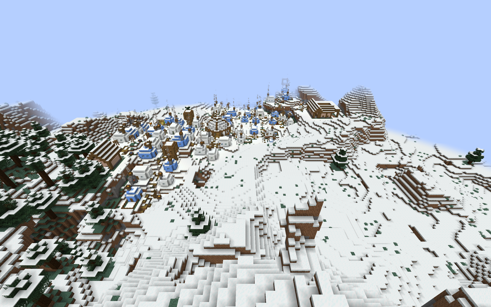

# Training Yards in custom villages

This optional datapack adds furnished practice yards and drill courtyards to
six regional themes in ChoiceTheorem's Overhauled Village (CTOV). Each has
two spaced drill positions, decorative targets, shelter, and a clear route
around the practice area.

## Installation and coverage

Build with `./gradlew customTrainingYardIntegration`. Install
`build/distributions/villager-guard-gunners-training-yards-ctov.zip` in the
world's `datapacks` folder with the current Villager Guard Gunners JAR,
Guard Villagers, Timeless and Classics Zero (TaCZ), CTOV, and their dependencies.

Enable **Generate Village Defense Buildings** and **Training Yards** in the
Village Defense Buildings settings. Reopen the world or restart the server.
Generation changes affect newly generated villages; `/reload` alone does not
replace the live village pools.

| CTOV theme | Regional architecture | Incoming pool |
| --- | --- | --- |
| Plains | Timber and stone | `ctov:village/plains/terminator` |
| Desert | Desert masonry | `ctov:village/desert/terminator` |
| Taiga | Taiga timber | `ctov:village/taiga/terminator` |
| Snowy Igloo | Snowy sheltered yard | `ctov:village/snowy_igloo/terminator` |
| Swamp | Raised Swamp platform | `ctov:village/swamp/terminator` |
| Jungle | Raised Jungle platform | `ctov:village/jungle/roads` |

Both layouts are included for each theme. These are the CTOV 3.4.14 connections
reviewed for the [Armories](custom-village-armories.md),
[Barracks](custom-village-barracks.md), [Sentry Posts](custom-village-sentry-posts.md),
and [Watchtowers](custom-village-watchtowers.md). Jungle roads have an empty
fallback, so that theme uses its roads pool directly. Other CTOV themes and
other providers require separate placement review.

All five CTOV building packs with the built-ins use 85 definitions across
11 pools. The full collection of five regional building families, five CTOV
packs, and the five [Sky packs](sky-village-defense-buildings.md) uses 175
definitions across 20 pools in twenty-five ZIPs plus the built-ins. Use the current build supporting
192 definitions and 24 target pools.

## Placement and guard behavior

The pack preserves the [regional Training Yard geometry](regional-training-yard-integration.md),
including target decorations, shelter, circulation space, and raised perimeter
rails. Each template has one outward `minecraft:street` connector, an empty
continuation pool, rigid projection, and empty processors. Existing CTOV pool
resources are preserved.

Entries have weight 1 and selection chance 0.25. Road space, terrain, and other
pieces affect appearance; these values do not mean that a quarter of villages
contain a Training Yard. A yard can terminate a road branch, and the wider
courtyard needs more free space than the practice yard.

Each building retains the existing difficulty-based initial garrison policy,
with two guards on Normal under the tested defaults. Two drill duties require
ranged weapons and face the target area. Their offsets and facings rotate
with the building. Readiness, orders, equipment, and available guards determine
actual staffing. The targets are decorative; this pack does not add target
shooting behavior. Yards do not receive initial Armory stock.

Foundations have finite depth. Slopes, foliage, ravines, and flooded provider
roads can create awkward placements. The known [Swamp junction limitation](custom-village-sentry-posts.md)
remains relevant when reviewing raised buildings beside CTOV intersections.

## Validation scope

Natural-placement trials use the packaged Villager Guard Gunners JAR in
ordinary Minecraft 1.20.1 clients with Forge 47.4.10, Guard Villagers 1.6.19,
TaCZ 1.1.8-hotfix, CTOV 3.4.14, and Lithostitched 1.4.11. All five CTOV building
packs are installed together at their normal weights and selection chances.
The observation helper locates naturally selected buildings without replacing
roads or flattening surrounding terrain.

Each ten-leg trial visits both actual drill duties, returns along the firing line, then follows the authored circulation
and sheltered destinations, and the adjoining road. The walking guard must
remain alive, at full health, and out of water. Standing-cell support and
raised perimeter rails are checked in the loaded world. Saved-world audits
check road blocks and dry body space. Resident identities, claimed actions,
and rotated duties are compared after a full process restart; repeated
activation must add no guards.

All twelve layouts passed fresh-generation and full-process-restart trials on
seed 314159: 24 ordinary-client runs, 280 walking legs, and 2,656 dry standing
positions. The fresh samples contained 14 yards and 28 resident guards. All
four rotations occurred across the set, though each layout was not separately
tested in every rotation. Original resident UUIDs, action claims, and duties
survived restart; repeated activation added no guards. Installed resources
matched the player ZIP bytes. The build and all 103 Python tooling tests passed,
including preservation of regional geometry and duty positions.

An initial Plains courtyard trial reached both drill positions but stalled
when asked to move directly from the western position to the far eastern lane.
Two copies showed this behavior beside intact range walls. The accepted route
returns along the firing line before circling the yard. That waypoint sequence
checks usable circulation; it does not fix or establish arbitrary autonomous
detours around the range walls. The direct-route failure is retained separately.

A separate ordinary dedicated Forge server loaded all twenty-one player ZIPs
without the observation helper: 167 definitions across 20 pools. Startup,
`/reload`, and a full process restart passed with zero missing pools,
processors, templates, or invalid templates. Both processes exited successfully,
and all JAR and ZIP hashes remained unchanged. Existing Guard Villagers
configuration-watcher warnings recurred during shutdown. This checks combined
resource loading, not multiplayer movement or every provider's road fit.

These checks target large CTOV starts and encountered rotations. They do not
establish every seed's terrain safety, small/medium village appearance rates,
multiplayer movement, automatic staffing, or village-wide patrol coverage.
The helper and its manifests are excluded from the player resources.

## Natural village examples

These ordinary-client overviews show the yards in their village surroundings.
They provide placement context rather than close-up interior validation.

