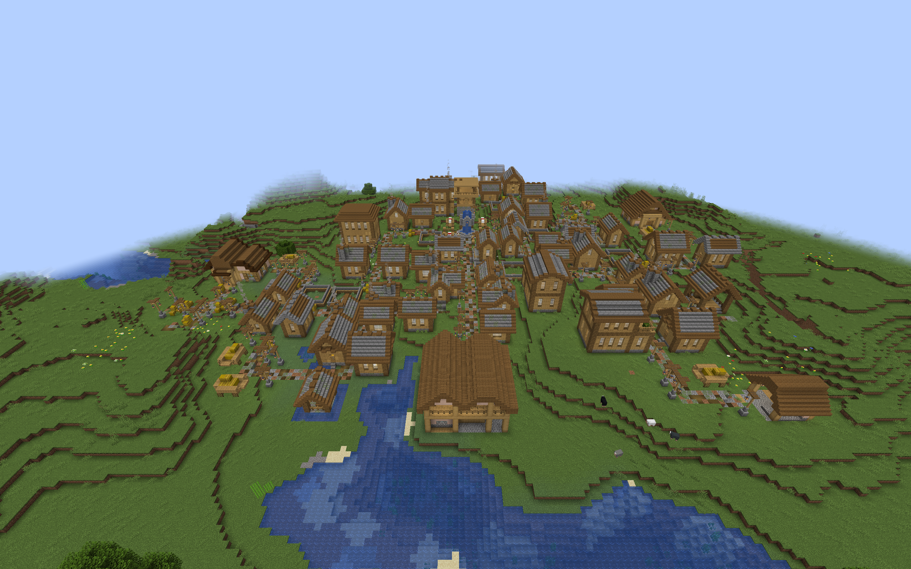
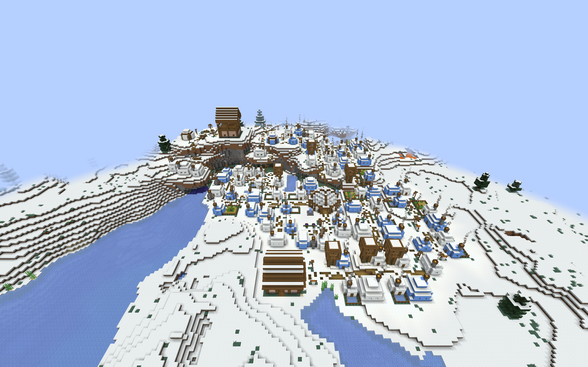

# Watchtowers in custom villages

This optional datapack adds compact towers and gatehouse lookouts to six
regional themes in ChoiceTheorem's Overhauled Village (CTOV). Each has a
furnished ready room, internal stairs, and two sheltered lookout positions.
The gatehouse includes a covered entrance and an east gallery.

## Installation and coverage

Build with `./gradlew customWatchtowerIntegration`. Install
`build/distributions/villager-guard-gunners-watchtowers-ctov.zip` in the world's
`datapacks` folder with the current Villager Guard Gunners JAR, Guard Villagers,
Timeless and Classics Zero (TaCZ), CTOV, and their dependencies.

Enable **Generate Village Defense Buildings** and **Village-Integrated
Watchtowers** in the Village Defense Buildings settings. Reopen the world or
restart the server. Generation changes affect newly generated villages;
`/reload` alone does not replace the live village pools. The separate rare
[Village Watchtower](village-watchtowers.md) is unaffected.

| CTOV theme | Regional architecture | Incoming pool |
| --- | --- | --- |
| Plains | Timber and stone | `ctov:village/plains/terminator` |
| Desert | Desert masonry | `ctov:village/desert/terminator` |
| Taiga | Taiga timber | `ctov:village/taiga/terminator` |
| Snowy Igloo | Enclosed Snowy tower | `ctov:village/snowy_igloo/terminator` |
| Swamp | Raised Swamp platform | `ctov:village/swamp/terminator` |
| Jungle | Raised Jungle platform | `ctov:village/jungle/roads` |

Both layouts are included for each theme. These are the CTOV 3.4.14 connections
reviewed for [Armories](custom-village-armories.md),
[Barracks](custom-village-barracks.md), and
[Sentry Posts](custom-village-sentry-posts.md). Jungle roads have an empty
fallback, so that theme uses its roads pool directly. Other CTOV themes and
other providers require separate placement review.

The four CTOV building packs with the built-ins use 73 definitions across
11 pools. The full collection of five regional building families, both custom
Armory packs, CTOV Barracks, CTOV Sentry Posts, and CTOV Watchtowers uses 155
definitions across 20 pools in twenty ZIPs plus the built-ins. Use the current
build supporting 192 definitions and 24 target pools. Adding the
[CTOV Training Yard pack](custom-village-training-yards.md) brings the full
collection to 167 definitions across the same 20 pools. The expanded
[Sky building collection](sky-village-defense-buildings.md) brings that total
to 175.

## Placement and guard behavior

The pack preserves the reviewed [regional Watchtower geometry](regional-watchtower-integration.md),
including stairs, doors, railings, furnishings, and raised entrance steps.
One outward connector uses `minecraft:street`, an empty continuation pool,
rigid projection, and empty processors. Existing CTOV pool resources are
preserved. The covered gatehouse entrance does not require a through road.

Each entry has weight 1 and selection chance 0.25. Space, terrain, and the
provider's road layout affect appearance; these values do not mean that a
quarter of villages contain a Watchtower. A tower can terminate a road branch.

Each building retains the existing maximum of two initial guards. Difficulty,
garrison, population, and loadout settings still apply. Two spaced overwatch
duties sit five blocks above the anchor, rotate with the building, and require
ranged weapons. Readiness, orders, and available guards determine actual
staffing. The DATA marker registers the tower and becomes air; towers do not
receive initial Armory stock.

Foundations have finite depth. Steep slopes, foliage, ravines, and flooded
provider roads can create awkward placements. The wider gatehouse needs more
free space than the compact tower. The [known Swamp Sentry Post junction
limitation](custom-village-sentry-posts.md) also warrants attention when
reviewing raised buildings at CTOV intersections.

## Validation scope

Natural-placement trials use the packaged Villager Guard Gunners JAR in ordinary
Minecraft 1.20.1 clients with Forge 47.4.10, Guard Villagers 1.6.19,
TaCZ 1.1.8-hotfix, CTOV 3.4.14, and Lithostitched 1.4.11. The CTOV Armory,
Barracks, Sentry Post, and Watchtower packs are installed together at their
normal weights and selection chances. A separate observation helper locates
naturally selected buildings without replacing roads or flattening terrain.

Each walking trial visits the ground floor, stairs, upper deck, both actual
lookout duty slots, the gallery or rear deck, the ground floor again, and the
adjoining road. Guards must complete eight walking legs alive, at full health,
and out of water. The helper counts residents by building identity among
loaded entities, checks rotated duties, and compares garrison UUIDs, action
claims, and duty layouts after a full process restart. Repeated activation
must add no guards. Saved-world audits check adjoining road blocks and dry
body space at authored standing and lookout positions.

All twelve layouts passed fresh-generation and full-process-restart trials on
seed 314159: 24 ordinary-client runs, 240 walking legs, and 2,882 dry
standing-position checks. The fresh samples contained 15 observed Watchtowers.
All four rotations occurred across the sample set, though each layout was not
separately tested in every rotation. Original guard UUIDs, action claims, and
both duty layouts survived restart; repeated activation added no guards.
Installed resources matched the player ZIP bytes. The build and all 101 Python
tooling tests passed, including preservation of regional geometry and duties.

The accepted matrix uses eight-leg routes that visit both actual lookout
slots. Two earlier Plains compact runs used six legs and are excluded from
these totals; the subsequent preliminary gatehouse run was interrupted to
strengthen the observer. The complete eight-leg matrix had no failed samples.
No template changes, road edits, or alternate seeds were needed for it.

A separate ordinary dedicated Forge server loaded all twenty player ZIPs
without the observation helper: 155 definitions across 20 pools. Startup,
`/reload`, and a full process restart passed with zero missing pools,
processors, templates, or invalid templates. Both processes exited successfully,
and all JAR and ZIP hashes remained unchanged. Existing Guard Villagers
configuration-watcher warnings recurred during shutdown. This verifies combined
resource loading, not multiplayer movement or every provider's road fit.

These trials target large CTOV starts and encountered rotations. They do not
establish every seed's terrain safety, separate small/medium village appearance
rates, multiplayer movement, or automatic readiness and staffing behavior.
The helper and its observation manifests are excluded from the mod and
player packs. Village-wide patrol coverage and combined building frequency
still need separate behavior and balance testing.

## Natural village examples

Ordinary-client overviews show the buildings in their village surroundings.
They provide placement context rather than close-up interior validation.

