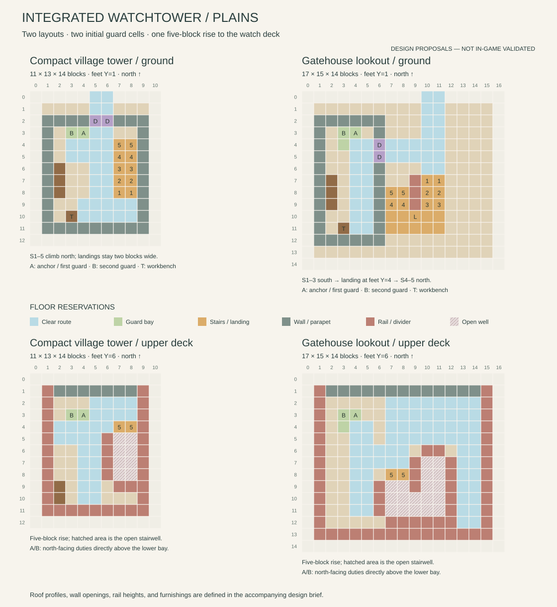

# Integrated Watchtower design proposals

Status: furnished layouts and optional natural village integration. Furnished Plains prototypes
are available in the [Watchtower preview pack](watchtower-preview.md), which
records the implemented details and validation limits. These plans remain the
design reference; [natural village integration](regional-watchtower-integration.md)
is delivered in separate optional packs.

Prototype refinement: keep the initial cells below, but use firing duties at
`(5,6,3)` and `(3,6,3)`, two blocks apart. The adjacent original duties inhibit
fire through the default ally-clearance check. The first duty therefore needs
offset `[1,5,0]`; initial placement still uses `[0,5,0]`. The preview guide
also records the bounded production retry that resolves the longer return
routes found during native trials.

The integrated Watchtower should be a recognizable village landmark: a sturdy
local guardhouse carrying a sheltered lookout. Continue the rustic village
architecture of the Barracks, Village Armories, and Sentry Posts, with practical
masonry, timber framing, useful rooms, and restrained decoration.

## Two layouts

Dimensions include the proposed roof margins and entrance strip, in
**width × depth × height** order. Minecraft NBT stores width, height, depth.

| Layout | Working ID | Proposed envelope | Character |
| --- | --- | --- | --- |
| Compact village tower | `compact_tower` | 11 × 13 × 14 | A small stone-and-timber guardhouse, one broad straight stair, and a covered upper watch deck |
| Gatehouse lookout | `gatehouse_lookout` | 17 × 15 × 14 | A west guardroom beside a covered arrival porch, a turning stair, and a broader upper gallery |

Both have the same five-block rise to the occupied deck and the same maximum
two initial guards. The broader layout adds circulation and shelter. Its
archway frames the entrance to the building; it does not require a village
road to continue through the structure. A functioning through-road gatehouse
would need its own connector and road-generation design.

The **village-integrated** building is the subject here. The rare standalone
[Village Watchtower](village-watchtowers.md) has separate generation, terrain,
garrison, and Armory behavior and needs a separate design pass.

## Current implementation and constraints

The built-in integrated template is **9 × 10 × 13**, with pool weight `1`.
Its anchor is `(4,1,7)` and its second initial guard starts at `(3,1,7)`.
A single-width north-facing staircase climbs from the rear ready room to the
upper deck. The floor at Y=5 supports guards with feet at Y=6. The two current
deck positions are `(4,6,7)` and `(3,6,7)`, behind the stair opening.

The current garrison group supplies one rifleman on Easy; on Normal it has a
marksman and a 50% chance of a second rifleman; on Hard it has a marksman and
support member. Peaceful creates none. Garrison and population settings can
reduce these counts. Equipment still follows the configured loadout rules.

After initial equipment selection, `VillageWatchtowerGuardPlacement` makes a
one-time attempt to move a guard holding a TaCZ gun or a crossbow exactly
**five blocks above its lower position**. It checks loaded chunks, standing
support, block collisions, and other entities. Melee-equipped or unarmed
guards stay in the ready room. This initial move is not proof of stair access;
normal movement must be tested separately. Later equipment changes do not
repeat that initial teleport.

The two default duties are `deck_center` and `deck_west`, facing local north,
with kind `overwatch` and weapon requirement `ranged`. They use offsets
`[0,5,0]` and `[-1,5,0]` from the building anchor. Authored duty slots can change
destinations, but they do **not** change the current initial five-block move.
Keep those systems aligned in both prototypes.

Source references:

- [Integrated template](../src/main/templates/villagerguardgunners/village_buildings.json)
- [Initial deck placement](../src/main/java/com/gamergaming/villagerguardgunners/worldgen/village/VillageWatchtowerGuardPlacement.java)
- [Default duties](../src/main/java/com/gamergaming/villagerguardgunners/defense/duty/VillageDefenseDutyLayouts.java)
- [Garrison group](../src/main/resources/data/villagerguardgunners/guard_post_groups/village_watchtower.json)
- [Existing integrated geometry checks](../src/test/java/com/gamergaming/villagerguardgunners/VillageDefenseBuildingsStepNineContractTest.java)

## Shared floor and movement rules

Local north is toward the road, before Z=0; X increases east and Z increases
south. Coordinates below are inclusive. Ground floor blocks occupy Y=0 and
standing feet are at Y=1. Upper floor blocks occupy Y=5 and standing feet are
at Y=6. Stair coordinates identify stair **blocks**, not standing positions.

Reserve the same initial cells in both proposals:

| Purpose | Position | Reservation |
| --- | --- | --- |
| Anchor / first lower guard | `(4,1,3)` | Clear cell in the west ready-room bay |
| Second lower guard | `(3,1,3)` | Adjacent clear cell; no bench or door swing |
| `deck_center` | `(4,6,3)` | Ranged overwatch facing north |
| `deck_west` | `(3,6,3)` | Ranged overwatch facing north |

Keep a clear two-by-two bay at X=3..4, Z=3..4 on both levels. Place the main
cross-route behind it at Z=4 or farther back, with an additional rear route
at Z=5 where possible; a guard standing at Z=3 must not block the stairs.
Routes can meet the rear row of the bay, but furniture cannot occupy it.

All ordinary circulation lanes are two blocks wide. Reserve three clear
blocks above full-floor walking positions. Paired wooden doors are the
normal two-block-high exception, with hinges opening against the outside
edges. Stairs need two clear blocks above each stair block and additional
clearance through floor openings and landings; check the actual moving entity
box before adding beams, hanging lights, or rail caps.

Use full blocks under the primary floors and landings. Stair supports should
close unusable crawl spaces. Guard every open stairwell edge, while leaving
the intended stair entrances open. Use connected fences on ordinary exposed
deck edges and a supported parapet at the north observation openings. The
prototype must settle the parapet height through live firing and movement
checks: low slabs alone are not adequate protection on an elevated deck.

## Compact village tower

The compact tower has an enclosed ready room below and a single broad
staircase on the east side. The stair climbs north; guards arrive on the
upper front landing and turn west toward the watch bay. This keeps the
initial guard cells out of the stair entrance and exit.

| Element | X/Z reservation | Height or detail |
| --- | --- | --- |
| Supported ground floor | X=1..9, Z=1..11; entrance X=5..6, Z=0 | Full blocks at Y=0 |
| Ready-room shell | X=1..9, Z=2..11 | Walls outside the reserved interior lanes |
| Paired entrance doors | X=5..6, Z=2 | Lower halves at Y=1, facing north |
| Main ground lane | X=5..6, Z=0..10 | Branch west into the ready bay and east toward the stair foot |
| Lower stair landing | X=7..8, Z=9..10 | Feet Y=1; two-by-two turning space |
| Stair flight | X=7..8, Z=8,7,6,5,4 | Stair block Y=1,2,3,4,5 respectively; facing north |
| Upper landing | X=7..8, Z=2..3 | Feet Y=6; two-by-two clear landing |
| Upper landing connection | X=5..8, Z=2..3, then X=5..6, Z=3..4 | Two-wide turn west of the landing |
| Upper cross-route | X=2..5, Z=4..5 | Behind the occupied watch cells at Z=3 |
| Rear upper circulation | X=4..5, Z=5..10 | Two clear lanes west of the stairwell rail |
| Upper floor opening | X=7..8, Z=5..8 | No floor at Y=5 above the climbing route; final stair at Z=4 replaces floor blocks |
| Stairwell edge rails | X=6, Z=5..8; X=7..8, Z=9 | At upper floor height, with supported posts; outer east edge joins perimeter railing |
| Bench | X=2, Z=6..8 | Against the west ground-floor wall |
| Crafting table | `(3,1,10)` | Work position `(4,1,10)`; no storage inventory |
| Rear upper rest corner | X=2..3, Z=9..10 | Modest seating outside the stair and return lane |

The west interior uses small framed windows, a timber notice panel, and a
bench. Leave the north lower spawn bay completely clear. Put ground lighting
on wall faces or above the circulation envelope. The upper deck needs its
own light near the rear cross-route, supported from the roof frame.

Use cobblestone and andesite for the lower base, oak framing, pale plaster
infill, and a spruce gable. Reserve the roof within X=0..10, Z=1..12, with
eaves and beams at Y=9 or higher and a ridge within Y=13. Keep the profile
narrow and readable from a village road. Avoid oversized battlements or a
second occupied roof platform.

## Gatehouse lookout

The wider lookout gives the arrival porch its own bay beside the west
ready room. A turning staircase occupies the rear of the porch. Upstairs,
the two watch cells remain in the west bay, with additional standing room
and an east gallery for circulation and views.

| Element | X/Z reservation | Height or detail |
| --- | --- | --- |
| Supported ground floor | X=1..15, Z=1..13; entrance X=10..11, Z=0 | Full blocks at Y=0 |
| West ready-room shell | X=1..6, Z=2..12 | Interior X=2..5, Z=3..11 |
| Open arrival lane | X=10..11, Z=0..6 | A timber arch at Z=2, starting above the three-block clearance |
| Ready-room doors | X=6, Z=4..5 | Paired doors facing east; outer hinges |
| Ground cross-route | X=4..11, Z=4..5 | Links the room, porch, and stair approach |
| Ready-room aisle | X=4..5, Z=4..11 | Clear access from the guard bay to the rear work position |
| First stair landing | X=10..11, Z=5..6 | Feet Y=1 |
| First flight | X=10..11, Z=7,8,9 | Stair block Y=1,2,3 respectively; facing south |
| Turning landing | X=7..11, Z=10..11 | Full floor Y=3, feet Y=4; room to turn around the central divider |
| Return flight | X=7..8, Z=9,8 | Stair block Y=4,5 respectively; facing north |
| Upper landing | X=7..8, Z=6..7 | Feet Y=6 |
| Upper north gallery | X=7..14, Z=2..5 | Room to leave the stair landing before approaching the west watch bay |
| Upper west circulation | X=4..5, Z=4..11 | A clear return route behind the watch positions |
| Upper landing cross-route | X=4..8, Z=6..7 | Connects the west lane to the stair landing |
| Upper east gallery | X=13..14, Z=2..12 | Two clear lanes; accessed from the north gallery, ending at the rear perimeter |
| Upper floor opening | X=10..11, Z=7..11, plus X=7..9, Z=9..11 | Leave the turning landing and lower flights open above; return stair at Z=8 replaces floor blocks |
| Well-edge rails | X=6, Z=9..11; X=7..11, Z=12; X=12, Z=7..12; X=10..11, Z=6 | Keep the intended upper stair exit at X=7..8, Z=7 open |
| Central stair divider | X=9, Z=7..9 | Supported barrier; ends before the turning landing |
| Ground bench | X=2, Z=7..9 | Along the west wall |
| Crafting table | `(3,1,11)` | Work position `(4,1,11)` |

The upper perimeter lies at X=1/15 and Z=1/13. The east gallery is a useful
side balcony, not a promised loop behind the stairwell. Keep its rear end
railed and avoid placing a duty at that dead end. Use a wider west roof over
the watch room and a shallower adjoining roof over the porch and stair bay.
Keep both within X=0..16, Z=0..14 and below height 14, with clear upper
headroom through Y=8. Their junction needs real timber support and closed
roof seams in the prototype.

Use the same Plains palette as the compact tower, with a stronger stone base
under the porch supports, restrained wall banners, and small shuttered windows
on the west room. The broad silhouette should read as a civic entrance
building with a lookout, rather than a miniature fortress. The arch does not
add gates, tolls, alarms, or a new checkpoint AI.

## Validation questions

The preview and village integration checks address these questions:

- Can guards walk ground-to-deck-to-ground through every stair segment and
  landing in all four rotations, independently of the initial deck teleport?
- Can two guards pass or wait safely at both landings, with occupied duty
  cells, opened doors, and a villager approaching the entrance?
- Do parapets and the stairwell rails stop accidental walk-offs while leaving
  useful northward and diagonal firing lines? Sample road-level targets at
  several distances, including 12 and 24 blocks. Check close-range blind
  spots explicitly rather than assuming a tower can fire at its own base.
- Can melee-equipped initial guards move around the ready room, and can
  ranged guards descend to reach the entrance? Can a guard walk to a duty
  after a later equipment change, without another initial-placement teleport?
- Do lights, roof beams, door leaves, and stair shape reconciliation preserve
  clearance? Do covered duty and landing cells remain dry and lit in rain?
- Do initial identities and duty slots survive reopening without creating
  extra guards or moving already established guards again?

Validation uses packaged JARs in ordinary Forge. The
[preview guide](watchtower-preview.md) records the furnished prototype's
results; diagram connectivity alone is not evidence that Minecraft's
pathfinder can traverse the result.

The [regional previews](regional-watchtower-preview.md) adapt the same two
layouts to Desert, Savanna, Taiga, Snowy, Ocean, Jungle, and Swamp. Regional roofs and foundations
can change; the five-block ready-room-to-duty rise stays fixed unless the
initial placement code is deliberately redesigned and tested. Raised decks
must shift their ground anchor and upper duties together.

The optional integration packs use the native template writer and add one
entrance apron to each preview. Provider pool and road-height details are in
the [integration guide](regional-watchtower-integration.md). All sixteen entries
count toward the current limits of 192 definitions and 24 pools. The known river/ravine flooding case from
[Sentry Post integration](regional-sentry-post-integration.md) remains relevant
when deciding where a tower can be placed.
