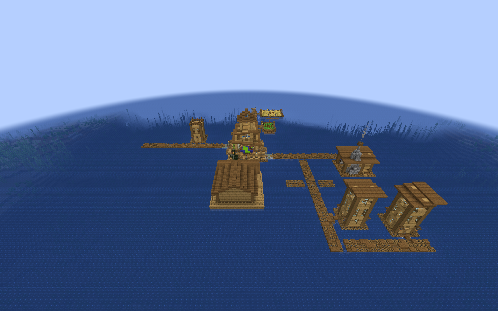

# Regional Armory village integration

The optional regional Armory packs add compact storehouses and supply yards
at village street ends. Each building uses the normal public Village Armory,
one-time initial stock, and a separate entrance sentry duty. They do not
create a new garrison. The [furnished previews](regional-armory-preview.md)
remain available for manual decoration and architectural review.



## Build and install

Build the current mod and integration datapacks:

```sh
./gradlew build regionalArmoryIntegration
```

The files are in `build/distributions/`:

| Filename suffix | Designs | Village provider |
| --- | --- | --- |
| `regional-armories-vanilla.zip` | Plains, Desert, Savanna, Taiga, Snowy | Vanilla villages |
| `regional-armories-tidal-towns.zip` | Deep ocean | Tidal Towns 1.3.4 |
| `regional-armories-mmv.zip` | Jungle and Swamp | Moog's Missing Villages 2.1.1 |

Each filename begins with `villager-guard-gunners-`. Install the packs you
need in a fresh test world's `datapacks` directory. Use the newly built mod
JAR with Guard Villagers and Timeless and Classics Zero (TaCZ), plus each
selected provider's required dependencies. Enable **Generate Village Defense
Buildings** (`villageBuildings.enabled`) and leave **Village Armory Buildings**
(`villageBuildings.armories`) enabled. The master switch is off by default.
Restart the server or reopen the world after changing building entries. `/reload` alone does not replace live
village pools, and existing generated villages are unchanged.

These packs work alongside the [regional Barracks packs](regional-barracks-integration.md).
With both complete families installed, the 25 built-ins and 32 regional
entries total 57 definitions across thirteen target pools. The current mod
supports 192 definitions and twenty-four pools. Older builds with the 50-definition
cap cannot load that full combination. Existing layouts are retained.

Provider packs require their matching mods. Missing target pools produce a
startup validation error; the packs do not redirect ocean or MMV structures
into ordinary land villages. The packs contain no replacement provider pools.

CTOV, Integrated Villages, Sky Villages, and Villages&Pillages' custom Witch
villages use separate pools. Install the additional [custom village Armory
packs](custom-village-armories.md) for the reviewed themes listed there. The
regional packs alone do not add buildings to those custom villages.

## Frequency and road connections

Each entry has weight 1. Vanilla land layouts use `selection_chance: 0.5`;
Tidal Towns and MMV retain `0.25`. The chance determines whether the layout enters a
shuffled candidate list before Minecraft checks connection and available
space. It is not a percentage of villages or a per-village building cap.
A village can contain multiple Armories or none, especially when other large
buildings compete for the same street ends.

Land and MMV entries use their provider's `terminators` pools. Their larger
footprints can then terminate a road instead of trying to fit a small house
plot along its side. Tidal Towns uses `joshie:village/ocean/roads`, which can
end a floating-road branch at an Armory. This can change the village's size
and road arrangement. Other mods that replace vanilla village pools still
need their own fit and traffic trials.

Every template has one north-facing entrance connector with an empty
continuation pool. Its name is `minecraft:street` for vanilla and Tidal Towns,
and `mmv:street` for Jungle and Swamp. A new two-block-wide apron at local
Z=0 shifts the original architecture one block south, preserving doors,
Snowy pressure plates, furniture, and roof margins. Integration templates
are therefore one block deeper than their previews.

Ordinary land layouts join at standing-floor level. Ocean, Jungle, and Swamp
use a bottom-slab apron followed by their existing half-step landing and
full raised deck. The jigsaw final state is a slab without a directional
property, so it remains correct in all rotations. Foundations stay finite;
terrain, water levels, and neighboring roads still determine the final fit.
Occasional awkward terrain placement remains possible.

## Registration and stock

Templates and definitions use `vggarmories:armory/<region>/<layout>`. The
occupied Armory in each preview becomes one `village_anchor:armory` data
marker in its integration template. Normal village placement clears that
marker, records the building, and creates the public Armory through the
existing lifecycle. Preplacing an empty Armory would bypass that setup, so
the integration template deliberately contains no functional Armory block.

Initial ammo uses `villagerguardgunners:chests/village_armory` and the normal
placement/stock configuration. Claimed setup and generated identity persist
with the building and block entity; repeated activation must not refill an
Armory or replace player stock. The single `entry_sentry` duty uses the
reviewed sentry position relative to the Armory and rotates with the building.
The building adds a duty location, not a guaranteed new guard.

A direct `/place template` command does not run this registration workflow
and can leave data markers and jigsaws visible. Use the architecture preview
pack for manual decoration, or generate fresh villages with the integration
pack to test lifecycle behavior.

## Authoring and validation

The [integration writer](../tools/build_regional_armory_integration.py) reads
both Plains previews and all fourteen regional previews. It authors native
NBT directly, with one additional entrance row. It does not expand the
schematic layout compiler's sixteen-block axis or 4,096-block volume limits.
The largest resulting Armory envelope is the Snowy yard at 17 × 21 × 12,
which contains 4,284 cells. The preview builders validate the source geometry; decoded-NBT tests compare
the complete integration output. Packaged Minecraft placement is the final
native-format check.

```sh
python3 -m unittest discover -s tools/tests -p 'test_regional_armory*.py'
```

Decoded-NBT tests compare every original architectural block with its shifted
integration counterpart, except the intentional Armory marker replacement.
They check all shifted coordinate schedules, doors, thresholds, one connector,
provider names, duty offsets, and the expanded Snowy envelope. Runtime tests
accept the 71-entry combination with custom village adapters and the
192-entry boundary, and reject 193 entries before mutating live pools.

The isolated natural-generation observer uses the unchanged pack weights.
It normally searches up to nine origins for a village containing a requested
regional entry and records empty samples. Targeted QA metadata can extend the
bounded search to twenty-five origins for rare layouts, without changing
player packs or their selection weights. A missing regional building is not a pass.
For selected pieces, it checks registered generated identity, public access,
initial-stock claims, rotation, a supported road approach, and native paths
to service space. It checks both entrance lanes for dry standing room and
head clearance; an overhanging tree canopy is not treated as road support.
A temporary guard then walks from the actual road to the
service area and back using scripted goals with native navigation and doors.
Minecraft limits each path search by the guard's follow range; the observer
records whether its first path reaches the destination outright. A partial
path can pass only if repeated native searches complete the entire walk.
A path that stalls still fails the walking timeout.

The persistence trial first observes generated ammo, then replaces the
remaining stock with seven rounds carrying a custom test tag. Resident guard
AI is paused in that disposable world to isolate persistence from consumption.
After a full game restart, the test compares every inventory slot, tag,
building identity, and action claim, then retries activation to verify that
it does not refill or overwrite the saved stock. This controlled stock trial
is separate from the ordinary resupply trials in the preview guide.

Saved chunks can also be checked for water or lava in the scheduled standing,
work, service, and sentry cells:

```sh
python3 tools/audit_regional_armory_world.py <completed-run-directory>
```

This check compares the saved road support with the native observation and
examines occupied body space above the floor. Water beneath a dry boardwalk
is expected.

## Packaged verification

The completed trials used the packaged Villager Guard Gunners 1.6 JAR in
ordinary Minecraft 1.20.1 with Forge 47.4.10, Guard Villagers 1.6.19, and
Timeless and Classics Zero (TaCZ) 1.1.8-hotfix. Tidal Towns 1.3.4 and
Moog's Missing Villages 2.1.1 supplied the ocean, Jungle, and Swamp villages.

All sixteen layouts appeared through natural generation and passed the
complete road-to-service-and-back walk. Twenty-three successful client
launches covered seventeen fresh Armories and ten reloaded Armories, with
54 completed walking legs. The combined Barracks and Armory installation
loaded all 57 definitions; supplementary Armory-only trials loaded all 41.
Both setups reported no missing pools, missing resources, invalid templates,
or rejected entries.

| Region | Natural placement and walking | Stock checked after restart |
| --- | --- | --- |
| Plains | Compact and supply yard | Supply yard |
| Desert | Compact and supply yard | Compact |
| Savanna | Compact and supply yard | Both |
| Taiga | Compact and supply yard | Compact |
| Snowy | Compact and supply yard | Compact |
| Deep ocean | Compact and supply yard | Compact |
| Jungle | Compact and supply yard | Compact |
| Swamp | Compact and supply yard | Compact |

The saved-chunk audit found no water or lava in the 1,236 scheduled standing
positions across those seventeen fresh Armories. Build validation also passed
886 Java unit tests and twelve Armory drawing, preview, and integration tests.
The earlier preview trials cover all four rotations separately; these natural
samples do not repeat every layout in every rotation.

Some targeted searches found no requested layout and were retained as empty
samples. Additional seeds and the supported Armory-only setup supplied the
missing examples. These selected samples establish usable placements, not a
frequency estimate or a guarantee that every village includes an Armory.

Two observer assumptions were corrected during testing. Snowy's longer
entrance needed native partial-path continuation before reaching service.
At the Taiga yard, a tree overhung one road lane; the other lane provided a
clear entrance and return route. Both passed full walking trials without
changing the building or increasing guards' path range.

## Additional installation checks

The same production JAR and all six regional Barracks and Armory ZIP packs
also passed ordinary Forge dedicated-server startup, resource reload, and
full process restart. The server loaded all 57 definitions with no missing
resources, invalid templates, or duplicate entries. This trial used the
player ZIPs directly, a normal saved configuration with buildings enabled,
and no QA helper mod. It verifies server installation and reload behavior;
no multiplayer client joined that server.

Five additional ordinary-client cases exercised the vanilla regional packs
with the downloaded village mods below. Each installed all 45 definitions
from the 25 built-ins and both ten-layout vanilla regional packs. The observed
Armories passed native walking in both directions and saved-chunk dry-space
checks, using unchanged selection weights.

| Installation | Observed layout | Result |
| --- | --- | --- |
| Better Villages 3.3.1 | Plains compact | Placement, walking, generated stock passed |
| Liberty's Villagers 2.0.0 | Plains supply yard | Placement, walking, generated stock passed |
| Better Villages with Liberty's Villagers | Plains compact | Placement, walking, generated stock, and full restart preservation passed |
| Lios Overhauled Villages 0.1.1 | Plains supply yard | Placement, walking, generated stock passed |

These are sampled Armory-access checks. They do not establish compatibility
for every regional layout, every village seed, or every behavior changed by
those mods.

The complete Python tooling suite passed all 64 tests. The downloaded CTOV
3.4.14, Integrated Villages 1.3.2, Sky Villages 1.0.4, and Villages&Pillages
1.0.2 JARs were also inspected for structure-connector and fallback pool
references. Their custom resources do not refer to the eight pools extended
by these regional packs. The regional packs alone do not cover them. Separate
[CTOV and Sky Armory adapters](custom-village-armories.md) now have natural
placement evidence; Clockwork and hostile Witch depots remain excluded.

## Remaining validation limits

The QA metadata and stock checkpoint are not shipped in player packs. These
trials do not establish all-seed terrain safety, natural generation in other
village overhauls, crowded queues, casualty carrying, combat, future flooding,
or complete spawn prevention. Native walking success also does not establish
that ordinary resupply always chooses the front door.

## Updated land-pack settings

The vanilla ZIP also reduces the matching built-in family's selection chance
to `0.25` and enables [terrain screening](village-building-terrain-safety.md)
for its regional layouts. See [frequency balancing](village-defense-balance.md#regional-pack-frequency).
Earlier layout samples in this guide predate these land-pack setting changes.
