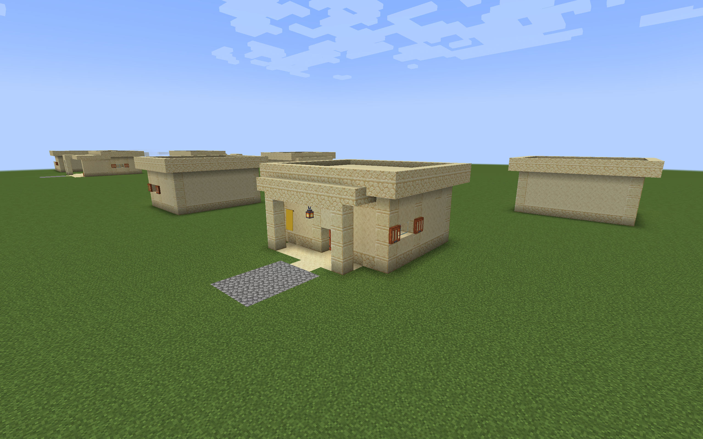
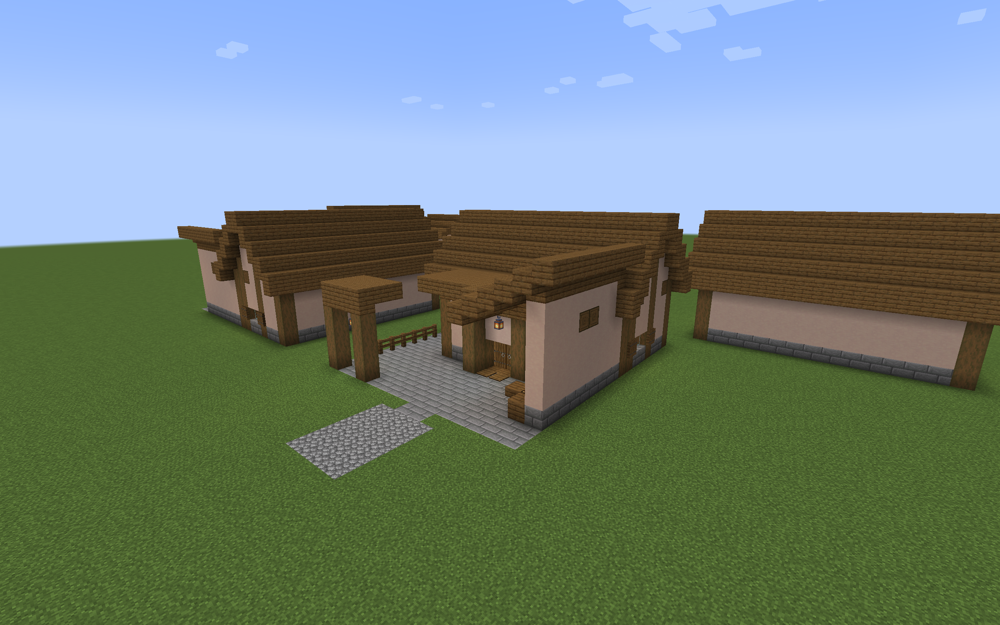
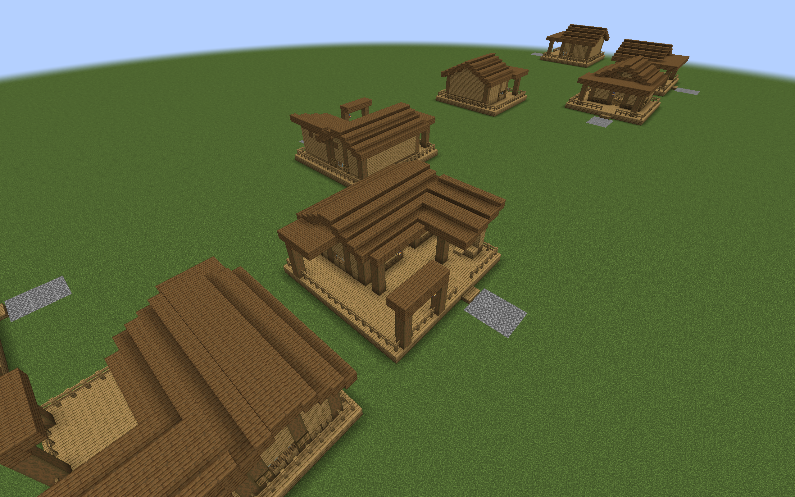
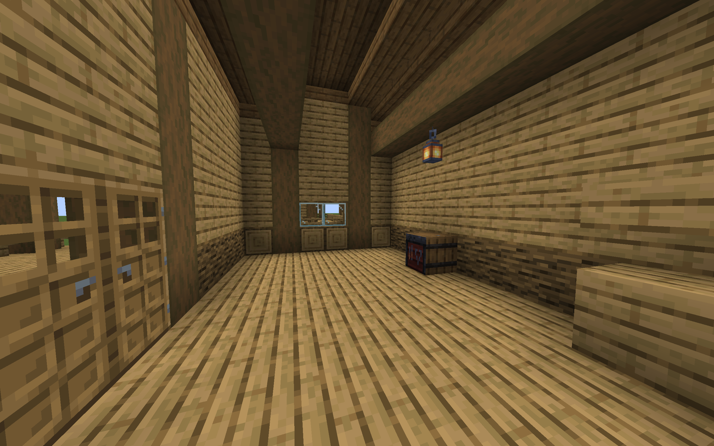

# Regional Village Armory previews

The seven regional Armory pairs now have furnished Minecraft templates:
Desert, Savanna, Taiga, Snowy, deep ocean, Jungle, and Swamp. Each compact
storehouse and supply yard follows the [regional drawings](regional-armory-drawings.md)
and contains one real, initially empty Village Armory. The existing
[Plains previews](armory-preview.md) are available separately.

These are architecture datapacks for manual placement in test worlds.
They do not add buildings to village generation or change the mod's defaults.









## Build and place

Run either command from the repository root:

```sh
python3 tools/build_regional_armory_preview.py
./gradlew regionalArmoryPreview
```

The output is
`build/distributions/villager-guard-gunners-regional-armory-preview.zip`.
Put the ZIP in a Minecraft 1.20.1 test world's `datapacks` directory and run
`/reload`. Use the packaged Villager Guard Gunners, Guard Villagers, and
Timeless and Classics Zero (TaCZ) JARs and their required dependencies.

Choose a clear, level plot. On grass, these examples put the architectural
base at ground level:

```mcfunction
/place template vggpreview:armory/desert/compact ~ ~-1 ~
/place template vggpreview:armory/snowy/supply_yard ~ ~-1 ~
/place template vggpreview:armory/ocean/supply_yard ~ ~-1 ~
```

Replace the region with `desert`, `savanna`, `taiga`, `snowy`, `ocean`,
`jungle`, or `swamp`. Both `compact` and `supply_yard` are available for each.
The origin is the northwest corner, including the roof margin. The dimensions
are listed in the [drawing index](regional-armory-drawings.md#drawing-index).

Land layouts have walking feet at local Y=1. Ocean, Jungle, and Swamp have
full decks at Y=1, standing feet at Y=2, and a finite underside at Y=0.
Their first landing is a bottom slab with its top at Y=1.5. Connect a test
approach with its walking surface at local Y=1 to exercise that half-step.
This is a controlled test elevation, not a measured provider-road connection.

Placement clears the envelope from the standing floor upward. Foundation
cells are placed only beneath the authored footprint. Use an empty plot:
the template neither adapts to terrain nor preserves objects inside its
cleared volume. Fill the Armory with compatible ammo to exercise ordinary
resupply.

## Native construction

The [preview author](../tools/build_regional_armory_preview.py) reads the
same geometry as the drawings. It writes native structure NBT directly,
without changing the layout compiler's bounds. Roof volumes use bottom,
top, and double slabs, retaining the half-block courses and separate canopy
heights. Overlapping courses are combined. At support junctions, a double
roof slab seals the end of a wall, post, or beam so a partial slab cannot
leave a gap above it.

The Taiga compact gable continues over its deep porch. The ocean yard's
frontage slopes into the rear store roof. Snowy retains both offset door
pairs and the clear lobby turn. Spruce pressure plates on both sides of each
Snowy door pair open the sheltered thresholds for approaching guards. Raised decks use connected wooden fences
beside their circulation areas. Glazing and shutters retain their scheduled
positions, and hanging lanterns have solid support undersides.

Furniture uses the scheduled native blocks: top-slab worktops, bottom-slab
seats, wooden crate shapes, and shelves with full bases and upper top slabs.
Only the Village Armory stores ammo. There are no additional inventories,
profession blocks, medical services, or garrisons.

The pack contains no building definitions, pool entries, jigsaw connectors,
spawn markers, loot tables, or stocked inventories. Manual placement does
not register a defense building or assign its planned service sentry.
Natural generation, generated stock, saved building records, and provider
connections are provided separately by the
[optional integration packs](regional-armory-integration.md).

## Validation workflow

```sh
python3 tools/draw_regional_armories.py --check
python3 -m unittest discover -s tools/tests -p 'test_regional_armory*.py'
```

The tests decode the generated NBT and check native size order, scheduled
furniture, landing heights, retained roof courses, support undersides,
banner block entities, empty metadata, and reproducible output. Drawing
checks retain the reserved routes and open courts.

The disposable packaged-client helper reads `vggpreview:armory_manifest.json`
through the existing `barracksDesignPreview` runner mode. Use a fresh isolated
world and at most four layouts per test plot. To build a smaller test pack,
use `--regions desert snowy` with separate `--output` and `--zip` paths.
Keep those packs separate from the Plains preview: their QA manifests share
a resource name.

The helper checks native placement in four rotations, Armory orientation,
detail survival, route collision, floor support, and actual landing heights.
It captures exterior, roof, interior, night, and yard rain views. Two guards
per rotation walk from the approach to a work area, then supplies, then back
outside using scripted goals with native navigation and door opening.
Separate armed guards use ordinary goals to seek ammo. A resupply success
alone does not prove front-door use because the current transfer range can
permit withdrawal beside an exterior wall.

All fourteen layouts passed the controlled packaged-client trials on
Minecraft 1.20.1, Forge 47.4.10, Guard Villagers 1.6.19, TaCZ 1.1.8-hotfix,
and Villager Guard Gunners 1.6. The trials covered 56 rotated placements;
112 guards completed 336 walking legs. Each layout's ordinary resupply
trial moved 60 rounds from a 64-round source into guard reserves, leaving
four rounds in the Armory. The 61 sampled work, service, lobby, and refuge
positions had block light levels 8–12 and remained sheltered during rain.
All seven yards retained their open 4 × 4 courts.

An initial trial found guards bunching at Snowy's door pairs during the
return journey. Adding pressure plates to both sides of those sheltered
thresholds resolved the jam in the rerun. This is a native construction
refinement; it changes neither guard AI nor the lobby dimensions.

These are controlled architectural trials. They do not establish natural
village fit, provider-road height, uneven-terrain behavior, casualty-carrier
clearance, crowded queues, combat behavior, generated-stock persistence, or
complete roof and floor spawn prevention. The
[integration guide](regional-armory-integration.md) describes natural-road
and stock-persistence trials and the separate runtime definition-cap change.
