# Regional Sentry Post previews

Seven regional pairs extend the [Plains Sentry Posts](sentry-post-preview.md)
with furnished roadside shelters and gateway lodges. They keep the watch bay
beside the walking route and give each setting its own materials, roof, and
weather shelter. The pack is for manual architectural review; it does not yet
add these buildings to village generation.

## Regional architecture

| Region | Materials and roof | Layout changes |
| --- | --- | --- |
| Desert | Sandstone base, cut sandstone piers, smooth sandstone walls, acacia furnishings | Flat shade roofs and low roof parapets; the lodge has a shaded front loggia |
| Savanna | Acacia frame, warm terracotta walls, acacia roofs | Broad roofs slope on all four sides, with open watch bays and a lower lodge veranda |
| Taiga | Spruce frame and wall panels over stone, steep spruce roofs | Side wind screens enclose the shelter's rear work area; small side windows retain light |
| Snowy | Spruce frame, pale infill, stone-brick base, steep roofs | Solid side wind screens, roof snow, and extra cover over the arrival landing |
| Deep ocean / Tidal Towns | Timber deck, spruce frame and roof, oak walls, cyan banner | Complete deck perimeter with fences and a two-block entrance; internal routes remain on the deck |
| Jungle / MMV | Mossy stone plinth, jungle timber and wall panels, jungle roof | Raised platform, perimeter fences, broad hipped roofs, and foliage-free walking and firing spaces |
| Swamp / MMV | Mud-brick base and wall panels, dark-oak timber and roof, brown banner | Raised boardwalk platform and fenced perimeter, with a sheltered return route through the building |

The lodge has a small enclosed rest room with paired wooden doors. The watch
bay stays outside those doors. Each layout contains one crafting table and
decorative benches, with no beds, stocked containers, or extra services.
All variants use vanilla blocks.

The raised platforms have only one intentional perimeter opening: the
supported two-block entrance. That opening still needs a real road or
boardwalk connection when the buildings are integrated into a village.
The preview supplies its own platform underside; it does not find the seabed
or generate piles down to terrain.

## In-game views

| Region | Roadside shelter | Gateway lodge |
| --- | --- | --- |
| Desert | 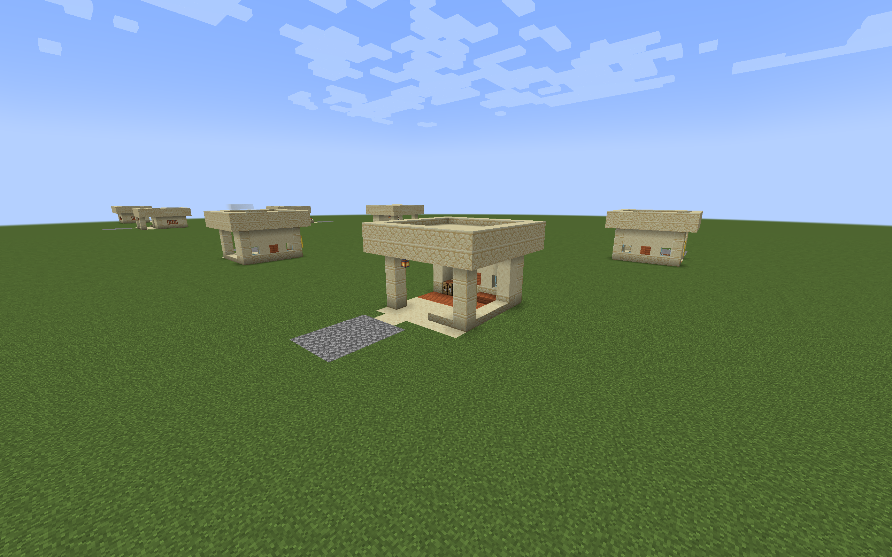 | 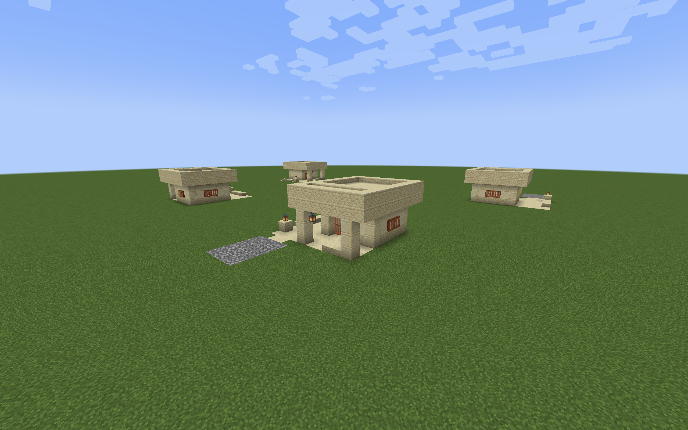 |
| Savanna | 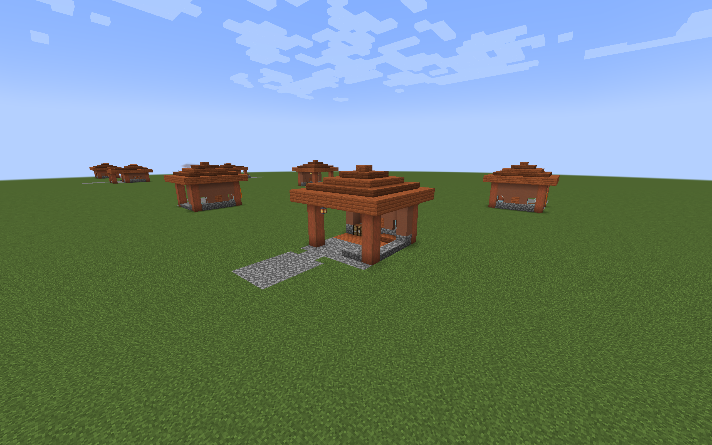 | 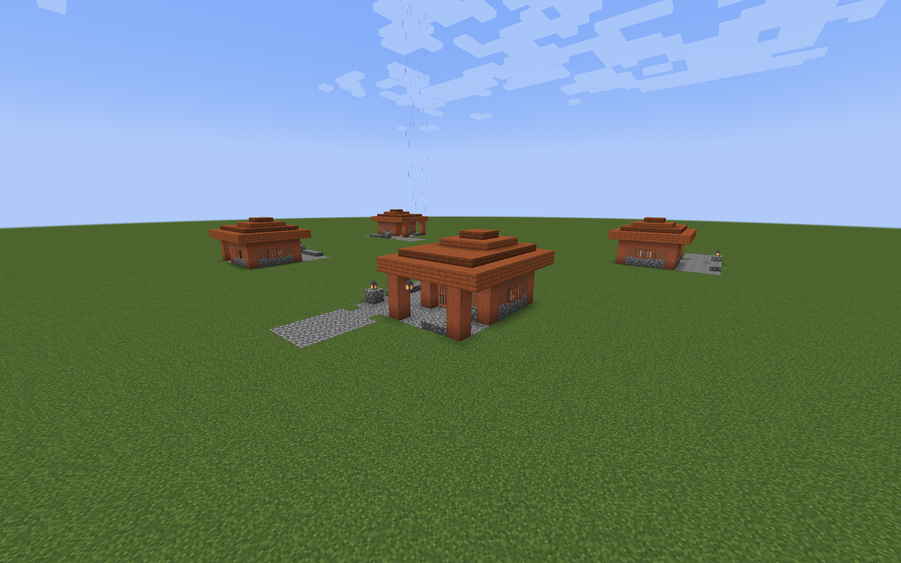 |
| Taiga | 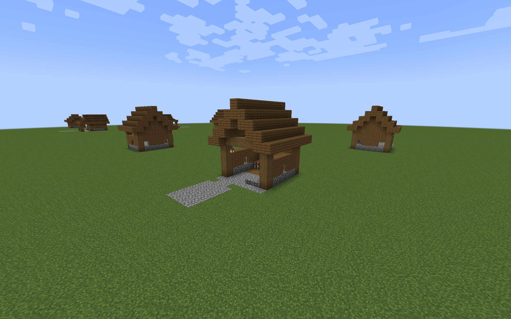 | 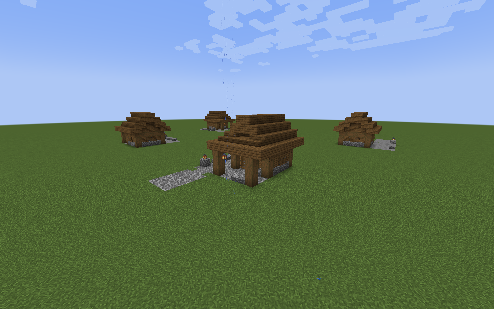 |
| Snowy | 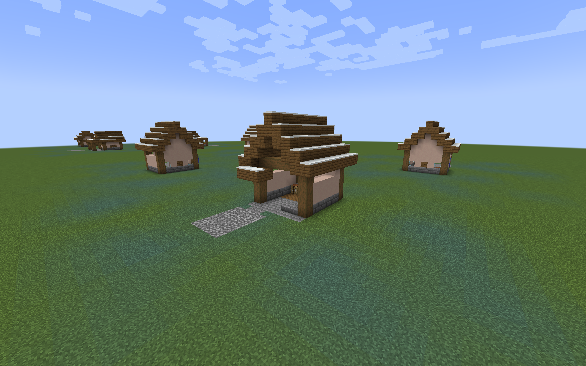 | 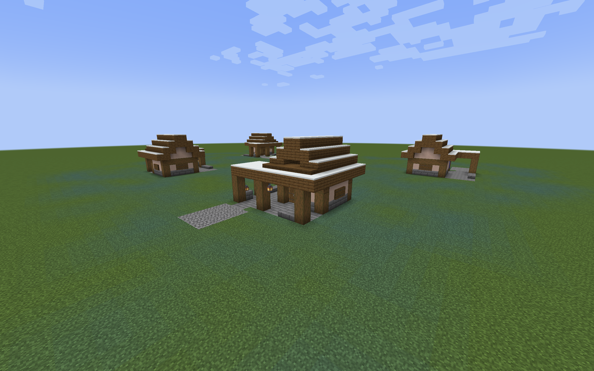 |
| Ocean | 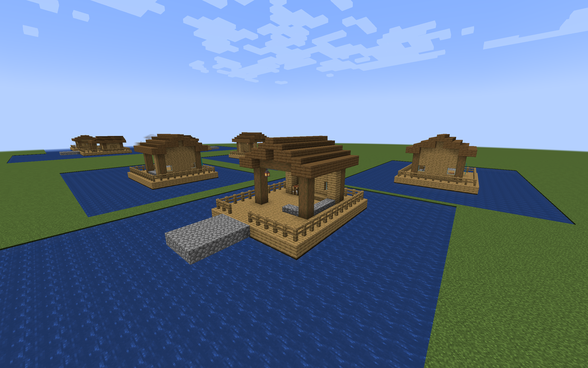 | 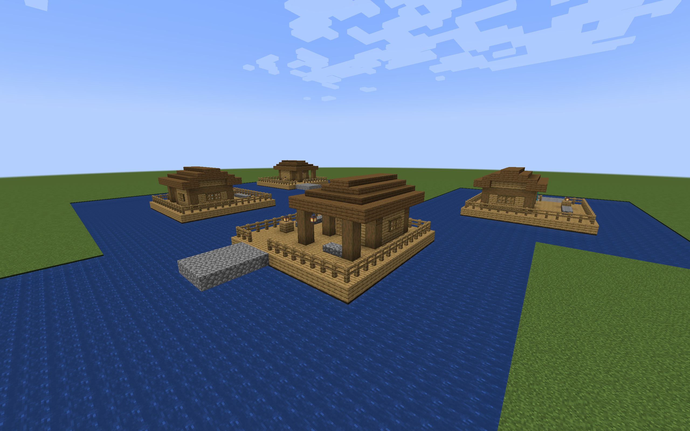 |
| Jungle | 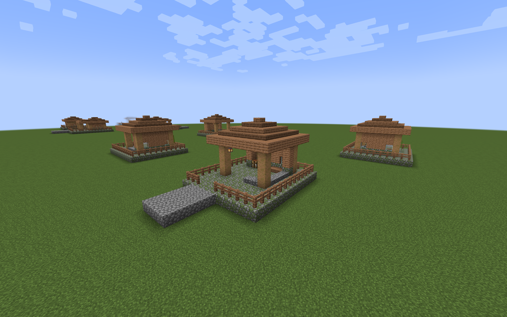 | 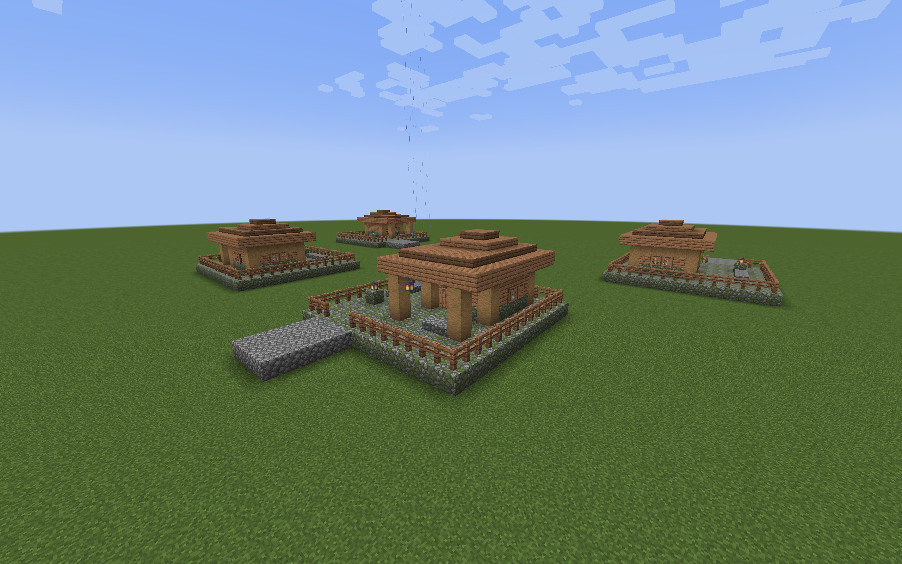 |
| Swamp | 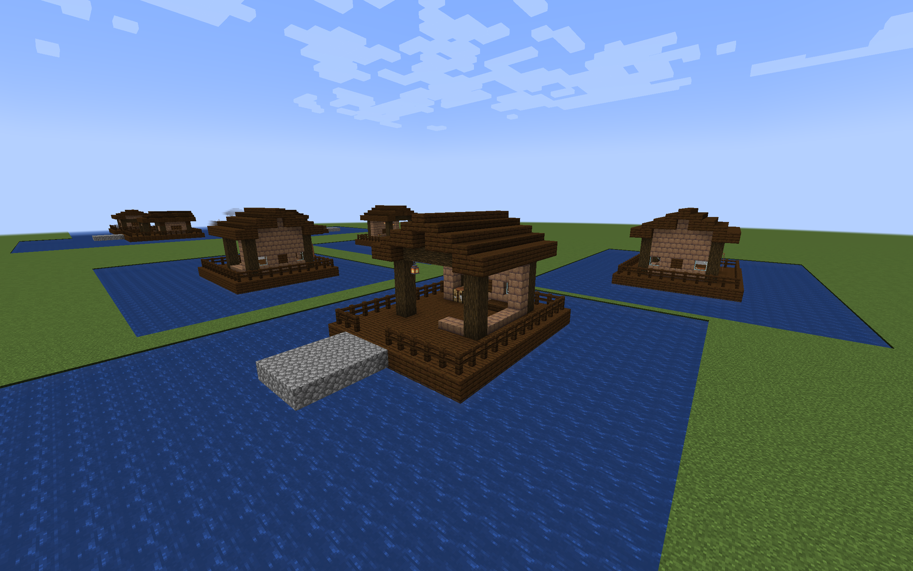 | 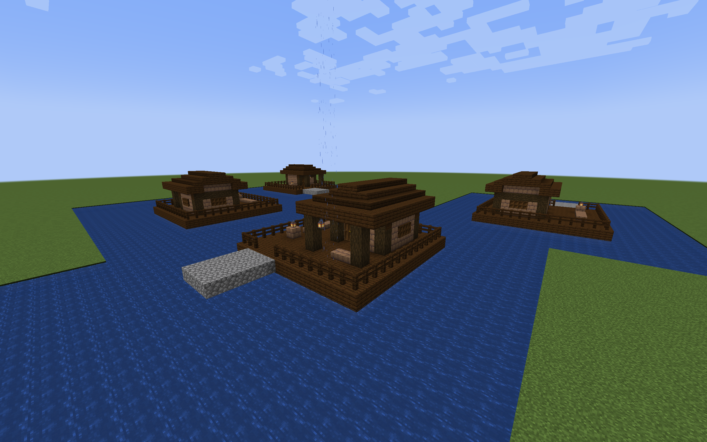 |

## Build and place

Run either command from the repository root:

```sh
./gradlew regionalSentryPostPreview
python3 tools/build_regional_sentry_post_preview.py
```

The output is
`build/distributions/villager-guard-gunners-regional-sentry-post-preview.zip`.
Put the ZIP in a Minecraft 1.20.1 test world's `datapacks` directory, then run
`/reload`.

For Desert, Savanna, Taiga, and Snowy, stand at the intended walking height and
place the template one block below your feet:

```mcfunction
/place template vggpreview:sentry_post/desert/roadside_shelter ~ ~-1 ~
/place template vggpreview:sentry_post/desert/gateway_lodge ~ ~-1 ~
```

Replace `desert` with `savanna`, `taiga`, or `snowy` as appropriate. Ocean,
Jungle, and Swamp use a raised platform with standing feet at local Y=2. To
align that deck with your current standing height, place its origin two blocks
below your feet:

```mcfunction
/place template vggpreview:sentry_post/ocean/roadside_shelter ~ ~-2 ~
/place template vggpreview:sentry_post/ocean/gateway_lodge ~ ~-2 ~
```

Replace `ocean` with `jungle` or `swamp` for those pairs. All entrances face
north. The command origin is the northwest corner, including roof or deck
margins. Place in clear space: templates clear the volume above their floor.
The preview does not automatically join roads or adapt to slopes.

For guard behavior tests, use packaged Villager Guard Gunners, Guard Villagers,
and Timeless and Classics Zero (TaCZ), with their dependencies. Manual
placement does not create a guard or assign a duty. Tidal Towns and Moog's
Missing Villages are the architectural contexts for the corresponding themes;
their natural village roads are covered by the separate
[integration packs](regional-sentry-post-integration.md).

## Dimensions

| Region | Roadside shelter: width × depth × height | Gateway lodge: width × depth × height | Standing feet Y |
| --- | --- | --- | --- |
| Desert | 9 × 10 × 7 | 12 × 11 × 6 | 1 |
| Savanna | 9 × 10 × 8 | 12 × 11 × 7 | 1 |
| Taiga | 9 × 10 × 10 | 12 × 11 × 8 | 1 |
| Snowy | 9 × 10 × 11 | 12 × 11 × 9 | 1 |
| Ocean | 11 × 13 × 9 | 14 × 14 × 8 | 2 |
| Jungle | 11 × 13 × 9 | 14 × 14 × 8 | 2 |
| Swamp | 11 × 13 × 9 | 14 × 14 × 8 | 2 |

## Authoring contract

The [regional builder](../tools/build_regional_sentry_post_preview.py) reuses the
Plains floor reservations and authors regional roofs, wall screens, platforms,
and perimeter protection. It writes native structure NBT and a reproducible
ZIP. Use `--regions`, `--output`, and `--zip` to build a selected subset.

The generated manifest records width, height, depth; standing feet height;
watch and work positions; doors; light and detail locations; and the required
perimeter fence cells. Those positions are preview metadata, not runtime duty
slots or spawn markers. The pack contains no village-building definitions,
loot tables, pool entries, or automatic garrisons.

Raised variants move the Plains layout one block east, one block up, and two
blocks south. Their full platform extends under the complete perimeter. Roof
courses overlap at steep rises so adjacent blocks meet along faces. Side
screens and roof supports stay outside the three-block route reservation;
wooden doors remain the two-block-height exception.

## Test scope

All fourteen final templates passed 56 rotated placements, 224 guard walking
legs, 112 villager passing legs, and 168 firing trials. The 168 sampled
watch/work positions had block light levels 8–11 and shelter from precipitation.
The tested template bytes match the distributable ZIP.

The architecture trials use ordinary Minecraft 1.20.1 and Forge 47.4.10 with
packaged Villager Guard Gunners 1.6, Guard Villagers 1.6.19, and TaCZ
1.1.8-hotfix. Tidal Towns 1.3.4 is installed in the Ocean trial; MMV 2.1.1 and
its structure-library dependency are installed in the Jungle and Swamp trials.
These are controlled plots, not naturally generated villages.

Each pair is placed in four rotations. The observer checks native block
attachments, full floor support, reserved route clearance, and the raised
platforms' required fence cells. Scripted movement goals use native navigation
and wooden-door opening to walk guards through the watch bay, rest area,
crafting approach, and exit. Villagers pass beside a stationary test sentry
in a separate traffic trial. Neither trial teleports entities after placement.

Fresh armed guards then use ordinary combat goals with Hold Position and a
loaded TaCZ AK-47. Straight-ahead targets and targets five blocks to either
side test three forward lanes. Success requires actual target damage, ammo
consumption, and the guard staying within 1.5 blocks of the watch position.
Traffic and gunfire are separate trials; they do not establish crossing-fire
safety or behavior under crowd pressure.

The Ocean and Swamp plots surround the platforms with water and provide
supported test approaches at deck height. Walking entities must remain dry and
at platform height. The Snowy plot uses a cold biome and precipitation. Roof
snow is also authored into the templates. Sampled work and watch positions
must remain lit and sheltered. This is a short weather trial, not a long-term
snow-accumulation or hostile-spawn guarantee.

The [integration guide](regional-sentry-post-integration.md) covers natural
placement, road connections, and garrison creation and reload. Broad slope
adaptation, casualty carrying, and larger combat scenarios remain separate work. The preview pack does not change existing Sentry
Posts, guard caps, village-pool weights, or automatic patrol rules.
