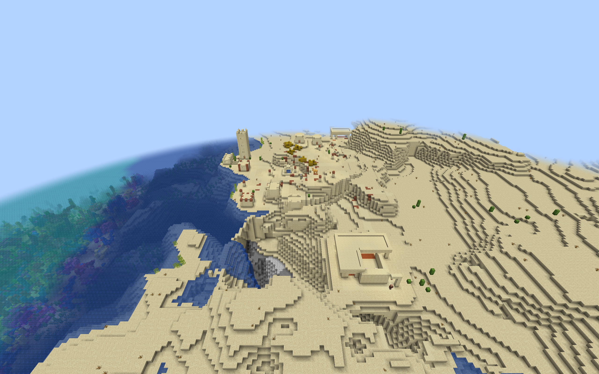
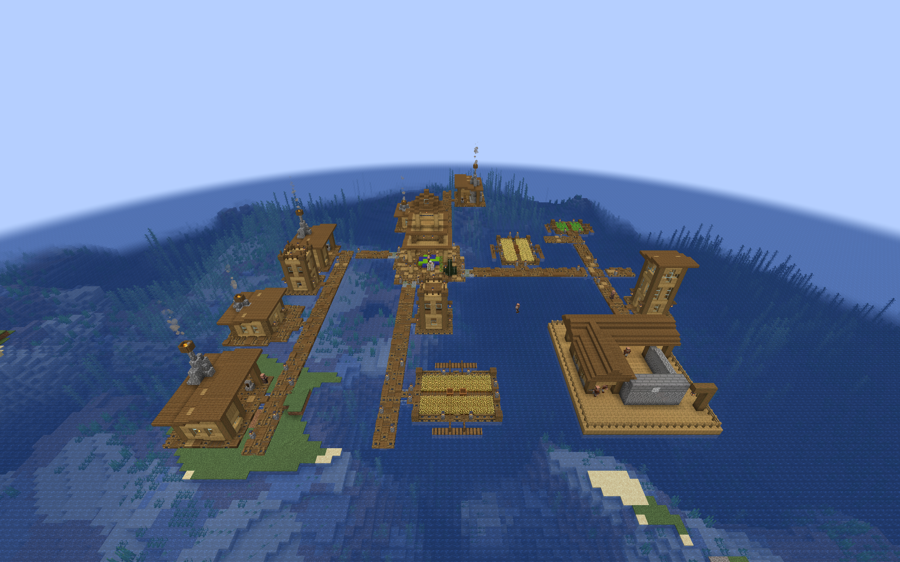

# Regional Training Yard village integration

Optional packs add furnished practice yards and drill courtyards to newly
generated villages. Both layouts retain two initial guard positions and two
south-facing drill duties, with the existing difficulty, population, and
gun-loadout settings. The larger courtyard adds shelter and circulation.

## Build and install

Run `./gradlew regionalTrainingYardIntegration` from the repository root.
The ZIPs appear in `build/distributions/`:

| Suffix after `villager-guard-gunners-regional-training-yards-` | Villages | Layouts |
| --- | --- | --- |
| `vanilla.zip` | Plains, Desert, Savanna, Taiga, Snowy | 10 |
| `tidal-towns.zip` | Tidal Towns deep-ocean villages | 2 |
| `mmv.zip` | Moog's Missing Villages Jungle and Swamp | 4 |

Put the desired ZIPs in the world's `datapacks` directory. Install the
corresponding village mod and its dependencies for the Tidal Towns or MMV
pack. Enable **Generate Village Defense Buildings** (`villageBuildings.enabled`)
and leave **Training Yards** (`villageBuildings.trainingYards`) enabled.
The master building switch is off by default.

Restart the server or close and reopen the world after changing generation
packs. `/reload` alone does not replace installed village pools. Only newly
generated villages can select these yards. They are additional choices
alongside the smaller built-in yards.

The [Plains](training-yard-preview.md) and
[regional](regional-training-yard-preview.md) manual previews remain available
for architectural review. The integration ZIPs contain only player resources;
their generator and disposable test observer are separate tools.

## Entrances and selection

Each yard has one outward road connector and a two-wide apron, adding one
block to its preview depth. Three blocks of body and headroom are cleared
above the apron. Land entrances use a full floor; Ocean, Jungle, and Swamp
use a bottom-slab step onto the raised, railed platform. The slab's final
state has no facing property and works in every rotation.

Vanilla and MMV entries target the region's `terminators` pool. Ocean entries
target `joshie:village/ocean/roads`. MMV uses `mmv:street` connectors; the
others use `minecraft:street`. These are branch-end yards with a side entrance,
not through-roads. Normal circulation passes behind the firing line and
alongside the target field.

Each entry uses rigid projection and weight `1`. Selection chance is `0.5`
for vanilla land layouts and `0.25` for Tidal Towns and MMV.
The chance applies to individual placement choices, not whole villages.
Actual frequency depends on available space and the other entries in the
pool. No new village-wide building cap is introduced.

The sixteen entries bring the regional collection plus custom Armories and
built-ins to 119 definitions across 20 target pools. Adding the twelve
[CTOV Barracks](custom-village-barracks.md) brings that collection to 131.
The [complete CTOV family collection](custom-village-training-yards.md) brings
that installation to 167 definitions across the same 20 pools. Including
the remaining [Sky building families](sky-village-defense-buildings.md) brings
the full installation to 175 definitions.
The current runtime permits 192 definitions and 24 pools. Other datapacks
count toward those same limits.

## Guard and duty behavior

One DATA marker becomes clear air and records the building's initial garrison
action once. Initial cells remain adjacent, using offsets `[0,0,0]` and
`[-1,0,0]` from the anchor. Peaceful creates no guards; Easy can supply a
rifleman and an optional marksman; Normal supplies a rifleman and marksman;
Hard supplies a breacher and marksman. Population, garrison, and valid spawn
position settings can reduce these counts. Configured gun-loadout rules
apply separately.

The authored duties are `firing_center` at `[1,0,0]` and `firing_west` at
`[-2,0,0]`, both facing local south, with kind `drill` and weapon requirement
`ranged`. Rotation transforms the duties with the building. These positions
are three blocks apart and align with the decorative targets.

Drill duties are available during Peace and Recovery and inactive during
Watch, Alert, and Siege. Guards need a compatible weapon and executable
orders to take them. Hold Position or Patrol Bound can prevent travel to a
different duty cell. Reopening the world must preserve the garrison claim,
guard identities, and authored duty layout.

The yards provide positions for the existing defense system. They do not
add automatic practice fire, training rewards, loot, beds, or supply services.
The masonry backstop is architectural containment; it does not guarantee
that every TaCZ gun, ammo type, or penetration setting stops there.

## Placement limits and checks

The named pools establish the intended adapters. CTOV, Integrated Villages,
Sky Villages, and other providers with custom pools need separate road and
terrain reviews. A loaded pack does not establish fit with their roads.

Foundations have finite depth and do not extend automatically to the seabed.
These packs do not level surrounding terrain or reject every submerged road
branch. Earlier building tests found a Savanna road descending into a river
and flooding the attached building. Similar terrain remains a concern for
yards attached at that road height. Exposed foundation seams or nearby foliage
are acceptable polish issues; flooded duties or unreachable entrances are
failed placements.

Natural-placement checks use ordinary packaged Minecraft 1.20.1 / Forge
47.4.10 with Guard Villagers, TaCZ, and the corresponding village mods. The
observer searches actual generated villages at unchanged pack weights,
checks floor support and dry standing cells, and walks a disposable guard
from the real road through eight yard destinations and back outside. The
terrain and road are not replaced with a flat fixture. A full process restart
checks the same natural guards and duties and repeats the walking routes.

The separate architectural previews cover controlled four-rotation placement,
passing villagers, supported details, sampled live gunfire, and limited
snow-layer behavior. Natural road samples cannot establish universal terrain
compatibility. Automatic Peace/Recovery staffing and readiness transitions
need a separate natural-resident exercise; preserving duty data alone does
not prove those behaviors.

## Recorded coverage

All sixteen layouts passed a fresh-generation case and a full-process restart
case in ordinary Minecraft 1.20.1 / Forge 47.4.10 using packaged Villager Guard
Gunners 1.6, Guard Villagers 1.6.19, and TaCZ 1.1.8-hotfix. Tidal Towns 1.3.4
and MMV 2.1.1, with Moog's Structure Lib 3.1.2, were installed in the matrix.

The 32 successful runs covered 17 naturally selected yards and the same yards
after reopening, 272 completed walking legs, and 2,984 audited standing
positions. Every observed yard supplied two initial guards on Normal, for
34 guards across the fresh samples. Repeated activation added none. Full
restarts preserved their UUIDs, garrison action claims, and two rotated duty
slots. Installed templates and definitions matched the player ZIPs byte for
byte; the main mod JAR remained unchanged throughout the tests.

| Region | Practice yard | Drill courtyard | Full restart |
| --- | --- | --- | --- |
| Plains | Passed | Passed | Both |
| Desert | Passed | Passed | Both |
| Savanna | Passed | Passed | Both |
| Taiga | Passed | Passed | Both |
| Snowy | Passed | Passed | Both |
| Ocean / Tidal Towns | Passed | Passed on second seed | Both |
| Jungle / MMV | Passed | Passed on second seed | Both |
| Swamp / MMV | Passed | Passed on second seed | Both |

Most cases used seed `314159`. Both Savanna layouts used `314160` because
earlier building tests had already documented a flooded road on the first
seed. The Ocean, Jungle, and Swamp courtyards each had no selected piece in
25 searched villages on `314159`; each then generated and passed on `314160`
without changing its template, weight, or selection chance. Those three empty
searches remain separate from the successful totals. They establish missing
samples, not failed geometry or proof of usable placement.

Large-courtyard frequency remains a balance question. Tidal Towns' 50-block
maximum distance from the village center can restrict space for a 19-by-23
footprint. The searches stop after finding a matching piece, so they are not
an unbiased estimate of village-wide generation frequency. The successful
samples prove fit and access at those locations; they do not establish a
minimum number of yards per village.

An ordinary dedicated Forge server also loaded all 17 optional building ZIPs
together, without the QA helper mod. Startup and full process restart each
installed all 119 definitions across 20 target pools, with no missing pools,
processors, or templates and no invalid templates. `/reload` accepted all
119 definitions on both runs. JAR and ZIP hashes stayed unchanged, and both
processes exited cleanly. This establishes combined resource loading, not
village-wide staffing or multiplayer combat under the full collection.

## Natural village examples

These unedited screenshots show the actual villages used for placement checks.
The [preview guide](regional-training-yard-preview.md) has closer architectural
views of the individual buildings.

Desert courtyard beside the generated road, with the surrounding coastal slope
left intact:

Ocean courtyard connected to a Tidal Towns boardwalk. The sampled approach used
a closed, waterlogged top trapdoor at standing height Y=63, a half-step apron,
and the dry yard deck at Y=64:

## Updated land-pack settings

The vanilla ZIP also reduces the matching built-in family's selection chance
to `0.25` and enables [terrain screening](village-building-terrain-safety.md)
for its regional layouts. See [frequency balancing](village-defense-balance.md#regional-pack-frequency).
Earlier layout samples in this guide predate these land-pack setting changes.
