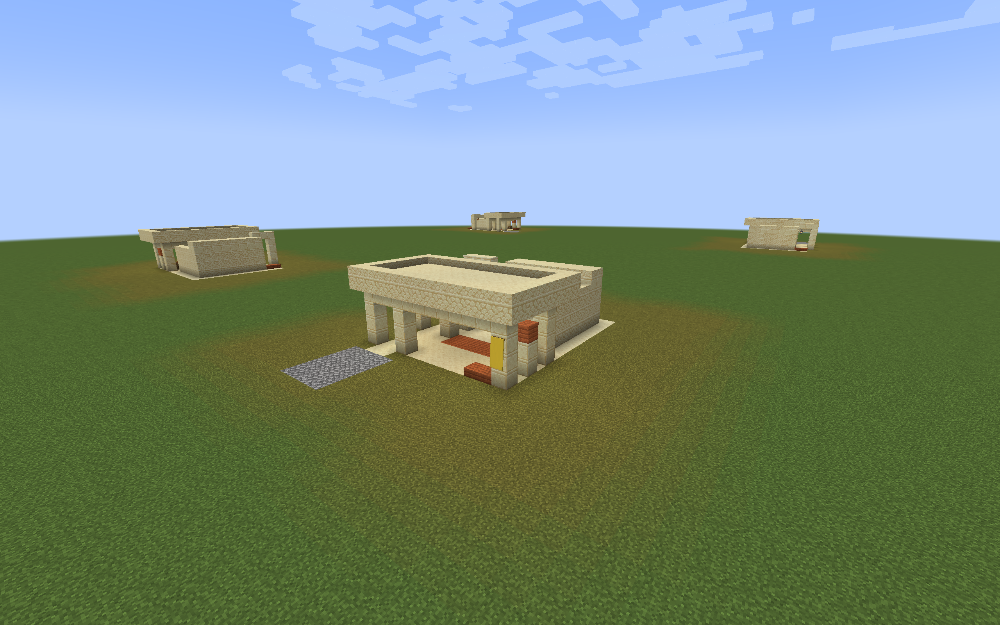
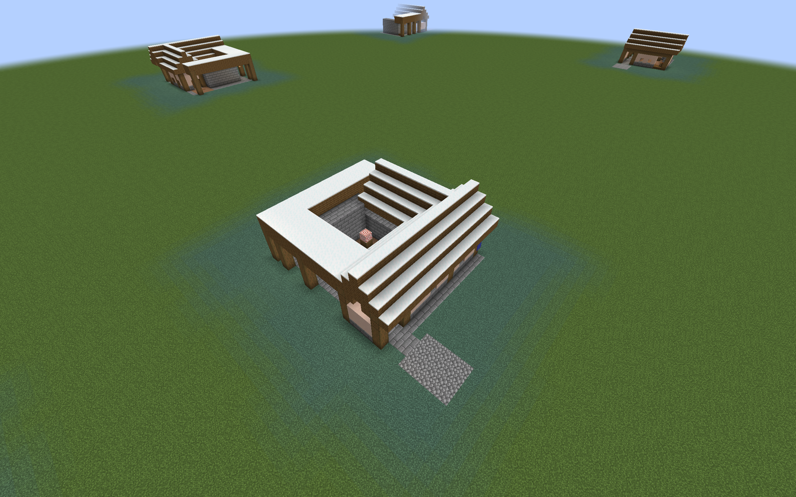
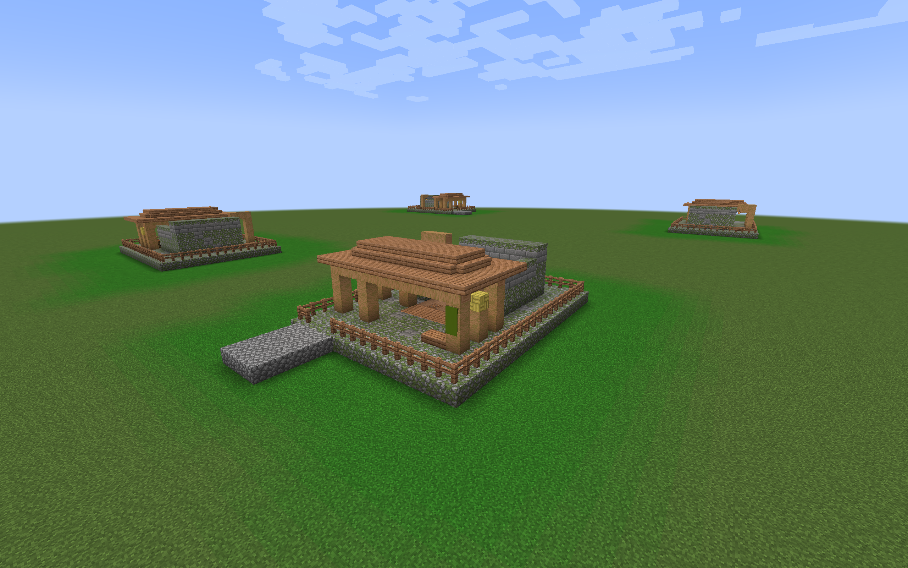
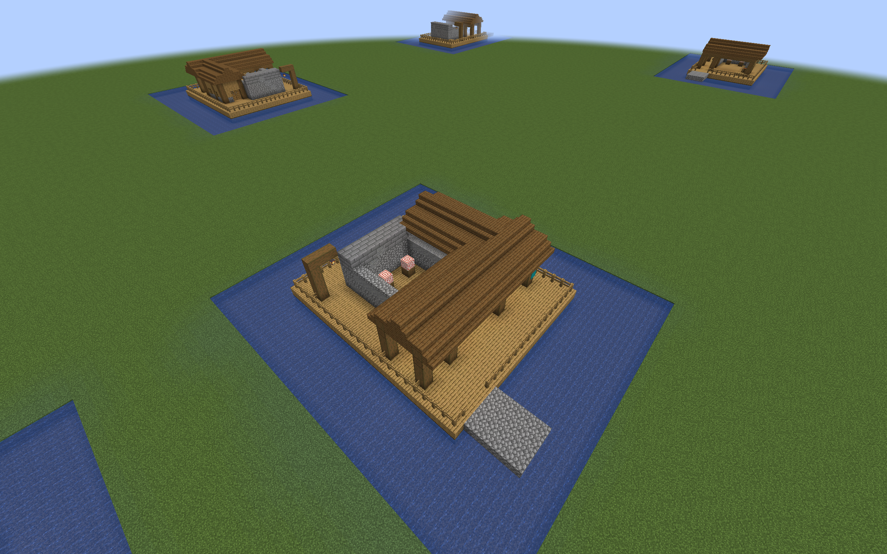

# Regional Training Yard previews

Fourteen furnished Training Yard previews adapt the practice yard and drill
courtyard to Desert, Savanna, Taiga, Snowy, Ocean, Jungle, and Swamp settings.
Each pair retains the Plains layouts' two drill positions, raised targets,
backstop, work space, and clear walking routes.

## Regional architecture

Dimensions below use width × depth × height and include roof margins,
platform edges, and authored snow.

| Region | Practice yard | Drill courtyard | Materials and construction |
| --- | --- | --- | --- |
| Desert | 13 × 17 × 7 | 17 × 19 × 7 | Cut sandstone supports, flat sandstone shade roofs, low parapets, acacia doors, and yellow banners |
| Savanna | 13 × 17 × 7 | 17 × 19 × 7 | Acacia framing, shallow roofs, terracotta range walls, red sandstone caps, and orange banners |
| Taiga | 13 × 17 × 9 | 17 × 19 × 9 | Heavy spruce, stone backstops, steeper roofs, covered side passages, and a covered courtyard rear walk |
| Snowy | 13 × 17 × 10 | 17 × 19 × 10 | Spruce and pale wall panels, stone brick backstops, glazed wind screens, covered service passages, and snow on full roof courses |
| Ocean | 15 × 20 × 9 | 19 × 22 × 9 | Oak decks on spruce foundations, spruce roofs, railed platforms, cyan banners, and masonry backstops supported by the deck |
| Jungle | 15 × 20 × 8 | 19 × 22 × 8 | Raised mossy foundations, jungle timber, shallow roofs, small bamboo insets, and continuous platform rails |
| Swamp | 15 × 20 × 9 | 19 × 22 × 9 | Dark oak boardwalks and frames, mud brick walls and foundations, sheltered work space, and railed dry platforms |

The Ocean pair follows the harbor-deck direction for Tidal Towns. Jungle and
Swamp follow the regional directions for Moog's Missing Villages (MMV).
These are manual previews. The [optional generation packs](regional-training-yard-integration.md)
separately adapt these layouts to provider roads and natural village connections.

The [Plains preview guide](training-yard-preview.md) explains the common
layout and guard-cell reservations. The [design brief](training-yard-designs.md)
records the broader architectural intent.

## Build and place

From the repository root, run either command:

```sh
./gradlew regionalTrainingYardPreview
python3 tools/build_regional_training_yard_preview.py
```

The output is
`build/distributions/villager-guard-gunners-regional-training-yard-preview.zip`.
Place it in a Minecraft 1.20.1 test world's `datapacks` directory and run
`/reload`. Install ordinary packaged Villager Guard Gunners, Guard Villagers,
and Timeless and Classics Zero (TaCZ), with their dependencies, for guard tests.

The templates use vanilla blocks, so viewing them does not require Tidal Towns
or MMV. Those mods matter when reviewing the surrounding village or later
adding natural-generation adapters.

Use the following IDs, replacing `desert` with `savanna`, `taiga`, `snowy`,
`ocean`, `jungle`, or `swamp`:

```mcfunction
/place template vggpreview:training_yard/desert/practice_yard ~ ~-1 ~
/place template vggpreview:training_yard/desert/drill_courtyard ~ ~-1 ~
```

The front faces north. Ground floor blocks occupy local Y=0 and feet stand at
Y=1 in Desert, Savanna, Taiga, and Snowy. In Ocean, Jungle, and Swamp, a foundation
layer occupies Y=0, the deck occupies Y=1, and feet stand at Y=2. To align a raised
preview's deck with an existing level walkway, place its origin two blocks
below the walkway's standing height, for example `~ ~-2 ~` while standing there.

Each template clears its full volume above its floor. Place it in open test
space with level support. Raised previews have finite foundations; they do not
extend pilings to a seabed or automatically join a nearby road.

## Raised platforms and winter shelter

Raised layouts translate the Plains building by `[1,1,2]`, add a full platform,
and place a continuous fence around its outer edge. The two-block-wide entrance
at Z=0 is the only perimeter opening. The practice yard uses entrance X=11..12;
the drill courtyard uses X=15..16. Floors remain dry above the water test surface.

The translation moves both initial cells, duties, targets, doors, and walking
reservations together. Initial guards remain adjacent; authored duties stay
three blocks apart with offsets `[1,0,0]` and `[-2,0,0]` from the anchor. The
preview pack itself creates no guards or assignments.

Taiga and Snowy extend shelter over the east service passage. Their courtyard
also covers the rear route behind the backstop. Snowy adds wind screens behind
and beside the firing veranda while leaving its south-facing target opening
clear. Roof snow sits on full block courses; no snow is authored in walking
lanes or on drill positions.

All yards include one crafting table and two decorative targets. They add no
storage inventories, loot, beds, or automatic practice fire. The backstop remains
masonry in every region, including Ocean; it is not a guarantee against every
TaCZ gun, penetration setting, or explosive effect.

## Validation scope

The [regional builder](../tools/build_regional_training_yard_preview.py) produces
native NBT templates and a separate preview ZIP. Structural checks cover clear
standing cells, connected supports, closed pavilion gables, masonry backstops,
complete platform rails, and consistent guard and target offsets.

All seven pairs passed manual-placement checks in ordinary Minecraft 1.20.1
with Forge 47.4.10 and packaged Villager Guard Gunners 1.6, Guard Villagers
1.6.19, and TaCZ 1.1.8-hotfix. MMV was installed for Jungle and Swamp; Tidal
Towns was installed for Ocean. A separate QA observer placed the templates,
checked native collision and block survival, and observed normal guard
navigation and combat.

Both layouts were checked in all four rotations. Guards completed routes
through the yards, and villagers passed two stationary guards through the
service routes and pavilion doorways. Ocean and Swamp routes remained dry
above the surrounding test water. Movement checks permit ordinary steps onto
bottom-slab benches while requiring full health and arrival at the intended
floor height.

Paired guards fired ordinary TaCZ AK47s at hostile targets four and five blocks
downrange. Both duty positions were exercised in every rotation, with ammo
consumption, target damage, position retention, and no friendly damage required.
Passing traffic was tested separately from gunfire. These checks do not establish
target-block redstone behavior, safety for pedestrians crossing an active range,
or containment for every gun and penetration setting.

Snowy movement and firing also passed after a controlled single-layer snow
application to exposed cells accepted by Minecraft's native snow-placement
rules. Covered drill positions stayed clear. This is a limited snow-layer check,
not a long weather soak or a test of deeper snow accumulation.

Natural village generation, provider connectors, and restart persistence are
covered separately by the integration packs. Combined-village population
balance and automatic drill staffing need further behavioral review. The
preview pack has no village entries or spawn markers and does not change the
main mod JAR.

## In-game examples

These are unedited screenshots from the packaged Forge checks. The flat review
plots and short cobblestone approaches are test scenery, not part of the templates.

Desert practice yard, with a flat shade roof and sandstone range wall:



Snowy drill courtyard, with steep roofs and covered service routes:



Jungle practice yard, with mossy foundations and timber framing:



Ocean drill courtyard, with a railed deck and masonry backstop:


