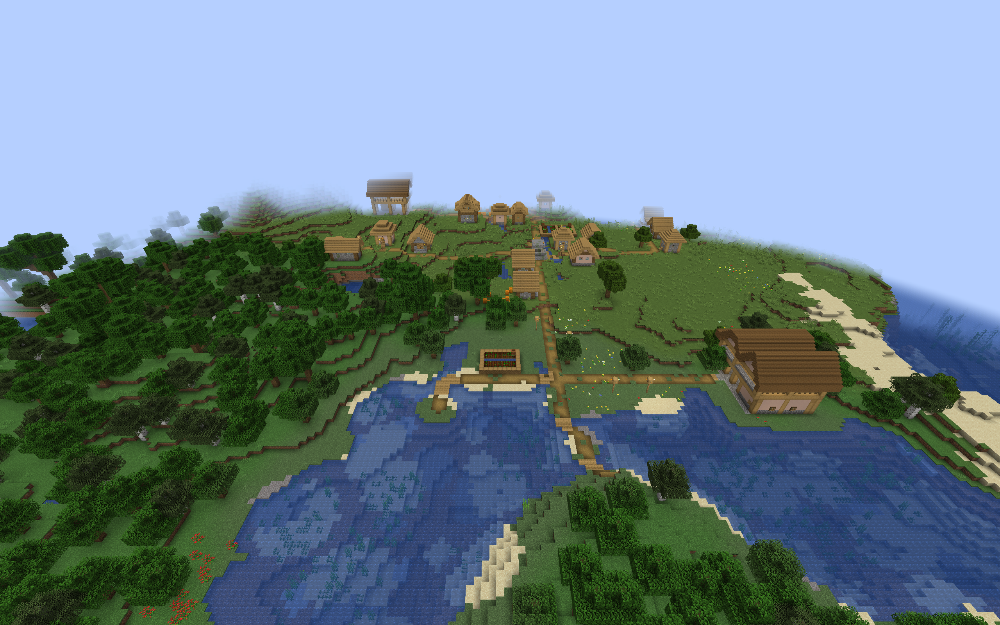
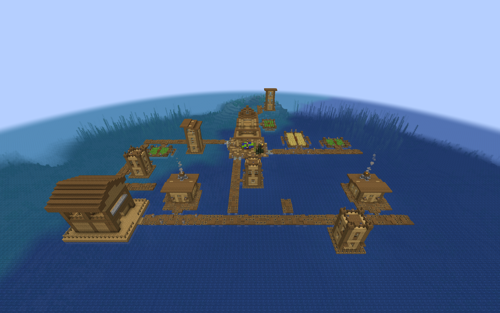

# Regional Watchtower village integration

Optional packs add compact towers and gatehouse lookouts to newly generated
villages. Each building has a ready room, broad stairs, and two sheltered,
spaced lookout duties. The larger gatehouse adds a covered entrance and an
east gallery. Both retain the existing maximum of two initial guards;
difficulty, garrison, population, and loadout settings still apply.

The separate [CTOV Watchtower pack](custom-village-watchtowers.md) adapts
both layouts to six reviewed themes.

## Installation

Build the packs with `./gradlew regionalWatchtowerIntegration`. The files
appear in `build/distributions/`:

| ZIP suffix after `villager-guard-gunners-regional-watchtowers-` | Villages | Layouts |
| --- | --- | --- |
| `vanilla.zip` | Plains, Desert, Savanna, Taiga, Snowy | 10 |
| `tidal-towns.zip` | Tidal Towns deep-ocean villages | 2 |
| `mmv.zip` | Moog's Missing Villages Jungle and Swamp | 4 |

Put the desired ZIPs in the world's `datapacks` directory. Install Tidal Towns
or Moog's Missing Villages and its dependencies for its corresponding pack.
Enable **Generate Village Defense Buildings** (`villageBuildings.enabled`)
and **Village-Integrated Watchtowers** (`villageBuildings.integratedWatchtowers`). The master building
switch is off by default.

Restart the server or close and reopen the world after changing generation
packs. `/reload` alone does not replace installed village pools. New entries
apply to newly generated villages; existing buildings remain unchanged.
These packs add choices alongside the smaller built-in integrated Watchtowers.
The separate rare [Village Watchtower](village-watchtowers.md) is unaffected.

Use the current Villager Guard Gunners build supporting 192 definitions when
combining the full optional collection. The [CTOV Watchtower guide](custom-village-watchtowers.md)
lists the current pack and definition totals. This limit applies to building
definitions, not the number of guards or buildings in a world. The separate
limit of 24 target pools remains unchanged.

The [Plains](watchtower-preview.md) and
[regional](regional-watchtower-preview.md) preview packs remain available for
manual architectural review. They contain no natural generation entries.

## Roads and placement

Each template has one outward connector and a two-block-wide entrance apron.
Vanilla and MMV entries use their region's `terminators` pool. Ocean entries
use `joshie:village/ocean/roads`. MMV connectors use `mmv:street`; the others
use `minecraft:street`. These are side branches or road-end buildings. The
covered gatehouse entrance does not require a road through the building.

Entries have weight `1` and rigid projection. Selection chance is `0.5`
for vanilla land layouts and `0.25` for Tidal Towns and MMV. These values apply to individual placement choices, not to the percentage of
villages with a Watchtower. They do not set a village-wide count cap. The
available space, terrain, and other entries affect selection.

The apron adds one block to the preview depth. Land entrances have a full
floor; raised Ocean, Jungle, and Swamp platforms use a bottom-slab step.
Both lanes explicitly clear their body and headroom. The slab's final state
has no facing property, so it works with every template rotation. The
reviewed interior, roof, stair, and rail blocks move together behind it.

Foundations have finite depth. These buildings do not level a village or
build supports down to a deep seabed. Steep slopes, flooded roads, foliage,
and ravines can still create awkward placements. The wider gatehouse needs
more free space than the compact tower. Custom CTOV, Integrated Villages,
Sky Villages, and other provider roads require their own placement reviews;
these packs target only the named pools above.

A retained Savanna test on seed `314159` placed a compact tower beside a
river/ravine below the waterline. Flowing water entered the lower room and
water occupied the upper deck. Marker removal succeeded; the placement
failed the dry-floor check. This remains a known terrain limitation, also
seen with the regional Sentry Post at that village. It is not counted as a
successful sample. Seed `314160` supplied successful generation and restart
samples for both Savanna layouts with unchanged weights and selection chances.

This unedited game capture shows the sampled Plains village, including road-end
gatehouses on the hillside and shoreline. Exposed foundations on slopes remain
possible.

The Ocean compact tower in this unedited capture connects to the village
boardwalk. Its sampled ready room and deck cells remained dry.

## Guards and lookout duties

One DATA marker in the ready room becomes clear air when the building is
registered. The existing garrison group supplies one guard on Easy, one
plus a chance of a second on Normal, and two on Hard. Peaceful supplies none.
Equipment and population rules can reduce armed staffing; a Watchtower does
not guarantee two gun-equipped guards.

After initial equipment selection, the existing placement code attempts to
move guards with a TaCZ gun or crossbow five blocks above their lower cells.
Melee-equipped guards remain downstairs. Later equipment changes do not
repeat that initial move. The lower anchor and upper cells shift together
in the raised variants.

Each entry authors two `overwatch` duties, facing local north and requiring
a ranged weapon. Existing readiness rules activate them at Watch or higher;
they are not permanent staffed posts during Peace. `deck_center` has offset `[1,5,0]`; `deck_west` has offset
`[-1,5,0]`. Their two-block spacing keeps the neighboring guard clear of the
sampled firing lines. Hold Position and Patrol Bound orders can prevent a
guard from travelling to a duty; use a Tactical movement order when the guard
should be free to return to the lookout. A bell raises Watch for 600 ticks
by default, so guards returning from farther away can need another bell or
a longer configured Watch duration. The first duty is one block east of its initial upper
spawn cell. Normal navigation moves guards to duties; the full stair routes
remain available for entering and leaving the deck.

A valid, executable defense-post duty takes precedence over vanilla
`MoveBackToVillageGoal`. That goal otherwise pulls guards toward village POIs
and can repeatedly remove them from road-end lookouts. The suppression ends
when the duty becomes invalid, unloaded, inactive, or blocked by higher-priority
work or orders. Other mobs and ordinary roaming without such a duty are
unaffected.

The garrison action is claimed once. Reopening a world or activating the same
building again must preserve guard and duty identities without creating
another initial garrison. Ordinary staffing can assign an eligible guard to
an unoccupied duty; the pack does not permanently bind a particular guard.

## Validation scope

The architecture previews cover all rotations, occupied decks, native guard
movement, supported furnishings, weather shelter, and sampled live TaCZ fire.
Natural integration checks use packaged JARs in ordinary Forge, actual village
pieces at unchanged entry weights, and the generated terrain. The observer
walks from the real road through the ready room and stairs, across the deck,
back downstairs, and outside, then checks saved guards and duties after a
full restart. Saved-world checks inspect occupied cells for water or lava.

Combined-pack server checks load the player ZIPs without the disposable QA
mod. Successful samples establish those placements' behavior; they do not
guarantee every seed or provider road fits.

## Recorded natural-generation coverage

The packaged Forge 1.20.1 / 47.4.10 client runs used Guard Villagers 1.6.19,
TaCZ 1.1.8-hotfix, Tidal Towns 1.3.4, and MMV 2.1.1 with its dependency.
All 16 layouts supplied a successful fresh-village sample and a full-process
restart sample: 32 successful runs, 204 completed walking legs, and 3,270
audited standing positions. Each position's body and head space was checked.
All successful samples preserved the natural garrison UUIDs and duty layouts;
repeated building activation supplied no additional initial guards.

The runs used seed `314159`, except for the documented Savanna retry on
`314160`. The failed flooded Savanna sample remains separate from the totals.
Only natural placement rotations encountered in those villages are covered
by these runs; the architecture previews provide the controlled four-rotation
coverage. Installed templates and definitions matched the generated player
ZIPs byte for byte.

A separate ordinary Forge dedicated server running the final JAR loaded all
14 player ZIPs without
the QA observer. Both first startup and full process restart installed all
103 definitions across 20 target pools, with no missing pools, processors,
or templates and no invalid templates. `/reload` accepted all 103 definitions
on both runs. JAR and ZIP hashes remained unchanged and both processes exited
cleanly. This checks pack loading and persistence, not multiplayer combat or
village-wide staffing under the combined collection.

## Lookout staffing regression

An additional natural-resident exercise exposed a village-return conflict:
`MoveBackToVillageGoal` repeatedly interrupted the defense-post movement goal
and pulled guards off the deck. The targeted fix makes that village-return
goal yield while the normal defense-post controller considers a duty valid
and executable. It does not raise the duty goal above combat or service work.

The final JAR passed the corrected exercise on the Plains compact tower,
Plains gatehouse, and Ocean gatehouse: seven natural guards across four
buildings reached their assigned lookout slots and remained settled for
240 consecutive ticks in each run. The observer equipped loaded guns, issued
ordinary Tactical movement orders, and maintained Watch through normal bell
signals every 400 ticks. It restored the original guns and orders afterward.
No guard was teleported, assigned a slot by the observer, given a replacement
movement goal, or given a custom pathfinding budget.

Earlier trials remain failures: an unchanged Hold Position order prevented
travel, one observer incorrectly treated brief water contact during village
travel as fatal, and repeated mobile trials exposed the village-return
conflict. Those trials do not count as successful staffing coverage. These
results do not promise that every natural loadout will staff a lookout after
a single bell, or that an occupied village cannot interrupt a guard for
combat, medical work, or resupply.

The 32 placement/restart runs preceded the targeted village-return fix; their
NBT and definition ZIPs are unchanged. The three extended staffing runs use
the final JAR with that fix.

## Updated land-pack settings

The vanilla ZIP also reduces the matching built-in family's selection chance
to `0.25` and enables [terrain screening](village-building-terrain-safety.md)
for its regional layouts. See [frequency balancing](village-defense-balance.md#regional-pack-frequency).
Earlier layout samples in this guide predate these land-pack setting changes.
