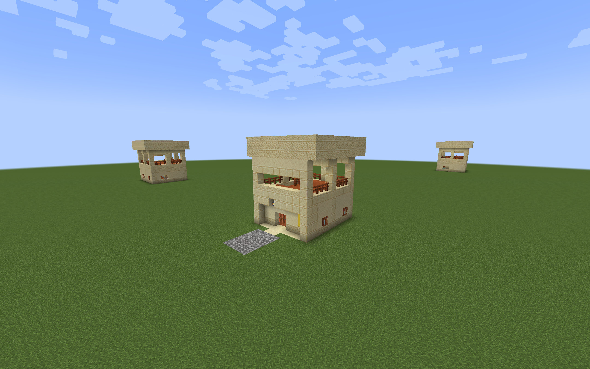
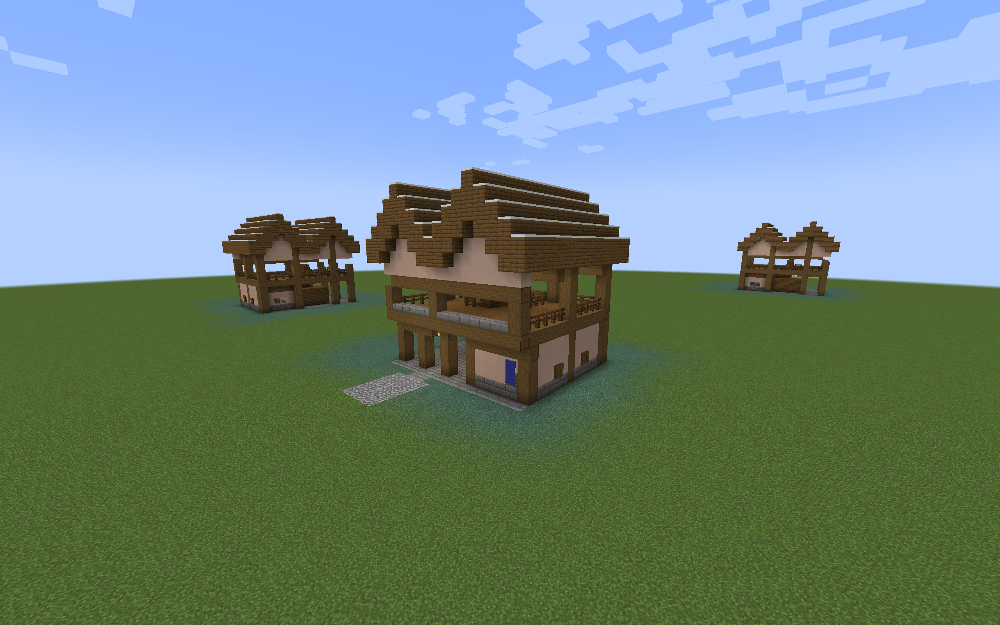
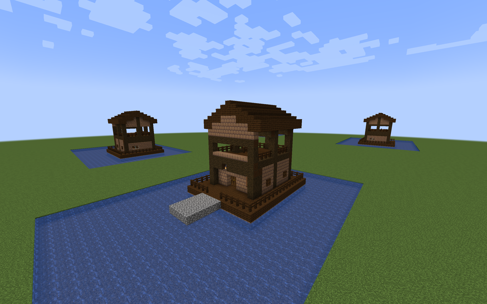

# Regional Watchtower previews

The regional preview pack contains a compact tower and a gatehouse lookout for
Desert, Savanna, Taiga, Snowy, Ocean, Jungle, and Swamp settings. Each keeps the
Plains layout's ready room, benches, crafting table, shuttered windows, covered
lookout, two-wide stairs, and protected firing openings. Regional materials,
roof shapes, and foundations give the buildings a local village character.

| Region | Construction | Compact width × depth × height | Gatehouse width × depth × height |
| --- | --- | --- | --- |
| Desert | Sandstone pillars, smooth sandstone walls, acacia details, flat sandstone roof and low parapet | 11 × 13 × 13 | 17 × 15 × 13 |
| Savanna | Acacia framing and hipped roof, terracotta walls, stone footing | 11 × 13 × 14 | 17 × 15 × 14 |
| Taiga | Spruce framing and walls, steep spruce roof, stone footing | 11 × 13 × 17 | 17 × 15 × 16 |
| Snowy | Spruce framing, pale walls, steep snow-covered roof, stone brick footing | 11 × 13 × 18 | 17 × 15 × 17 |
| Ocean | Oak deck and walls, spruce framing and roof, raised timber platform | 13 × 16 × 15 | 19 × 18 × 15 |
| Jungle | Jungle wood framing and hipped roof, raised mossy stone platform | 13 × 16 × 15 | 19 × 18 × 15 |
| Swamp | Dark oak framing and roof, mud brick walls, raised platform | 13 × 16 × 15 | 19 × 18 × 15 |

Ocean is the architectural theme intended for Tidal Towns; Jungle and Swamp
are intended for Moog's Missing Villages (MMV). The templates use vanilla
blocks and can also be placed manually without those village mods.



## Build and place

From the repository root, run either command:

```sh
./gradlew regionalWatchtowerPreview
python3 tools/build_regional_watchtower_preview.py
```

The pack is written to
`build/distributions/villager-guard-gunners-regional-watchtower-preview.zip`.
Install it in a Minecraft 1.20.1 test world's `datapacks` directory and run
`/reload`. For guard testing, install packaged Villager Guard Gunners, Guard
Villagers, and Timeless and Classics Zero (TaCZ), with their dependencies.

Use either layout under one of the seven region IDs:

```mcfunction
/place template vggpreview:watchtower/desert/compact_tower ~ ~-1 ~
/place template vggpreview:watchtower/taiga/gatehouse_lookout ~ ~-1 ~
/place template vggpreview:watchtower/ocean/compact_tower ~ ~-1 ~
```

Region IDs are `desert`, `savanna`, `taiga`, `snowy`, `ocean`, `jungle`, and
`swamp`. Layout IDs are `compact_tower` and `gatehouse_lookout`. The origin
includes roof margins and the front faces north. Place on a level test plot
with enough clear space: the templates clear their authored volume above
the foundation. They do not adjust to slopes or build supports to a deep
seabed. Raised platforms need an approach aligned to their higher floor.

Manual placement creates the building only. The pack adds no natural village
entries, automatic guards, duties, loot, or storage inventories. The separate
rare standalone Village Watchtower is unaffected.



## Layout contracts

The [Plains preview](watchtower-preview.md) defines the shared stairs, rooms,
initial guard cells, and spaced firing positions. Regional roofs keep ordinary
upper walking cells clear for three blocks. Roof courses have solid backing;
posts, gables, crossbeams, and hanging chains support the roofs and lanterns.
Snow appears only on full roof surfaces, outside circulation cells.

Desert, Savanna, Taiga, and Snowy retain the Plains coordinates: standing feet
at local Y=1 downstairs and Y=6 upstairs. Ocean, Jungle, and Swamp translate
the original structure by `(1,1,2)`, with feet at Y=2 and Y=7. Both initial
upper guard cells and proposed firing duties move with the lower anchor.
The rise remains five blocks, and firing positions remain two blocks apart.

Raised variants add a complete platform and outer fence, with a two-block
entrance opening at Z=0. Their platform is a controlled placement foundation,
not a claim that a large gatehouse fits every dock or jungle path.

The [builder](../tools/build_regional_watchtower_preview.py) writes native NBT
and a manifest containing translated stairs, entrances, occupied cells,
attachment positions, firing openings, and test routes. The manifest uses
Minecraft's width, height, depth order. Preview packs contain fourteen NBT
templates, this machine-readable manifest, and pack metadata.



## Packaged Forge checks

All fourteen templates passed controlled placement in all four rotations in
ordinary Minecraft 1.20.1 with Forge 47.4.10, packaged Villager Guard Gunners
1.6, Guard Villagers 1.6.19, and TaCZ 1.1.8-hotfix. Jungle and Swamp cases
loaded MMV 2.1.1, and the Ocean case loaded Tidal Towns 1.3.4. Snowy samples were verified
in a snowy biome; Ocean and Swamp used shallow water around their platforms.

The 56 placements retained supported floors, clear reserved lanes, working
paired doors, surviving decorative attachments and lanterns, and protective
rails and firing openings. Sampled ready-room, work, and lookout cells were
lit at block light levels 7–9 and sheltered during weather checks.

Guards completed 336 walking legs through ready rooms, stairs, occupied
decks, downstairs work positions, and entrances. They remained out of water
and took no health damage. These used ordinary navigation with the production
[walking retry](guard-navigation.md); the observer supplied no larger path
budget and follow range stayed at 20 blocks. The return-route controls also
passed for every regional pair.

Both spaced lookout positions passed 448 live TaCZ AK-47 trials across all
rotations: targets 12 and 24 blocks forward, and 24 blocks forward with a
five-block offset to either side. Every trial recorded ammo use and target
damage while the guard stayed within 1.5 blocks of its assigned firing cell.
Each trial used fresh guards and normal combat goals with Hold Position.
These are sampled firing lines, not full coverage or point-blank defense of
the tower's base. Hot-swapping guns during a burst remains outside this test.

The shared observer also passed a fresh Plains regression run: eight
placements, 48 walking legs, and 64 firing trials.

The tested template files match the generated preview ZIP. The disposable
observer and preview resources are separate from the main mod JAR.

## Validation scope

Architecture validation covers controlled placement, supported details,
walking routes, occupied lookout positions, lighting, weather shelter, and
sampled TaCZ firing lines. The [village integration guide](regional-watchtower-integration.md)
covers natural village fitting, provider road connections, automatic garrisons
and duties, persistence, the combined definition limit, and terrain concerns.

Optional [village integration packs](regional-watchtower-integration.md) add
these layouts to the named village pools; manual previews remain separate.
