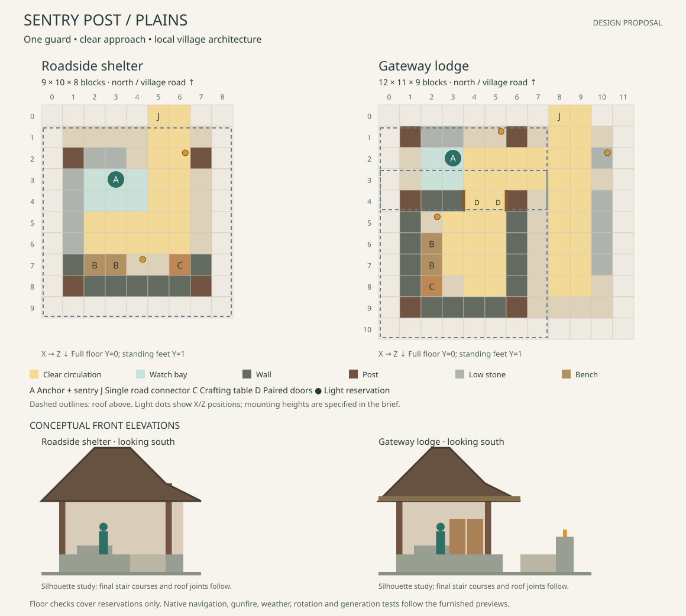

# Sentry Post design proposals

Status: the two Plains references now have [furnished, packaged-tested previews](sentry-post-preview.md).
The floor plans below describe the architectural intent. The seven other regions now have a separate
[regional preview pack](regional-sentry-post-preview.md). The [optional integration packs](regional-sentry-post-integration.md) connect
all sixteen layouts to village generation.

## Identity and role

A Sentry Post should look like a small village watch shelter: a visible place
where a guard keeps an eye on an approach, rests between duties, and maintains
equipment. Carry forward the local architecture of the
[Barracks](regional-barracks-designs.md) and [Village Armory](armory-designs.md):
stone foundations, timber framing, modest roofs, useful furnishings, and
restrained weathering. Keep the main sightline open and the occupied position
beside the entrance route.

Two arrangements provide the same function:

| Layout | Character | Plains envelope, width × depth × height |
| --- | --- | --- |
| Roadside shelter | Open watch bay with a sheltered rear bench and work corner | 9 × 10 × 8 |
| Gateway lodge | Front watch veranda, small rear rest room, and an open arrival strip beside it | 12 × 11 × 9 |

The lodge sits beside an approach. Its name does not imply a gate across the
village road, a toll system, or a through-road connection. Its larger footprint
provides weather shelter and turning room, not additional guards or supplies.
Neither reference has an occupied upper floor.

## Existing behavior to preserve

The built-in Sentry Post is 7 blocks wide, 8 deep, and 7 high. It has one
crafting table, one decorative seat, one lantern, and an open checkpoint plan.
Its reviewed pool weight is 2. The generated group supplies at most one initial
guard, subject to the current difficulty, garrison, and population settings.
A post is not guaranteed to receive a gun-equipped guard.

The current `road_sentry` duty occupies the anchor, faces local north, and
accepts any weapon. Preserve that one-duty arrangement. Put the anchor beside
the passage so the initial spawn and assigned duty share a useful standing
position. An authored variant can explicitly declare `road_sentry`, offset
`[0,0,0]`, facing `north`, kind `sentry`, and weapon requirement `any`.

The DATA anchor becomes clear standing space after activation. Do not put a
chest, seat, banner, or other furniture in that cell. Preserve one-time garrison
claims across reload; a larger building must not create a second initial guard.
Keep one crafting table and decorative seating. Beds, loot containers, a Village
Armory, medical stations, alarm bells, and new detection or checkpoint behavior
are outside this architectural pass.

## Plains plans

Coordinates use X east and Z south, with the village road north of Z=0.
Ranges are inclusive. Full floor blocks occupy Y=0; standing feet are at Y=1.
Dimensions include roof margins. The drawings show floor reservations and
conceptual front elevations; roof block courses remain to be authored.

### Roadside shelter

| Element | Local coordinates | Purpose |
| --- | --- | --- |
| Occupied platform | X=1..7, Z=1..8 | Full support beneath the shelter and furnishings |
| Road connector and companion | (5,1,0), with supported X=6 at Z=0 | One north-facing connection, two-block approach |
| Main arrival lane | X=5..6, Z=0..6 | Open entrance beside the guard |
| Rear cross-route | X=2..6, Z=5..6 | Two-block circulation behind the watch bay |
| Watch bay | X=2..4, Z=3..4 | Clear standing and retreat space |
| Anchor / sentry | (3,1,3), facing north | Separate from the arrival and cross-routes |
| Front low cover | X=2..3, Z=2 | Bottom stone slabs at Y=1; top surface Y=1.5 |
| West low edge | X=1, Z=3..6 | Low masonry along the exposed flank |
| Main timber posts | (1,2), (7,2), (1,8), (7,8) in X/Z | Keep structural corners outside the routes |
| Rear wall | X=1..7, Z=8 | Framed plaster and timber behind the rest area |
| Rear side returns | X=1 and X=7, Z=7 | Weather shelter and roof support |
| Decorative bench | X=2..3, Z=7 | Seats against the rear wall |
| Crafting table | (6,1,7) | Accessible from the clear cell at (6,1,6) |
| Lantern reservations | (6,4,2) and (4,4,7) | Above route headroom, supported from beams or roof chains |

Use a small north–south gable, with the roof footprint X=0..8, Z=1..9.
Reserve eaves no lower than Y=4 and ridge blocks no higher than Y=7. Leave
three full air blocks above the floor on all ordinary routes; beams and
lanterns belong at Y=4 or higher there. The rear wall closes the gable and
provides a sheltered backdrop. Keep the front open between the structural
posts, with no door or fence gate across the arrival lane.

Use stripped oak framing, pale terracotta infill at the back, a cobblestone
and andesite base, and a spruce roof. A small green banner on a side-facing
post and a restrained notice panel on the rear wall provide civic identity.
Keep both out of the north-facing watch opening. Worn stone belongs at the
entrance; moss belongs near damp foundation contact.

The low front slabs suggest a defensible edge without placing a full-height
wall immediately in front of the guard. Their actual effect on TaCZ muzzle
clearance and line of sight must be measured with the furnished prototype.
The clear rear route provides room to leave the bay; it does not add retreat AI.

### Gateway lodge

| Element | Local coordinates | Purpose |
| --- | --- | --- |
| Supported platform | X=1..10, Z=1..9 | Lodge, veranda, and arrival strip |
| Road connector and companion | (8,1,0), with supported X=9 at Z=0 | One north-facing connection beside the lodge |
| Arrival strip | X=8..9, Z=0..8 | Open approach; no gate, cart, or center decoration |
| Veranda cross-route | X=4..9, Z=2..3 | Two-block turn from the arrival strip into the lodge |
| Watch bay | X=2..3, Z=2..3 | Sheltered observation beside the route |
| Anchor / sentry | (3,1,2), facing north | One guard, clear of the route at X=4..5 |
| Front low cover | X=2..3, Z=1 | Bottom stone slabs at Y=1 |
| Veranda front posts | (1,1) and (6,1) in X/Z | Carry the canopy outside the cross-route |
| Lodge shell | X=1..6, Z=4..9 | Rear weather shelter; clear interior X=2..5, Z=5..8 |
| Lodge doors | X=4..5, Z=4 | Paired wooden doors with outside hinges |
| Interior main lane | X=4..5, Z=5..8 | Direct connection through the doors |
| Interior turning area | X=3..5, Z=5..7 | Clear 3 × 3 landing |
| Decorative bench | X=2, Z=6..7 | Against the west wall |
| Crafting table | (2,1,8) | Working position at (3,1,8) |
| East low border | X=10, Z=4..7 | Defines the arrival strip without closing its front |
| Lantern reservations | (5,3,1), (2,3,5), and a pedestal at (10,1,2) with light at Y=2 | Veranda, room, and arrival lighting, outside reserved routes |

Use the same oak-and-plaster construction, with a main north–south gable over
X=0..7, Z=3..10 and a lower canopy over X=0..7, Z=1..4. The main roof has eaves
at Y=4 or higher and a ridge no higher than Y=8. The canopy occupies Y=4..5;
its junction with the main roof needs a closed backing and a supported beam.
The east arrival lane at X=8..9 remains open to sky. Keep the lodge visibly
smaller than a Barracks.

Use framed windows in the west and rear walls, with exterior shutters confined
to the roof margin. The rest room is reached through two wooden doors; the
watch bay remains outside, so a closed door never traps the sentry. Budget the
open door leaves explicitly. Doorways are a two-block-height exception to the
three-air-block route target, not a promise of casualty-carrier clearance.

## Regional treatments

These directions informed the seven [regional preview pairs](regional-sentry-post-preview.md).
Their authoring guide records the implemented dimensions and construction.

| Setting | Roadside shelter | Gateway lodge | Main design constraint |
| --- | --- | --- | --- |
| Plains | Oak watch pavilion, pale rear infill, small spruce gable | Framed lodge with a lower veranda | Clear view past the posts and low cover |
| Desert | Sandstone shade shelter, deep lintel, low parapet | Recessed sandstone room and shaded loggia | Keep the viewing slot broad and the shaded route tall |
| Savanna | Acacia frame, broad light roof, open sides | Low veranda lodge with warm infill | Keep wide eaves supported without crowding the watch bay |
| Taiga | Heavy spruce shelter, stone base, steep gable | Spruce lodge with a sheltered rear room | Keep snow and roof trim out of the approach |
| Snowy | Wind-protected booth with an open front watch recess | Insulated lodge with a larger sheltered entrance landing | Enclose the rest space without glazing or dooring over the firing opening |
| Deep ocean / Tidal Towns | Harbor watch shelter on a protected deck | Dockside lodge and contained arrival deck | Match the actual road surface; rail the perimeter and provide an internal return route |
| Jungle / MMV | Raised timber lookout shelter on a stone plinth | Deep-eaved jungle lodge and veranda | Keep foliage, hanging details, and screens clear of sightlines and feet |
| Swamp / MMV | Weathered dark-oak shelter with mud-brick backing | Marsh lodge and raised boardwalk frontage | Dry standing cells and a supported connection without a side exit into water |

A low land border is not adequate fall protection over water or in Sky Villages.
Raised versions need an enclosed platform perimeter, an actual supported
entrance, and a roofed watch bay behind the edge. Sky and other custom-provider
adapters are subsequent work; a Plains palette swap does not establish fit.

## Placement and validation plan

1. Author both furnished Plains previews and their roof sections. Verify that
   every route, the anchor, the table approach, and light support agree with
   these plans. Review four rotations, closed roof seams, shutters, and doors.
2. Use packaged JARs in ordinary Forge to walk a guard from the adjoining
   approach to the duty position, into the rest area, and back out. Test doors
   in both states and a passing villager while the sentry occupies its bay.
3. Separately test northward and diagonal visibility and gunfire. Check actual
   muzzle obstruction, line of sight, and friendly traffic. A successful walk
   or a clear-looking window is not a firing test; architecture does not create
   a no-fire lane or change friendly-fire rules.
4. In a generated structure, verify one initial guard at most, rotated north
   duty facing, a finalized clear anchor, and no duplicate garrison after
   reload. Check available-guard duty assignment separately from spawning.
5. Review night lighting, rain shelter, snow accumulation, and safe floor
   edges. Develop the other regional pairs, then their actual road connections.
   Start integration trials with the native house pools where the smaller
   footprint fits; test road-end alternatives if necessary.

Preview templates need no extra village-building definitions. If all sixteen
regional Sentry Post layouts are later added alongside the current complete
71-definition collection, the total would be 87, within the 96-definition
limit. Pool count is a separate constraint (currently 24); regional and custom
connections must be counted explicitly. Do not change weights, remove old
layouts, or raise limits during an architectural preview pass.

Blocking issues are unreachable duty cells, unsafe edges, regularly obstructed
shots, blocked traffic, duplicate guards, and invalid generation data.
Occasional cosmetic foundation seams and uncommon terrain awkwardness can
remain later playtesting work, consistent with the other building families.
