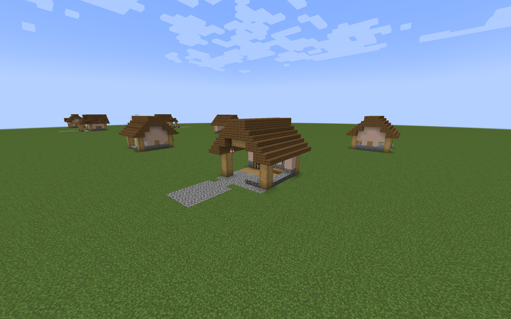
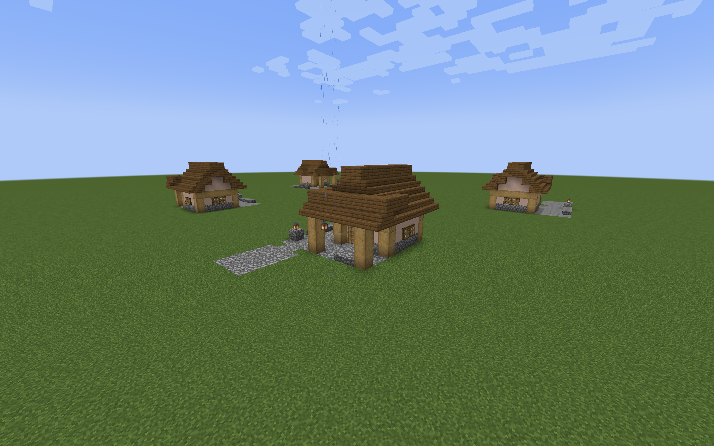
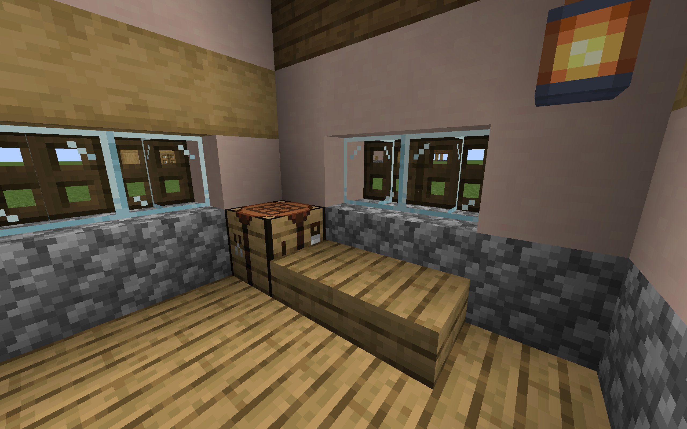

# Plains Sentry Post previews

Two furnished Plains Sentry Posts are available as a separate architecture
preview pack. The roadside shelter has an open watch bay and a covered rear
bench and work corner. The gateway lodge adds an enclosed rest room, paired
wooden doors, shuttered windows, and an open approach beside the veranda.
Both use stone bases, oak framing, pale wall panels, and spruce roofs.







## Build and place

Run either command from the repository root:

```sh
./gradlew sentryPostPreview
python3 tools/build_sentry_post_preview.py
```

The output is
`build/distributions/villager-guard-gunners-sentry-post-preview.zip`.
Put it in a Minecraft 1.20.1 test world's `datapacks` directory and run
`/reload`. For guard and gun testing, install packaged Villager Guard Gunners,
Guard Villagers, and Timeless and Classics Zero (TaCZ), with their dependencies.

Stand on a level surface and place either template with its floor at ground level:

```mcfunction
/place template vggpreview:sentry_post/plains/roadside_shelter ~ ~-1 ~
/place template vggpreview:sentry_post/plains/gateway_lodge ~ ~-1 ~
```

The command origin is the northwest corner, including the roof margin. The
front faces north. Dimensions below are width east × depth south × height;
the generated manifest uses Minecraft's width, height, depth order.

| Layout | Envelope | Approach at local Z=0 | Proposed sentry position | Crafting table |
| --- | --- | --- | --- | --- |
| Roadside shelter | 9 × 10 × 8 | X=5..6 | (3,1,3) | (6,1,7) |
| Gateway lodge | 12 × 11 × 9 | X=8..9 | (3,1,2) | (2,1,8) |

Floors are at local Y=0 and standing feet at Y=1. Place in clear space: each
template clears its entire volume above the floor. Neither supplies a deep
foundation, adapts to slopes, or connects automatically to a village road.
The lodge's paired doors occupy X=4..5, Z=4. Its exterior watch bay remains
accessible with those doors closed.

Each contains one crafting table, decorative seating, and lighting. Manual
placement creates no guards, duty assignments, loot, or storage inventories.
The pack contains no village-building definitions, pool entries, jigsaw
connectors, or spawn markers. The [optional generation packs](regional-sentry-post-integration.md) add these
designs to new villages; existing generated Sentry Posts keep their layouts.

## Architecture and roof construction

The [design brief](sentry-post-designs.md) defines the floor reservations and
regional directions. Edit [the preview builder](../tools/build_sentry_post_preview.py)
to change the actual blocks. The two structures are encoded as native NBT and
packaged in a reproducible ZIP.

Both main roofs run north–south, with full plank backing under raised courses.
Their cross-sections use these local block-Y schedules from west to east:

| Roof | X columns | Z span | Upper course Y by X |
| --- | --- | --- | --- |
| Roadside gable | 0..8 | 1..9 | 4, 5, 6, 7, 7, 7, 6, 5, 4 |
| Lodge gable | 0..7 | 3..10 | 4, 5, 6, 7, 7, 6, 5, 4 |

The lodge's lower canopy starts with south-facing stairs at Y=4, Z=1,
backed planks at Y=4, Z=2, and an upper course at Y=5, Z=2..4. The main
roof replaces intersecting canopy blocks. The east arrival lane remains open
to sky. Beams and roof blocks support hanging lanterns; a stone pedestal
supports the lodge's approach lantern. Bottom stone slabs provide a low
front edge without closing the firing opening.

## Packaged validation

The controlled trials used ordinary Minecraft 1.20.1 with Forge 47.4.10,
Villager Guard Gunners 1.6, Guard Villagers 1.6.19, and TaCZ 1.1.8-hotfix.
The disposable observer verified production mode and packaged code sources;
it remains outside the release JAR.

Both templates passed placement, attachment survival, floor support, and
reserved route clearance in all four rotations. Eight guards completed
32 walking legs: approach to watch bay, rest area, crafting position, and
return outside. Scripted movement goals used native navigation and door
opening, with no teleporting after initial placement. Eight villagers then
completed 16 trips along the approaches beside occupied watch bays.

A separate combat trial used ordinary guard combat goals, a loaded TaCZ
AK-47, and Hold Position. Each guard hit a stationary adult husk straight
ahead and on both forward diagonals while remaining within 1.5 blocks of the
watch position. All 24 trials recorded ammo consumption and actual target
damage. The diagonal targets were five blocks to either side; these are
sampled firing lanes, not proof of an unrestricted field of fire. Friendly
traffic was tested separately from gunfire.

Three sampled watch/work positions in every rotated structure had block light
levels 8–11 and remained sheltered in rain. Exterior, interior, roof, night,
and rain views were captured for both layouts. These sampled readings do not
establish that every floor or roof block prevents hostile spawning.

Natural road access and garrison persistence are covered separately in the
[integration guide](regional-sentry-post-integration.md). Casualty carrying,
larger crowds, and combat with friendly entities crossing the firing line
remain separate behavior trials. The seven other regional pairs have a separate [preview pack](regional-sentry-post-preview.md).
