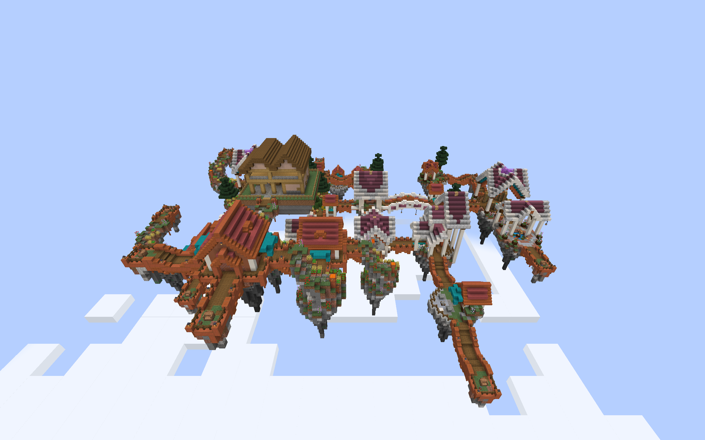

# Defense buildings in Sky Villages

Optional datapacks add Plains-style timber defense buildings on floating
stone-and-dirt islands to Sky Villages. Each island has a grass border,
perimeter railings, and a two-block entrance at bridge-floor height.

The timber gatehouse lookout is visible at the back left of this native
Minecraft scene.

## Building the packs

Run `./gradlew skyVillageIntegration customArmoryIntegration`. The ZIPs in
`build/distributions/` begin with `villager-guard-gunners-`:

| Filename suffix | Layouts |
| --- | --- |
| `barracks-sky-villages.zip` | Compact Barracks and courtyard Barracks |
| `armories-sky-villages.zip` | Compact Village Armory and supply yard |
| `sentry-posts-sky-villages.zip` | Roadside shelter and gateway lodge |
| `watchtowers-sky-villages.zip` | Compact Village Watchtower and gatehouse lookout |
| `training-yards-sky-villages.zip` | Practice yard and drill courtyard |

Install selected ZIPs in the world's `datapacks` folder with Sky Villages
1.0.4 for Forge 1.20.1, Villager Guard Gunners, Guard Villagers, Timeless and
Classics Zero (TaCZ), and their dependencies. Enable **Generate Village
Defense Buildings** and the building types you want. Reopen the world or
restart the server; generation changes affect newly generated villages.
`/reload` alone does not replace the live village pools.

## Placement and behavior

The four newer families use foundations sized to their own footprints, with
two blocks of extra space at each side and the rear. Watchtowers preserve
their stairs and upper lookout railings. Barracks side access opens onto the
island rather than directly over its edge. Training Yards preserve their
sheltered firing positions and circulation space.

All five families use `skyvillages:skyvillage_houses`, with the incoming
`skyvillages:house` connector replacing floor planks. Each template has rigid
projection, empty processors, and an empty continuation pool. Their islands
have finite depth; they do not build supports down to the ground.

Each layout uses weight 5 and selection chance 0.5, matching the existing
Sky Armory adapter. Sky Villages gives its normal houses weight 50. These
settings are candidate-selection controls, not a percentage of villages
containing a building. Available space, rotation, and competition with other
pieces affect placement. Installing all five packs increases that competition;
broad frequency and population balancing remains future work. Individual
layouts can be rare: several searches covering 25 natural villages found no
example of the requested layout during validation.

Duty positions retain their offsets from each building's anchor. Watchtowers
keep two ranged lookout duties; Training Yards keep two ranged drill duties.
Training targets are decorative. Readiness, equipment, orders, and available
guards determine actual staffing. These packs do not change guard navigation.

The full collection of regional packs, six-theme CTOV packs, and five Sky
packs contains 175 building definitions across 20 pools, including the
built-ins. Use the current build supporting 192 definitions and 24 pools.

## Packaged-game validation

All eight new layouts passed naturally generated Minecraft 1.20.1 / Forge
47.4.10 client trials using Sky Villages 1.0.4 and the packaged mod JAR.
Each layout was checked in a fresh world and after a full client restart,
with all five Sky player packs installed together. The accepted samples
covered three rotations across the set, not every layout in every rotation.

The trials completed 108 scripted native walking legs. Saved-world checks
verified 1,302 dry standing positions and 1,024 perimeter positions with
supporting floors and intact fences. Eight fresh buildings created fourteen
guards under the tested difficulty defaults; their identities and building
actions survived restart, and repeated activation did not add more guards.
Installed datapack resources matched the distribution ZIPs.

Five earlier searches found no example of the requested layout: three for
the courtyard Barracks and two for the gateway Sentry Post. These are retained
as unsuccessful samples. The courtyard passed with seed 314162 and the
gateway passed with seed 314161; the other layouts passed with seed 314159.
No geometry or selection settings were changed to obtain those results.

Walking checks establish traversable routes in those samples, not complete
autonomous staffing, combat, or patrol coverage. The existing Training Yard
direct cross-range detour limitation remains; its checked route returns from
the western drill position through the center before following circulation.

A separate ordinary dedicated Forge server loaded all twenty-five player ZIPs
without the observation helper: 175 definitions across 20 pools. Startup,
`/reload`, and a full process restart passed with no missing pools, processors,
templates, or invalid templates. Both runs exited cleanly and preserved the
installed JAR and ZIP hashes. This does not establish multiplayer behavior.
