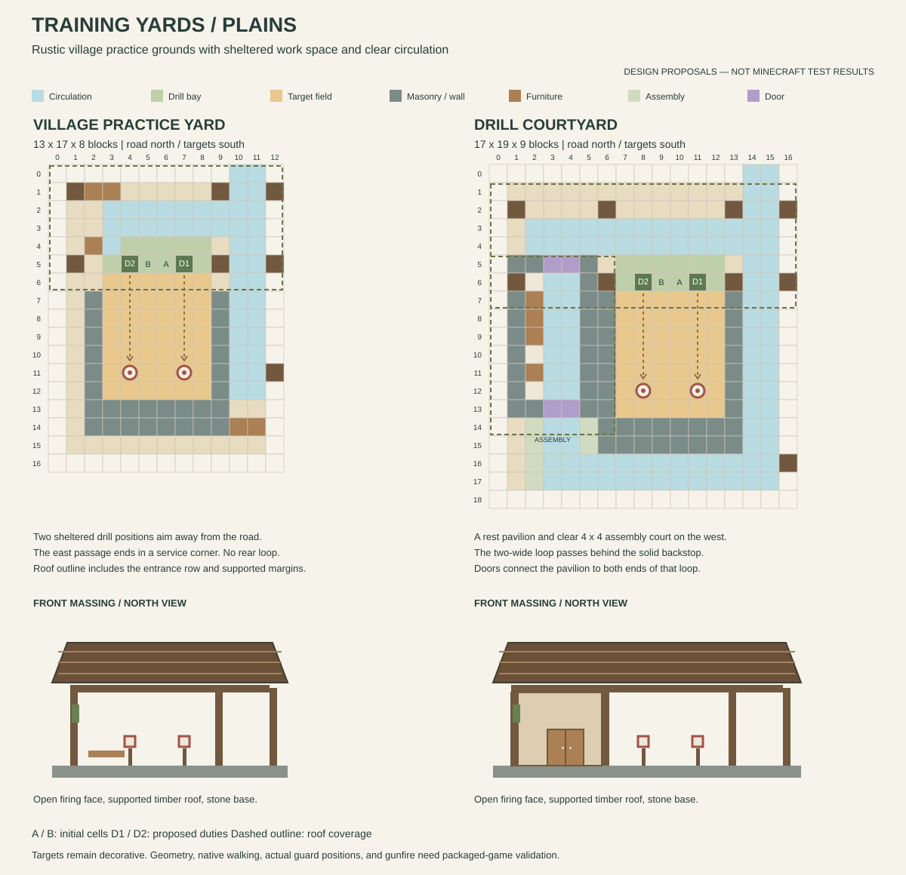

# Training Yard design proposals

Status: architectural brief and original coordinate reservations. Furnished
Plains templates are now available in the [preview pack](training-yard-preview.md).
Its guide records the built geometry and validation scope. The
[regional preview pack](regional-training-yard-preview.md) adds the seven other
pairs. The [optional generation packs](regional-training-yard-integration.md)
adapt all sixteen layouts to village roads and preserve their initial guards
and authored duties.

## Identity and layouts

A Training Yard should feel like a village militia's everyday practice ground:
a sheltered firing line, maintained targets, a substantial rear backstop,
somewhere to put equipment down, and room to gather before a patrol. Continue
the local masonry, timber, plaster, and modest roofs of the redesigned
[Barracks](regional-barracks-designs.md), [Armories](armory-designs.md), and
[Sentry Posts](sentry-post-designs.md). Keep the open court visually dominant.

| Layout | Working ID | Plains envelope, width × depth × height | Character |
| --- | --- | --- | --- |
| Village practice yard | `practice_yard` | 13 × 17 × 8 | Covered practice veranda, two target lanes, rear masonry backstop, and an independent side approach |
| Drill courtyard | `drill_courtyard` | 17 × 19 × 9 | A larger practice ground with a west rest pavilion, sheltered firing line, small assembly court, and circulation behind the backstop |

Dimensions include roof margins and the reserved north entrance row. NBT uses
width, height, depth order. Both proposals have one occupied level and the same
maximum of two initial guards. The larger court adds usable space and weather
shelter, rather than increasing the garrison or adding more target lanes.

## Existing behavior to preserve

The built-in template is 11 blocks wide, 10 deep, and 5 high, with pool weight
`1`. Its anchor is `(5,1,3)`; the second initial cell is `(4,1,3)`. Two raised
targets occupy the rear portion of an open yard beneath a small front canopy.

The `village_training_yard` group currently supplies a rifleman and a 25%
chance of a marksman on Easy, a rifleman and marksman on Normal, and a breacher
and marksman on Hard. Peaceful creates none. Garrison settings, population
limits, and valid spawn positions can reduce those counts. Configured gun
loadout rules apply separately; two initial guards do not guarantee two guns.

The two default duties are `firing_center` and `firing_west`, facing local
south, with kind `drill` and weapon requirement `ranged`. Drill duties are
active during **Peace and Recovery**, and inactive during Watch, Alert, and
Siege. They position available guards; they do not make guards shoot targets,
spend practice ammo, gain experience, or perform training animations.

Preserve the one-time garrison claim and the two initial spawn offsets
`[0,0,0]` and `[-1,0,0]`. Authored duty positions can be farther apart, but they
do not move the initial spawn cells. Guard Orders and role defaults still
apply. In particular, Hold Position or Patrol Bound can prevent travel to a
different duty position. The recent village-return fix also applies to valid,
executable drill duties outside vanilla's village POI boundary.

Use one crafting table and decorative seating in each proposed layout.
Keep functional beds, loot containers, Village Armory blocks, medical services,
and automatic shooting practice outside this architectural pass. Decorative
equipment racks should use ordinary blocks and supported trim, without item
frames or armor stands that can introduce entities or unintended rewards.

## Shared construction rules

The road is north of Z=0; X increases east and Z increases south. Coordinates
below are inclusive. Primary floor blocks are at Y=0, with feet at Y=1.

- Keep ordinary routes two blocks wide, with three clear air blocks above
  them. Paired wooden doors have the normal two-block doorway clearance;
  budget both leaves opening away from the route.
- Place the road entrance and normal cross-route behind the firing line.
  An east passage serves the building without crossing the target lanes.
  Entering a target lane is a deliberate maintenance or player action.
- Use full, sturdy floor blocks beneath duties, spawn cells, approaches, and
  turning areas. Dry packed mud or dirt can texture the practice ground;
  keep partial path blocks and decorative clutter off scheduled standing cells.
- The firing veranda has roof and beam undersides at Y=4 or above. Give both
  shooting positions a broad open face toward the targets. Keep lanterns,
  banners, braces, and roof trim outside those sightlines.
- Put target blocks at Y=2 on full pedestals at Y=1. Use two restrained target
  assemblies, backed by two-block-deep masonry. Avoid exposed hay immediately
  beside lanterns or decorative campfires.
- The backstop is architectural containment, not a promise that every TaCZ
  gun, penetration setting, explosive round, or firing angle will be stopped.
  Do not add a guaranteed-safe shooting claim or a new no-fire zone.
- Land boundaries can be low and open. Ocean and raised wetland variants need
  continuous fall protection around the outer platform, with the entrance as
  the only opening onto a verified supporting road surface.

## Plains floor reservations

The drawings distinguish circulation, occupied bays, target lanes, and solid
construction. A drawn route is a design reservation, not pathfinding evidence.
Front elevations illustrate massing. The preview builder now authors the exact
roof courses; these drawings remain the original paper reservations.

### Village practice yard

| Element | Local reservation | Purpose |
| --- | --- | --- |
| Main floor | X=1..11, Z=1..15; entrance X=10..11, Z=0 | Continuous support for the yard and side approach |
| Future connector | `(10,1,0)`, facing north; companion at `(11,1,0)` | One connection to a road, with two clear entrance lanes |
| East approach and return | X=10..11, Z=0..12 | Reach the veranda and rear service corner beside the range |
| Front cross-route | X=3..11, Z=2..3 | Move behind the occupied firing cells |
| Firing bay | X=3..8, Z=4..5 | Two rows of clear space under the veranda |
| Initial cells | Anchor `(6,1,5)`; second guard `(5,1,5)` | Preserve adjacent initial spawn offsets |
| Authored duties | `firing_center` at `(7,1,5)`; `firing_west` at `(4,1,5)` | South-facing drill positions, three blocks apart |
| Target field | X=3..8, Z=6..12 | Open surface forward of the firing line |
| Targets | `(4,2,11)` and `(7,2,11)` | Matching pedestals immediately below at Y=1 |
| Backstop | X=2..9, Z=13..14, Y=1..4 | Thick rear wall with supported cap at Y=5 |
| Side returns | X=2 and X=9, Z=7..12, Y=1..3 | Frame the range and separate it from the east passage |
| Front bench | X=2..3, Z=1 | Resting space behind the main cross-route |
| Crafting table | `(2,1,4)`; working cell `(3,1,4)` | Small shaded equipment-maintenance corner |
| Rear service seat | X=10..11, Z=14 | End of the side passage; turning space stays at Z=11..12 |
| Veranda roof | X=0..12, Z=0..6; eaves Y≥4, ridge Y≤7 | Shallow north–south section, ridge running east–west |
| Main posts | X=1,9,12 at Z=1 and Z=5 | Roof support outside routes and the firing bay |
| Light reservations | `(2,4,2)`, `(10,4,2)`, `(10,4,11)` | Supported veranda lights and a side-passage lamp |

Add full footing blocks below the outboard X=12 posts. The rear passage lamp
hangs from a bracket at Y=5, carried by a post at `(12,1..5,11)` with its own
full footing at Y=0. Keep that support outside the X=10..11 passage.

The compact yard has an out-and-back side passage, not a rear circulation
loop. Do not advertise a second exit or put a door through the backstop.
Targets remain accessible from the open front of the range when it is not
being used. The service seat and its lamp must not narrow the turning area.

Use a cobblestone and andesite base, stripped oak posts, pale rear notice
panels, a spruce roof, and a modest green banner on the west outside post.
The target wall should read as a maintained stone retaining wall with timber
braces, rather than a tall perimeter fortification. Keep the east edge low on
land, and use a fully railed edge for raised regional versions.

### Drill courtyard

| Element | Local reservation | Purpose |
| --- | --- | --- |
| Supported floor | X=1..15, Z=1..17; entrance X=14..15, Z=0 | Main court, pavilion, and perimeter routes |
| Future connector | `(14,1,0)`, facing north; companion at `(15,1,0)` | A side entrance behind the firing line |
| East passage | X=14..15, Z=0..17 | Continuous route beside the range |
| Front cross-route | X=2..15, Z=3..4 | Connect the entrance, firing veranda, and west pavilion |
| Firing bay | X=7..12, Z=5..6 | Two-row occupied bay, outside the front cross-route |
| Initial cells | Anchor `(10,1,6)`; second guard `(9,1,6)` | Same two-member spawn arrangement |
| Authored duties | `firing_center` at `(11,1,6)`; `firing_west` at `(8,1,6)` | South-facing drill positions, three blocks apart |
| Target field | X=7..12, Z=7..13 | Open practice surface |
| Targets | `(8,2,12)` and `(11,2,12)` | Full pedestals at Y=1 |
| Backstop | X=6..13, Z=14..15, Y=1..4 | Two-block rear thickness; cap at Y=5 |
| Range side walls | X=6 and X=13, Z=7..13, Y=1..3 | Separate practice space from public circulation |
| Rear cross-route | X=3..15, Z=16..17 | Two-wide return behind the solid backstop |
| West pavilion shell | X=1..5, Z=5..13 | Small roofed rest and maintenance wing |
| Pavilion doors | X=3..4, Z=5 and Z=13, lower halves Y=1 | Paired front and rear doors with outward hinges |
| Pavilion route | X=3..4, Z=5..17 | Connect the front veranda to the rear court |
| Pavilion bench | X=2, Z=7..9 | Wall-side seating beside the two-wide passage |
| Crafting table | `(2,1,11)`; working cell `(3,1,11)` | Sheltered work space |
| Assembly court | X=2..5, Z=14..17 | Clear four-by-four space; overlaps the return route intentionally |
| Front canopy | X=0..16, Z=1..7; underside Y≥4, ridge Y≤8 | Broad shelter across the occupied firing line |
| Canopy posts | X=1,6,13,16 at Z=2 and Z=6 | Outside the front cross-route and duty cells |
| West roof | X=0..6, Z=5..14; underside Y≥4, ridge Y≤8 | Lower-looking gabled wing with a backed canopy junction |
| Light reservations | `(2,4,3)`, `(14,4,3)`, `(2,4,10)`, `(14,4,16)` | Front, pavilion, and rear circulation |

Add full footing blocks under the outboard X=16 canopy posts. The rear lamp
uses a bracket at Y=5 from a post at `(16,1..5,16)` on a full footing, outside
the east passage. Lantern reservations require solid overhead attachment;
they are not floating light blocks.

The west pavilion and east passage form a real circulation loop around the
range. Its rear leg is behind the backstop; it is not a lane between the
guards and targets. The assembly court stays empty apart from floor texture.
No extra duty, guard spawn, or training activity is attached to that space.

Use the compact yard's materials, with pale plaster panels in the pavilion,
small shuttered windows on its west wall, and a noticeboard at the front.
Keep the front canopy open and the roof junction closed against rain. Avoid
an entrance tower, an occupied roof, or a second sleeping wing: this should
remain a practice ground rather than another Barracks.

## Regional directions

Both Plains footprints are starting reservations. Raised foundations and
regional roof changes can enlarge their envelopes; final dimensions belong
to the furnished regional preview pass.

| Region | Practice yard | Drill courtyard | Placement and material constraint |
| --- | --- | --- | --- |
| Plains | Oak practice veranda, spruce gable, worn stone and earth floor | Plaster-and-timber rest pavilion beside an open court | Use the proportions and green accent of the other Plains defense buildings |
| Desert | Cut sandstone shade canopy and low roof parapet | Recessed sandstone loggia and cool enclosed rest wing | Deep shade, warm terracotta accents, and clear tall openings; no cactus beside routes |
| Savanna | Acacia frame, broad shallow roof, terracotta rear wall | Airy veranda and acacia rest pavilion | Retain ventilation; keep roof braces outside lanes and avoid a flammable-looking target backdrop |
| Taiga | Heavy spruce canopy, stone backstop, steep roof | Spruce lodge wing and sheltered perimeter walk | Support broad eaves and keep snow-catching trim outside routes |
| Snowy | Enclose the sides and rear of the firing veranda | Insulated rest wing, windbreaks, and covered rear walk | Keep the firing face open toward targets; test snow accumulation on the uncovered field and approach |
| Deep ocean / Tidal Towns | Timber practice deck with a modest stone-infilled, visibly supported backstop | Connected harbor training platform and sheltered rest cabin | No shore exit or apparent wall floating beyond the raft; dry floor and continuous rails; match actual boardwalk height |
| Jungle / MMV | Raised jungle-timber canopy with stone foundations and restrained bamboo trim | Deep-eaved pavilion and raised court | Keep vines and leaves off routes, targets, and sightlines; do not assume bamboo is MMV's primary structure material |
| Swamp / MMV | Weathered dark oak, mud-brick backstop, dry boardwalk frontage | Marsh pavilion and railed court with sheltered service space | Keep the interior dry; use dark oak and mud brick as the main theme rather than a blanket mangrove substitution |

An ocean platform should read as a deliberately built harbor deck. Foundations
remain finite; supports are not guaranteed to reach a deep seabed. Ordinary
terrain unevenness is acceptable, but an unsupported entrance, flooded duty
cell, or regular fall into water needs a fix before that variant is accepted.

## Implementation and validation sequence

1. Build the two furnished Plains previews as separate templates. Author roof
   sections, supported details, targets, floor texture, doors, and rails against
   the reservations above. Give previews no generation entries or spawn markers.
2. Test the packaged previews in ordinary Forge using normal player JARs.
   Check all four rotations, occupied duty bays, the side passage, both
   courtyard doors, and the complete courtyard loop. Inspect lighting, roof
   seams, ground support, target support, and moving entity clearance.
3. Separately sample real TaCZ shots toward the targets with both guards and
   passing traffic present. The three-block authored spacing is only a design
   target: normal arrival tolerance can leave guards closer together. Record
   actual occupied positions, ally checks, muzzle clearance, target-block
   behavior, and shots beyond the backstop. Do not add automatic practice fire.
4. Develop all seven other regional pairs, emphasizing Ocean road height,
   Snowy accumulation, and wetland floor and rail protection. Repeat packaged
   movement and weather checks on the actual resulting geometry.
5. Add optional natural-generation packs. Resolve provider pools and actual
   connector heights through placement samples; road-end pools are candidates,
   not established coverage. Preserve one marker, one garrison claim, and two
   authored duties. Use offsets `[1,0,0]` and `[-2,0,0]`, facing south, kind
   `drill`, and weapon requirement `ranged` for these Plains reservations.
6. Test native garrison counts and initial equipment, automatic staffing during
   Peace/Recovery, release of drill assignments during Watch/Alert/Siege, and
   identity preservation after a full restart. Distinguish normal default
   orders from an explicit Tactical-order exercise. Retain failed samples.

The optional Training Yard packs add sixteen definitions, bringing the regional
collection, custom Armories, and built-ins to 119. Including the twelve
[CTOV Barracks](custom-village-barracks.md) brings the total to 131 within the
current 192-definition bound. These packs reuse existing pools; the combined
collection targets 20 of the allowed 24.
Each yard uses weight `1` and selection chance `0.25`. Combined-village balance
needs further observation; these values do not cap the number of yards in a
village.

Unreachable duties, blocked normal routes, missing support, unsafe raised
edges, duplicate guards, and invalid generation data block acceptance.
Occasional foundation seams and awkward terrain joins can remain later polish.

## Source references

- [Built-in template source](../src/main/templates/villagerguardgunners/village_buildings.json)
- [Training Yard garrison group](../src/main/resources/data/villagerguardgunners/guard_post_groups/village_training_yard.json)
- [Duty layouts](../src/main/java/com/gamergaming/villagerguardgunners/defense/duty/VillageDefenseDutyLayouts.java)
- [Readiness and drill shifts](../src/main/java/com/gamergaming/villagerguardgunners/defense/duty/VillageDefenseShiftPolicy.java)
