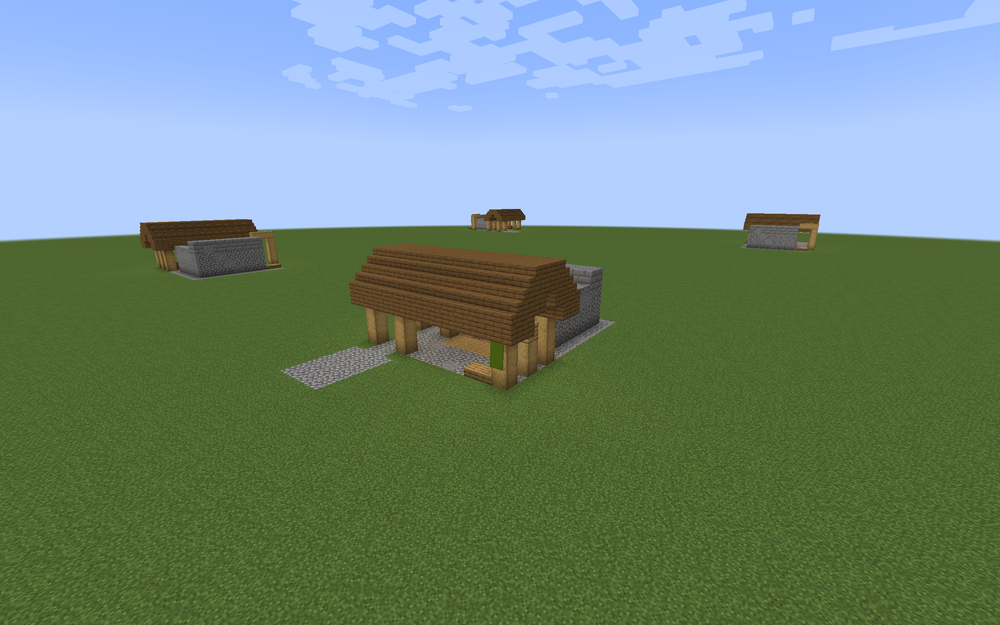
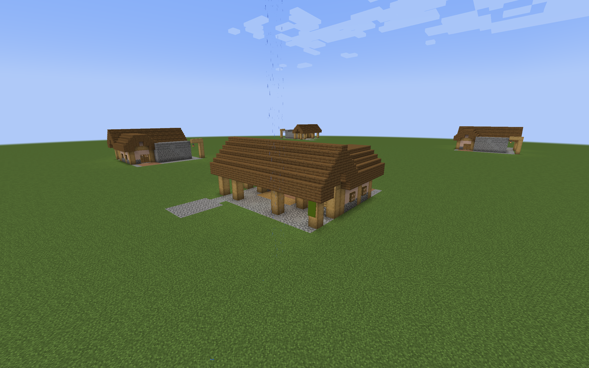
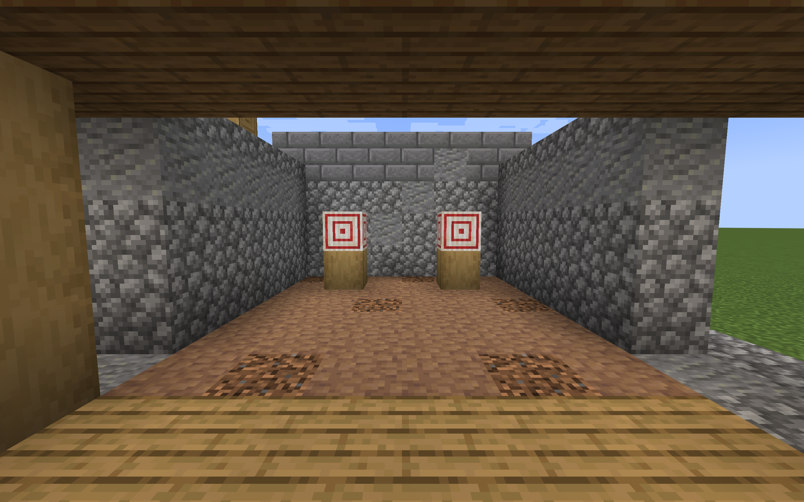
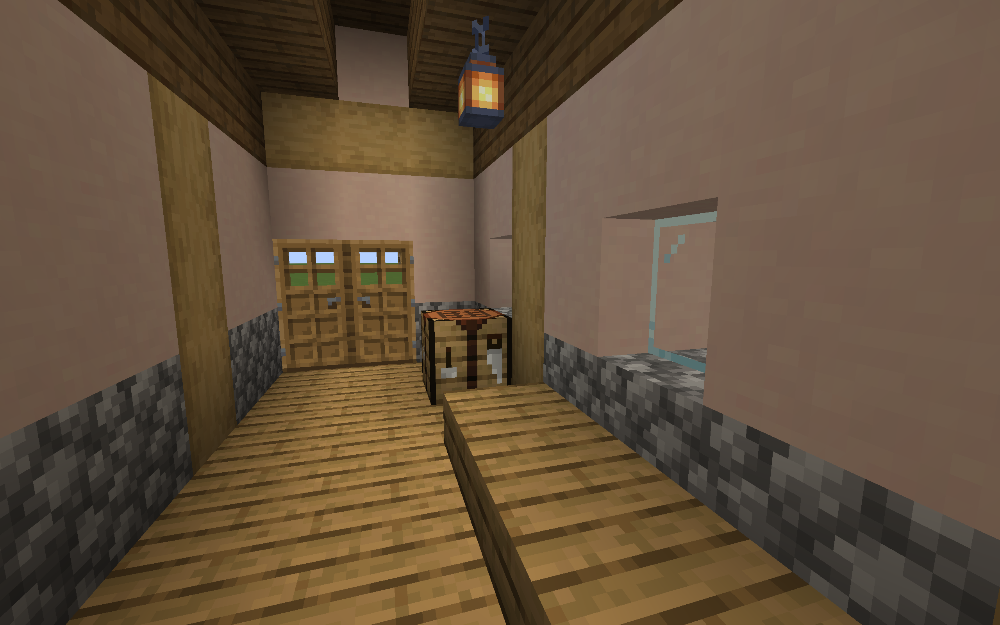

# Plains Training Yard previews

Two furnished Plains Training Yards are available in a separate manual-placement
pack. The village practice yard has a sheltered firing line, two raised targets,
a stone backstop, benches, and a side service passage. The drill courtyard adds
a plaster-and-timber rest pavilion, paired doors, an assembly court, and a
walking loop behind the backstop. Oak framing, spruce roofs, worn stone,
and earth floors connect both yards to the other village defense buildings.





## Build and place

Run either command from the repository root:

```sh
./gradlew trainingYardPreview
python3 tools/build_training_yard_preview.py
```

The output is
`build/distributions/villager-guard-gunners-training-yard-preview.zip`.
Put it in a Minecraft 1.20.1 test world's `datapacks` directory, then run
`/reload`. Use packaged Villager Guard Gunners, Guard Villagers, and Timeless
and Classics Zero (TaCZ), with their dependencies, for guard testing.

Stand on a level surface and place a template with its floor at ground level:

```mcfunction
/place template vggpreview:training_yard/plains/practice_yard ~ ~-1 ~
/place template vggpreview:training_yard/plains/drill_courtyard ~ ~-1 ~
```

The origin is the northwest corner, including roof margins. The entrance faces
north and the firing positions face south. Place in clear space: each template
clears its volume above the ground floor. These previews need level support;
they do not adapt their foundations or entrances to slopes.

| Layout | Width × depth × height | Entrance X at local Z=0 | Circulation |
| --- | --- | --- | --- |
| Village practice yard | 13 × 17 × 8 | 10..11 | Side passage to the rear service seat, returning the same way |
| Drill courtyard | 17 × 19 × 9 | 14..15 | East passage, rear cross-route, and west pavilion form a loop |

Manual placement creates no guards or duty assignments. Each yard includes two
decorative target blocks, one crafting table, benches, and supported lanterns.
The pack contains no village definitions, garrison markers, loot, or storage
inventories. Targets do not cause guards to practice firing or consume ammo.

## Construction and reserved guard cells

The [design brief](training-yard-designs.md) records the architectural intent
and regional directions. The [preview builder](../tools/build_training_yard_preview.py)
is the source for the actual block geometry. Ground floor blocks occupy Y=0;
standing feet are at Y=1. Templates use Minecraft's width, height, depth order.

| Layout | Reserved initial cells | Proposed drill positions | Target blocks |
| --- | --- | --- | --- |
| Practice yard | `(6,1,5)`, `(5,1,5)` | `(7,1,5)`, `(4,1,5)` | `(7,2,11)`, `(4,2,11)` |
| Drill courtyard | `(10,1,6)`, `(9,1,6)` | `(11,1,6)`, `(8,1,6)` | `(11,2,12)`, `(8,2,12)` |

Later integration should preserve the adjacent initial cells and author duty
offsets `[1,0,0]` and `[-2,0,0]`, both facing south with kind `drill` and weapon
requirement `ranged`. The three-block duty spacing leaves more room beside a
neighboring guard. Actual arrival tolerance still affects where guards stand.

Walking lanes remain two blocks wide with three clear blocks above the floor,
except the pavilion's ordinary two-block-high doors. Furniture stays beside
the route. The front canopy has an east–west ridge; the courtyard's west wing
joins it with a smaller north–south gable. Full backing closes roof courses,
and wall panels close the pavilion's gable ends. A fifth courtyard lantern
above the front cross-route improves light at the western drill position.

Both target fields use full blocks and two targets on timber pedestals. The
rear masonry is two blocks deep and four blocks high, with a slab cap. Side
returns separate the range from normal circulation. This is architectural
containment, not a guarantee against TaCZ penetration, explosive rounds,
ricochets, or shots aimed above the wall.



## Packaged Forge checks

Both layouts passed native placement in all four rotations using Minecraft
1.20.1, Forge 47.4.10, Villager Guard Gunners development build 1.6, Guard
Villagers 1.6.19, and TaCZ 1.1.8-hotfix. The disposable observer confirmed
production mode and packaged code sources.

Eight guards completed 64 walking legs beside an occupied neighboring drill
position, using ordinary navigation and door opening. Eight villagers then
completed 56 legs beside two occupied positions per yard. The courtyard trials
recorded actual passage through both pavilion door rows and used destinations
around the complete loop. No walking entity lost health. These are controlled
waypoint routes; a direct request to leave the compact yard can instead take a
harmless shortcut over its front bench.

Both guard positions passed paired TaCZ AK-47 combat trials in every rotation,
with live hostile targets four and five blocks downrange. All 32 trials
recorded ammo consumption and target damage; shooters stayed within 1.5 blocks
of their prescribed cells and took no damage. These checks used ordinary
combat goals with Hold Position, independent fresh guard pairs, and no
scripted shots or damage. Passing traffic was tested separately from gunfire.

Native attachment checks passed for doors, shutters, windows, banners, lights,
and targets. Sampled drill and work positions had block light 6–10 and stayed
sheltered during rain. Screenshot review caught and corrected an open pavilion
gable; the final interior is closed beneath the roof.



The structure checks also cover connected supports, clear route reservations,
paired door halves, roof-end closure, target alignment, and reproducible NBT.
The preview ZIP contains only two templates, its manifest, and pack metadata.
Neither the preview nor the disposable observer is included in the main mod JAR.

## Validation scope

The preview pack supports controlled level-ground review. The
[optional generation packs](regional-training-yard-integration.md) separately
adapt these layouts and the regional pairs to natural roads, initial garrisons,
and persistent duties. Automatic duty scheduling needs its own behavioral
exercise.

Firing trials used hostiles in front of the decorative targets. They do not
establish target-block redstone behavior, bullet containment beyond the wall,
or performance with every gun and ammo type. Automatic drill staffing and
practice shooting were not exercised or added by these previews.

The [regional preview pack](regional-training-yard-preview.md) adds seven pairs
with local materials, roof shapes, winter shelter, and raised platforms.
