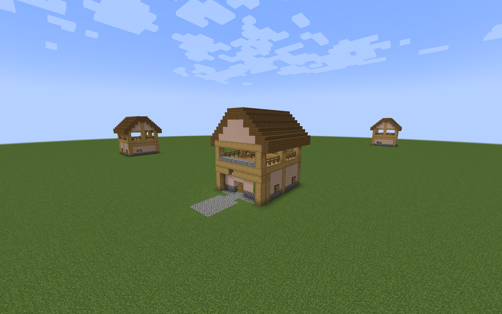
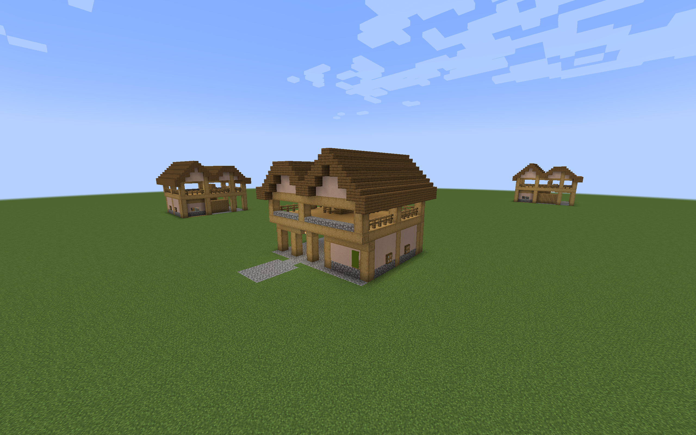

# Plains Watchtower previews

Two furnished Plains Watchtowers are available in a separate architecture
preview pack. The compact tower has an enclosed ready room, a broad straight
stair, and a sheltered lookout. The gatehouse lookout adds a covered arrival
porch, a turning staircase, and an east gallery. Both use stone foundations,
oak framing, pale wall panels, shuttered windows, and backed spruce roofs.





## Build and place

Run either command from the repository root:

```sh
./gradlew watchtowerPreview
python3 tools/build_watchtower_preview.py
```

The output is
`build/distributions/villager-guard-gunners-watchtower-preview.zip`.
Put it in a Minecraft 1.20.1 test world's `datapacks` directory, then run
`/reload`. Install packaged Villager Guard Gunners, Guard Villagers, and
Timeless and Classics Zero (TaCZ), with their dependencies, for guard testing.

Stand on a level surface and place a template with its floor at ground level:

```mcfunction
/place template vggpreview:watchtower/plains/compact_tower ~ ~-1 ~
/place template vggpreview:watchtower/plains/gatehouse_lookout ~ ~-1 ~
```

The origin is the northwest corner, including roof margins. The front faces
north. Place in clear space: each template clears its volume above the ground
floor. These previews need level support and do not supply deep foundations
or adjust themselves to slopes.

| Layout | Width × depth × height | Entrance at local Z=0 | Stair |
| --- | --- | --- | --- |
| Compact tower | 11 × 13 × 14 | X=5..6 | Two blocks wide, straight northward flight |
| Gatehouse lookout | 17 × 15 × 14 | X=10..11 | Two blocks wide, turning landing and return flight |

Ground floor blocks occupy local Y=0, with standing feet at Y=1. Upper floor
blocks occupy Y=5, with standing feet at Y=6. The reserved lower guard cells
are `(4,1,3)` and `(3,1,3)`; corresponding deck cells are `(4,6,3)` and
`(3,6,3)`. This preserves the current integrated Watchtower's five-block
initial placement offset and two-guard limit for later integration. The
proposed firing duties are farther apart, at `(5,6,3)` and `(3,6,3)`.
They need authored duty offsets `[1,5,0]` and `[-1,5,0]`; the first guard
would walk one cell east from its initial upper position. Adjacent shooters
at X=4 and X=3 fall inside each other's default friendly-fire clearance.
The gatehouse's front intermediate roof post moves to X=9 to clear these
firing openings.

Manual placement creates no guards or duty assignments. Each building has one
crafting table, benches, supported lanterns, and decorative details. The pack
contains no village entries, spawn markers, loot, or storage inventories. It
also leaves the separate rare standalone Village Watchtower unchanged.

## Construction

The [design brief](integrated-watchtower-designs.md) records the layout intent
and coordinate reservations. The [preview builder](../tools/build_watchtower_preview.py)
is the source for the furnished blocks. Native NBT accommodates the wider
lookout without changing the older village-layout compiler.

The north observation opening combines a bottom stone slab at Y=6 with a
full timber lintel at Y=8. The resulting 1.5-block opening is shorter than a
guard; the sill is not its only barrier. Ordinary deck edges and stairwell
edges use fences. Roof beams stay above the reserved walking lanes, and
upper lanterns hang at Y=9 from roof backing or chains. The turning stair's
solid central divider closes the space between flights.

Both roofs run north–south. Full plank backing beneath the upper courses
closes the seams between rising rows. The compact gable has a broad ridge;
the gatehouse uses adjoining gables over the room and porch. Dimensions and
roof profiles in the generated manifest use Minecraft's width, height, depth
order.

## Packaged Forge checks

Testing uses ordinary Minecraft 1.20.1 with Forge 47.4.10, Villager Guard
Gunners development build 1.6, Guard Villagers 1.6.19, and TaCZ 1.1.8-hotfix. The disposable
observer verifies production mode and packaged code sources.

Both templates passed native placement and attachment checks in all four
rotations. Reserved floor cells had support and the required clearance;
paired doors, lanterns, shutters, panes, and banners survived placement.
The native guard collision box could occupy both proposed upper positions
but could not stand through the north sill-and-lintel opening. Ordinary
rails retained their 1.5-block collision height. Sampled ready-room, work,
and watch positions had block light 7–9 and remained sheltered during rain.

Both spaced firing positions passed actual TaCZ AK-47 trials in every
rotation: straight ahead at horizontal distances of 12 and 24 blocks, then
24 blocks forward and five blocks left or right. All 64 trials recorded ammo
consumption and target damage while the shooter stayed within 1.5 blocks of
its prescribed position. Each trial used a fresh guard pair, ordinary combat
goals, and Hold Position. These sampled openings do not establish a complete
field of fire or close-range coverage at the tower's base. Swapping a live gun
between bursts caused drift in an earlier observer trial; that transition is
outside the independent firing checks and remains a separate behavior case.

**Return navigation passes with the production retry.** Eight guards completed
48 walking legs through the rooms, stairs, occupied decks, downstairs work
positions, and exits in all four rotations. They took no health damage. The
observer used ordinary path requests throughout, with no larger route
allowance supplied by the test code. Their follow-range attribute remained
20 blocks.

The [bounded walking retry](guard-navigation.md) resolves the longer return
routes. A native 20-block control request still failed on the regression
route, while the ordinary request succeeded through the production fix.
Additional controls verified preservation of the active partial path,
per-guard retry throttling, reuse of complete paths, no additional loaded
chunks during the retry, and exclusion of combat and non-guard requests.

These controlled routes passed; this is not a guarantee that guards can
navigate arbitrary player alterations or every terrain placement.

## Validation scope

The prototypes are for controlled level-ground review. Natural village
placement, automatic garrisons and duty registration, restart persistence,
and provider road connections are covered separately in the
[village integration guide](regional-watchtower-integration.md).

The [regional preview pack](regional-watchtower-preview.md) adapts both layouts
to seven additional material and roof themes.

Optional [village integration packs](regional-watchtower-integration.md) add
these layouts to the named village pools; manual previews remain separate.
